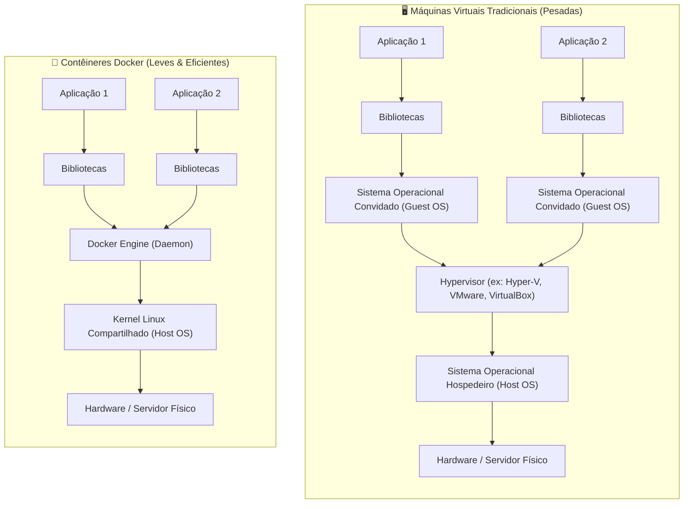
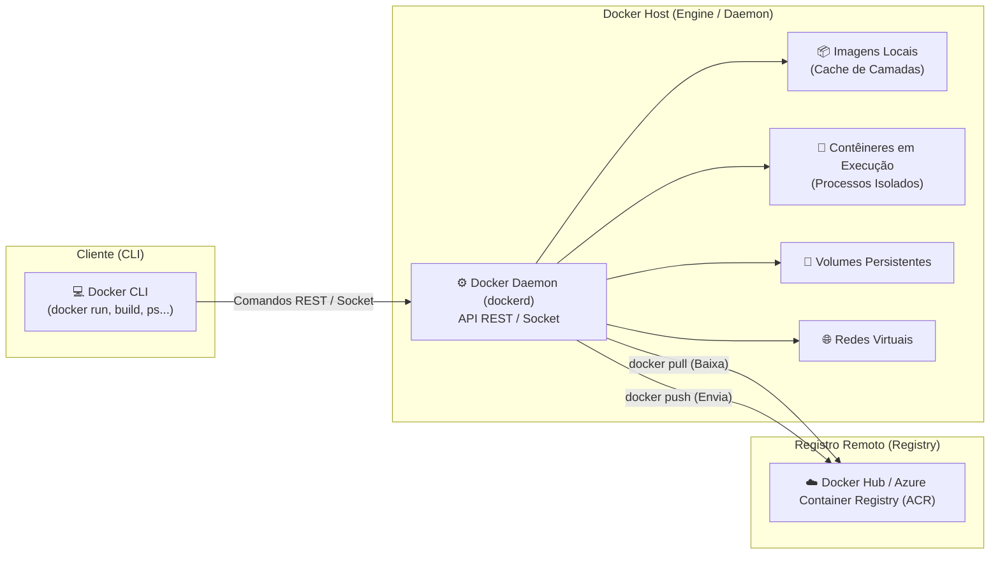

# Docker: Conceitos Fundamentais e Instalação no Windows

Bem-vindo ao primeiro módulo do guia de **Docker & Containerização** do ecossistema **FIAP Cloud Games**. Este documento estabelece os conceitos fundamentais sobre contêineres, detalha a arquitetura interna do Docker e guia o processo completo de instalação e configuração do **Docker Desktop no Windows** utilizando o backend **WSL 2**.

---

## 📑 Sumário

- [1. O que é Containerização?](#1-o-que-é-containerização)
  - [1.1. Máquinas Virtuais (VMs) vs. Contêineres](#11-máquinas-virtuais-vms-vs-contêineres)
  - [1.2. Como o Linux viabiliza Contêineres: Namespaces e Cgroups](#12-como-o-linux-viabiliza-contêineres-namespaces-e-cgroups)
  - [1.3. O Paradigma "Na Minha Máquina Funciona"](#13-o-paradigma-na-minha-máquina-funciona)
- [2. Arquitetura Interna do Docker](#2-arquitetura-interna-do-docker)
  - [2.1. O Modelo Cliente-Servidor](#21-o-modelo-cliente-servidor)
  - [2.2. Imagens vs. Contêineres](#22-imagens-vs-contêineres)
  - [2.3. Registries (Docker Hub, ACR, etc.)](#23-registries-docker-hub-acr-etc)
- [3. Instalação Completa no Windows 10/11](#3-instalação-completa-no-windows-1011)
  - [3.1. Pré-requisitos de Hardware (Virtualização na BIOS/UEFI)](#31-pré-requisitos-de-hardware-virtualização-na-biosuefi)
  - [3.2. Configurando o WSL 2 (Windows Subsystem for Linux)](#32-configurando-o-wsl-2-windows-subsystem-for-linux)
  - [3.3. Instalando o Docker Desktop](#33-instalando-o-docker-desktop)
  - [3.4. Resolução de Problemas Frequentes (Troubleshooting)](#34-resolução-de-problemas-frequentes-troubleshooting)
- [4. Verificação Prática e Primeiro Contêiner](#4-verificação-prática-e-primeiro-contêiner)
  - [4.1. Inspecionando o Ambiente](#41-inspecionando-o-ambiente)
  - [4.2. Executando o `hello-world`](#42-executando-o-hello-world)
- [5. Navegação](#5-navegação)

---

## 1. O que é Containerização?

A **containerização** é uma forma de virtualização em nível de sistema operacional que permite empacotar uma aplicação juntamente com todas as suas dependências (binários, bibliotecas de runtime, variáveis e arquivos de configuração) em uma unidade isolada e padronizada chamada **Contêiner**.

### 1.1. Máquinas Virtuais (VMs) vs. Contêineres

Para compreender o impacto da containerização, compare a arquitetura tradicional de Máquinas Virtuais com a de Contêineres:



| Critério | Máquina Virtual (VM) | Contêiner Docker |
|---|---|---|
| **Abstração** | Nível de Hardware (emula CPU, RAM, BIOS, Placa de Rede) | Nível de SO / Processo (compartilha o Kernel) |
| **Sistema Operacional** | Cada VM roda um SO completo independente (GBs de disco) | Não possui SO completo; apenas binários da aplicação |
| **Tamanho da Imagem** | Tipicamente 5 GB a 40 GB | Tipicamente 20 MB a 300 MB |
| **Tempo de Boot** | Minutos (precisa dar boot em todo o SO) | Milissegundos a poucos segundos (início de processo) |
| **Uso de Memória** | Memória RAM alocada e fixa, mesmo ociosa | Consumo dinâmico sob demanda (apenas o que o processo usa) |
| **Densidade** | Dezenas de VMs por servidor físico | Centenas a milhares de contêineres por servidor |

### 1.2. Como o Linux viabiliza Contêineres: Namespaces e Cgroups

Contêineres não são "mágica"; eles são processos comuns do Linux executados sob duas primitivas do próprio Kernel:

1. **Namespaces (Isolamento de Visão):**
   - **`PID`:** O contêiner enxerga seu processo principal como PID 1, isolado dos outros processos da máquina hospedeira.
   - **`NET`:** Cada contêiner possui sua própria interface de rede virtual (`eth0`), tabela de roteamento e portas exclusivas.
   - **`MNT` (Mount):** O contêiner enxerga seu próprio sistema de arquivos raiz (`/`), sem acesso aos discos do host a menos que explicitamente montado.
   - **`IPC` & `UTS`:** Isolamento de comunicação interprocessos e nomes de host (*hostname*).
   - **`USER`:** Permite que um usuário dentro do contêiner tenha UID 0 (root virtual) sem possuir privilégios de root real no sistema operacional host.

2. **Control Groups (`cgroups` - Governança de Recursos):**
   - Limitam, contabilizam e isolam o uso de recursos computacionais por contêiner (ex: limitar um container a no máximo `512MB` de RAM e `1.0` núcleo de CPU).

### 1.3. O Paradigma "Na Minha Máquina Funciona"

Antes do Docker, o maior desafio dos times de desenvolvimento e infraestrutura era a discrepância de ambientes:
- O desenvolvedor utilizava Windows com .NET 10.0.1;
- O servidor de homologação utilizava Ubuntu com versão antiga de bibliotecas C++ nativas;
- O servidor de produção utilizava Red Hat com variáveis de ambiente diferentes.

Com o Docker, **a imagem gerada na máquina de desenvolvimento é a exata imagem que executa em produção**, eliminando comportamentos inesperados causados por dependências externas descalibradas.

---

## 2. Arquitetura Interna do Docker

O Docker adota uma **arquitetura cliente-servidor distribuída**:



### 2.1. O Modelo Cliente-Servidor
- **Docker Client (`docker`):** A interface de linha de comando (CLI) que o usuário interage no terminal. Ela não cria contêineres diretamente; ela envia requisições HTTP REST para a API do Docker Daemon.
- **Docker Daemon (`dockerd`):** O serviço em segundo plano responsável pelo gerenciamento pesado: compilar imagens, subir contêineres, orquestrar redes e anexar volumes.
- **Docker Engine:** O pacote que reúne o Daemon, a API REST e a CLI.

### 2.2. Imagens vs. Contêineres
- **Imagem Docker (Template Imutável):** É um pacote somente leitura (*read-only*) contendo o sistema operacional mínimo, o código-fonte compilado e as dependências. As imagens são construídas em **camadas empilhadas (layer caching)**.
- **Contêiner Docker (Instância Viva):** É a imagem em execução. Quando um contêiner é iniciado, o Docker adiciona uma **camada fina de leitura e escrita (*Read-Write Layer*)** no topo da imagem imutável. Qualquer arquivo criado ou modificado durante a execução é salvo nessa camada efêmera.

### 2.3. Registries (Docker Hub, ACR, etc.)
Um **Registry** é um catálogo centralizado para armazenamento e distribuição de imagens Docker:
- **Docker Hub:** O registro público padrão da comunidade (hospeda imagens como `mcr.microsoft.com/dotnet/aspnet`, `rabbitmq`, etc.).
- **Private Registries:** Registros privados corporativos (ex: **Azure Container Registry - ACR**, AWS ECR ou Google Artifact Registry) para proteger código proprietário.

---

## 3. Instalação Completa no Windows 10/11

No Windows, o Docker executa contêineres Linux nativamente através da integração com o **WSL 2 (Windows Subsystem for Linux)**, que fornece um Kernel Linux real e performático integrado ao Windows sem o overhead de emulação.

### 3.1. Pré-requisitos de Hardware (Virtualização na BIOS/UEFI)
A virtualização assistida por hardware deve estar ativada:
1. Abra o **Gerenciador de Tarefas** (`Ctrl + Shift + Esc`).
2. Acesse a aba **Desempenho** $\rightarrow$ **CPU**.
3. Verifique se o campo **Virtualização** está marcado como **Habilitado**.
4. Caso esteja desabilitado, reinicie o computador, acesse a **BIOS/UEFI** (teclas `F2`, `F10` ou `Del` durante a inicialização) e ative a opção **Intel Virtualization Technology (VT-x)** ou **AMD SVM (Secure Virtual Machine)**.

### 3.2. Configurando o WSL 2 (Windows Subsystem for Linux)
Abra o **PowerShell como Administrador** e execute:

```powershell
# 1. Instalar o WSL com kernel Linux atualizado e distro padrão (Ubuntu)
wsl --install

# 2. Caso o WSL já esteja instalado, certifique-se de atualizar o kernel para a versão mais recente
wsl --update

# 3. Definir a versão 2 como padrão para qualquer nova distribuição
wsl --set-default-version 2

# 4. Verificar se a distribuição instalada está rodando na versão 2
wsl --list --verbose
```

> 💡 **Nota:** Se a saída do comando `wsl --list --verbose` exibir a versão `1`, converta a distribuição para a versão 2 com:  
> `wsl --set-version <nome-da-distro> 2`

### 3.3. Instalando o Docker Desktop
1. Baixe o instalador oficial em: [docker.com/products/docker-desktop](https://www.docker.com/products/docker-desktop/).
2. Execute o instalador `Docker Desktop Installer.exe`.
3. Na tela de opções de instalação, certifique-se de marcar:
   - ✅ **Use WSL 2 instead of Hyper-V (recommended)**.
   - ✅ **Add shortcut to desktop**.
4. Conclua a instalação e **reinicie o Windows** caso solicitado.
5. Inicie o **Docker Desktop** pelo menu Iniciar.
6. Aceite os termos de serviço (*Docker Subscription Service Agreement*).
7. Acesse as configurações (**Settings / Engrenagem**) $\rightarrow$ **Resources** $\rightarrow$ **WSL Integration**:
   - Garanta que a opção **Enable integration with my default WSL distro** esteja marcada.

### 3.4. Resolução de Problemas Frequentes (Troubleshooting)

- **Erro "WSL 2 installation is incomplete":**  
  Baixe manualmente o pacote de atualização do kernel do Linux para computadores x64 no site da Microsoft e instale-o.
- **Docker Desktop fica preso em "Starting Docker Engine":**  
  Abra o PowerShell como Administrador e reinicie o serviço do WSL:
  ```powershell
  wsl --shutdown
  ```
  Em seguida, feche e abra o Docker Desktop novamente.
- **Uso excessivo de memória pelo processo `vmmem`:**  
  O WSL 2 reserva dinamicamente RAM conforme necessário. Para limitar o teto máximo de memória que o WSL 2 pode consumir do Windows, crie um arquivo chamado `.wslconfig` no diretório do seu usuário (`C:\Users\<SeuUsuario>\.wslconfig`):
  ```ini
  [wsl2]
  memory=6GB
  processors=4
  ```

---

## 4. Verificação Prática e Primeiro Contêiner

### 4.1. Inspecionando o Ambiente
Abra o terminal (PowerShell, Command Prompt ou Terminal do VS Code) e execute:

```powershell
# Exibe a versão do Docker Client e do Docker Server (Daemon)
docker version

# Exibe informações detalhadas de arquitetura, plugins, contêineres e memória
docker info
```

Se a seção `Server` exibir o Engine em execução (geralmente com OS/Arch `linux/amd64`), sua instalação está pronta para uso!

### 4.2. Executando o `hello-world`
O Docker disponibiliza uma imagem oficial ultraleve para teste de ponta a ponta:

```powershell
docker run hello-world
```

#### O que aconteceu nos bastidores durante este comando?
1. O **Docker Client** contatou o **Docker Daemon**.
2. O Daemon procurou a imagem `hello-world:latest` localmente em seu cache de imagens e **não a encontrou**.
3. O Daemon se conectou ao registro público **Docker Hub** e realizou o download da imagem (*Pulling fs layer*).
4. O Daemon criou um novo contêiner a partir dessa imagem e inicializou o processo executável.
5. O executável dentro do contêiner imprimiu a mensagem de boas-vindas no console.
6. Como o executável terminou sua tarefa, o contêiner finalizou seu ciclo de vida (*Exited*).

---

## 5. Navegação

- 📑 **[Ir para o Índice do Guia de Docker (`index.md`)](index.md)**
- ➡️ **[Avançar para a Aula 02: Dockerfile, .dockerignore e Criação de Imagens (`02-dockerfile-dockerignore-e-imagens.md`)](02-dockerfile-dockerignore-e-imagens.md)**
