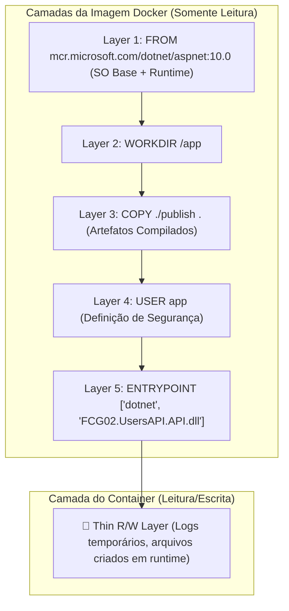

# Dockerfile, .dockerignore e Construção de Imagens

Neste segundo módulo do guia de **Docker & Containerização**, você aprenderá como transformar o código-fonte de uma aplicação em uma imagem imutável e portável. Vamos analisar cada instrução do `Dockerfile`, entender a função de segurança e performance do arquivo `.dockerignore`, explorar o padrão profissional de **Multi-Stage Build** em **.NET 10** e aprender estratégias de versionamento e atualização de imagens.

---

## 📑 Sumário

- [1. O que é um Dockerfile e Como Funciona uma Imagem](#1-o-que-é-um-dockerfile-e-como-funciona-uma-imagem)
  - [1.1. O Conceito de Camadas em Cache (Layer Caching)](#11-o-conceito-de-camadas-em-cache-layer-caching)
- [2. Instruções Fundamentais do Dockerfile](#2-instruções-fundamentais-do-dockerfile)
- [3. O Arquivo `.dockerignore`: Performance e Segurança](#3-o-arquivo-dockerignore-performance-e-segurança)
  - [3.1. Por que o `.dockerignore` é Mandatório?](#31-por-que-o-dockerignore-é-mandatório)
  - [3.2. O Risco Crítico de Segurança: Vazamento de Segredos](#32-o-risco-crítico-de-segurança-vazamento-de-segredos)
  - [3.3. Exemplo Prático do `.dockerignore` da Solução](#33-exemplo-prático-do-dockerignore-da-solução)
- [4. Multi-Stage Build em .NET 10 (Padrão de Produção)](#4-multi-stage-build-em-net-10-padrão-de-produção)
  - [4.1. Por que Multi-Stage? SDK vs. Runtime](#41-por-que-multi-stage-sdk-vs-runtime)
  - [4.2. Segurança: Executando sem Root (`USER app`)](#42-segurança-executando-sem-root-user-app)
  - [4.3. Dockerfile Oficial da UsersAPI (Exemplo Real)](#43-dockerfile-oficial-da-usersapi-exemplo-real)
- [5. Construindo a Imagem com `docker build`](#5-construindo-a-imagem-com-docker-build)
- [6. Atualização de Imagens e Versionamento de Tags](#6-atualização-de-imagens-e-versionamento-de-tags)
  - [6.1. O Perigo da Tag `:latest`](#61-o-perigo-da-tag-latest)
  - [6.2. Versionamento Semântico (`:v1.0.0`, `:v1.1.0`)](#62-versionamento-semântico-v100-v110)
  - [6.3. Como Atualizar uma Imagem Existente](#63-como-atualizar-uma-imagem-existente)
- [7. Navegação](#7-navegação)

---

## 1. O que é um Dockerfile e Como Funciona uma Imagem

O **`Dockerfile`** é um arquivo de texto declarativo (sem extensão) contendo a "receita de bolo" sequencial que o Docker Engine lê para compilar e montar uma imagem.

### 1.1. O Conceito de Camadas em Cache (Layer Caching)

Cada instrução em um Dockerfile cria uma **camada imutável (*layer*)** no sistema de arquivos da imagem:



#### Otimização de Cache:
Se uma camada não mudou desde o último build, o Docker reutiliza o cache instantaneamente (`Using cache`), acelerando compilações subsequentes de minutos para frações de segundo.  
*Regra de Ouro:* Coloque instruções que mudam com menor frequência (como restore de pacotes NuGet) no topo, e instruções que mudam frequentemente (cópia de código-fonte) mais abaixo.

---

## 2. Instruções Fundamentais do Dockerfile

| Instrução | Finalidade Técnica | Exemplo |
|---|---|---|
| **`FROM`** | Define a imagem base a partir da qual as camadas serão construídas. É a primeira instrução obrigatória. | `FROM mcr.microsoft.com/dotnet/sdk:10.0 AS build` |
| **`WORKDIR`** | Define o diretório de trabalho corrente dentro do contêiner para os comandos subsequentes. Se não existir, ele é criado. | `WORKDIR /app` |
| **`COPY`** | Copia arquivos ou pastas da máquina hospedeira (*Host/Build Context*) para o sistema de arquivos da imagem. | `COPY src/ ./src/` |
| **`RUN`** | Executa um comando durante o processo de **construção** da imagem e grava o resultado em uma nova camada imutável. | `RUN dotnet restore` |
| **`ENV`** | Define variáveis de ambiente persistentes que estarão disponíveis tanto no build quanto na execução do contêiner. | `ENV ASPNETCORE_HTTP_PORTS=8080` |
| **`EXPOSE`** | Documenta em qual porta de rede o processo escuta por padrão (não abre a porta automaticamente para o host). | `EXPOSE 8080` |
| **`USER`** | Define o usuário ou UID que executará os comandos restantes e o processo final, impedindo execução como `root`. | `USER app` |
| **`ENTRYPOINT`** | Configura o comando principal imutável que será executado quando o contêiner for iniciado. | `ENTRYPOINT ["dotnet", "MinhaApi.dll"]` |
| **`CMD`** | Fornece argumentos padrão para o `ENTRYPOINT` ou um comando sobrescritível via linha de comando. | `CMD ["--environment=Production"]` |

---

## 3. O Arquivo `.dockerignore`: Performance e Segurança

Assim como o `.gitignore` impede que pastas como `bin/`, `obj/` e `.vs/` subam para o repositório Git, o arquivo **`.dockerignore`** instrui o Docker CLI a ignorar arquivos e pastas locais no momento de montar o **Build Context**.

### 3.1. Por que o `.dockerignore` é Mandatório?
Quando você digita `docker build -t minha-imagem .`, o ponto final (`.`) representa o **Build Context**. O cliente Docker compacta recursivamente todos os arquivos da pasta e os transmite via socket para o Docker Daemon.

Sem o `.dockerignore`:
- Centenas de megabytes de binários locais antigos (`bin/`, `obj/`) serão enviados desnecessariamente ao Daemon via rede/socket, tornando o build lento.
- Podem ocorrer conflitos graves de compilação entre os binários gerados no Windows hospedeiro e o compilador Linux que roda dentro do contêiner.

### 3.2. O Risco Crítico de Segurança: Vazamento de Segredos
Se você possuir arquivos locais como `.env`, certificados privados (`.pfx`, `.key`), histórico `.git` ou configurações de homologação com senhas reais, **eles serão copiados para dentro da imagem Docker**.
Uma imagem pública ou compartilhada no Docker Hub contendo esses arquivos expõe as credenciais corporativas a qualquer pessoa que execute `docker history` ou `docker inspect` na imagem.

### 3.3. Exemplo Prático do `.dockerignore` da Solução

Arquivo `.dockerignore` padronizado nos microsserviços do FIAP Cloud Games:

```gitignore
# Diretórios de controle de versão
.git/
.gitignore

# Compilações intermediárias e binários gerados no host (Windows)
**/bin/
**/obj/
**/out/

# Arquivos de IDE e configurações pessoais
.vs/
.vscode/
*.user
*.suo

# Arquivos com segredos e variáveis locais sensíveis
*.env
*.env.*
*.pfx
*.key

# Testes e relatórios de cobertura
TestResults/
*.trx
coverage/
```

---

## 4. Multi-Stage Build em .NET 10 (Padrão de Produção)

O padrão **Multi-Stage Build** divide o `Dockerfile` em múltiplos estágios (`stages`) independentes, utilizando imagens especializadas para cada fase do ciclo de vida.

### 4.1. Por que Multi-Stage? SDK vs. Runtime

- **SDK (.NET SDK Image):** Contém compiladores Roslyn, ferramentas MSBuild, CLI do .NET, geradores de código e cabeçalhos. Tamanho aproximado: **~850 MB a 1.2 GB**. É necessária para compilar, mas inútil e perigosa em produção.
- **Runtime (ASP.NET Core Runtime Image):** Contém estritamente a máquina virtual CLR e as DLLs mínimas do ASP.NET Core necessárias para executar binários já compilados. Tamanho: **~120 MB a 220 MB**.

Com o Multi-Stage Build:
1. O primeiro estágio (`build`) usa a SDK pesada para restaurar pacotes e compilar em modo `Release`.
2. O segundo estágio (`runtime`) inicia a partir de uma imagem limpa e mínima de Runtime, **copiando apenas os artefatos compilados do estágio anterior** (`COPY --from=publish /app/publish .`).
3. Todo o código-fonte original, pastas temporárias e ferramentas de build são descartados da imagem final.

### 4.2. Segurança: Executando sem Root (`USER app`)

Por padrão no ecossistema Linux/Docker, processos rodam como `root` (UID 0). Caso a aplicação possua uma vulnerabilidade de segurança (ex: execução remota de código - RCE), o invasor ganharia privilégios totais dentro do contêiner.

No **.NET 8, 9 e 10**, a Microsoft introduziu nativamente o usuário de sistema não-root **`app`** (UID 1654). Com a instrução `USER app`, o processo do ASP.NET Core roda sem privilégios administrativos, bloqueando tentativas de invasão do sistema operacional hospedeiro (*Container Escape*).

### 4.3. Dockerfile Oficial da UsersAPI (Exemplo Real)

Localização: `fcg-fase-02--users/Dockerfile`

```dockerfile
# ==============================================================================
# ESTÁGIO 1: Build & Publicação (SDK Completo)
# ==============================================================================
FROM mcr.microsoft.com/dotnet/sdk:10.0 AS build
WORKDIR /src

# 1. Copia arquivos de projeto para otimização de cache de pacotes NuGet
COPY ["src/FCG02.UsersAPI.Domain/FCG02.UsersAPI.Domain.csproj", "src/FCG02.UsersAPI.Domain/"]
COPY ["src/FCG02.UsersAPI.Application/FCG02.UsersAPI.Application.csproj", "src/FCG02.UsersAPI.Application/"]
COPY ["src/FCG02.UsersAPI.Infrastructure/FCG02.UsersAPI.Infrastructure.csproj", "src/FCG02.UsersAPI.Infrastructure/"]
COPY ["src/FCG02.UsersAPI.API/FCG02.UsersAPI.API.csproj", "src/FCG02.UsersAPI.API/"]

# 2. Restaura apenas as dependências (camada pesada em cache)
RUN dotnet restore "src/FCG02.UsersAPI.API/FCG02.UsersAPI.API.csproj"

# 3. Copia o código-fonte completo
COPY src/ src/

# 4. Compila e publica em modo Release otimizado
WORKDIR "/src/src/FCG02.UsersAPI.API"
RUN dotnet publish "FCG02.UsersAPI.API.csproj" -c Release -o /app/publish /p:UseAppHost=false

# ==============================================================================
# ESTÁGIO 2: Runtime Final de Produção (Enxuto e Seguro)
# ==============================================================================
FROM mcr.microsoft.com/dotnet/aspnet:10.0 AS final
WORKDIR /app

# Configuração de portas não-privilegiadas (padrão .NET 10 para usuários não-root)
ENV ASPNETCORE_HTTP_PORTS=8080
EXPOSE 8080

# Copia estritamente os binários compilados do estágio 1
COPY --from=build /app/publish .

# Define execução como usuário seguro 'app' (sem privilégios de root)
USER app

# Ponto de entrada imutável do microsserviço
ENTRYPOINT ["dotnet", "FCG02.UsersAPI.API.dll"]
```

---

## 5. Construindo a Imagem com `docker build`

Para compilar a imagem na linha de comando:

```powershell
# Sintaxe: docker build -t <nome-da-imagem>:<tag> <caminho-do-contexto>
# Exemplo executado na pasta do microsserviço UsersAPI:
cd fcg-fase-02--users
docker build -t fcg02-users-api:v1.0.0 .
```

### Principais flags do `docker build`:
- **`-t` (ou `--tag`):** Atribui um nome e versão (tag) para a imagem gerada (formato: `repositorio:tag`).
- **`-f` (ou `--file`):** Especifica o caminho de um Dockerfile customizado caso ele não se chame `Dockerfile` (ex: `docker build -f Dockerfile.prod -t minha-api .`).
- **`--no-cache`:** Força o Docker a ignorar o cache de camadas e recompilar tudo do zero (útil para diagnosticar falhas de dependência).
- **`.` (ponto final):** Define o diretório atual como o **Build Context**.

---

## 6. Atualização de Imagens e Versionamento de Tags

Uma imagem Docker compilada é **100% imutável**. Você não "edita" uma imagem existente; você compila uma nova versão a partir de um Dockerfile ou código-fonte atualizado.

### 6.1. O Perigo da Tag `:latest`
Se você compilar uma imagem sem especificar tag (ex: `docker build -t users-api .`), o Docker atribui automaticamente a tag `:latest`.
- **Por que isso é um risco em produção?**  
  A tag `:latest` não significa "última versão estável do software"; ela significa apenas *"o ponteiro para o último build gerado sem tag explícita"*. Se uma nova compilação quebrar a API, você não tem como fazer rollback fácil para a versão anterior, pois o `:latest` foi sobrescrito.

### 6.2. Versionamento Semântico (`:v1.0.0`, `:v1.1.0`)
A melhor prática corporativa é utilizar **Semantic Versioning (SemVer)**: `MAJOR.MINOR.PATCH`:

```powershell
# 1. Versão inicial do microsserviço
docker build -t fcg02-users-api:1.0.0 .

# 2. Correção de bug pontual (Patch)
docker build -t fcg02-users-api:1.0.1 .

# 3. Adição de nova funcionalidade compatível (Minor)
docker build -t fcg02-users-api:1.1.0 .

# 4. Mudança estrutural com quebra de contratos (Major)
docker build -t fcg02-users-api:2.0.0 .
```

### 6.3. Como Atualizar uma Imagem Existente

Quando você altera uma linha de código em C#:
1. Execute o comando `docker build` com uma nova tag de versão:
   ```powershell
   docker build -t fcg02-users-api:1.1.0 .
   ```
2. Caso também queira atualizar a tag `:latest` para apontar para essa nova versão, utilize o comando `docker tag`:
   ```powershell
   docker tag fcg02-users-api:1.1.0 fcg02-users-api:latest
   ```
3. Para listar todas as imagens e tags armazenadas localmente:
   ```powershell
   docker images
   ```

---

## 7. Navegação

- ⬅️ **[Voltar para a Aula 01: Conceitos e Instalação no Windows (`01-conceitos-e-instalacao-windows.md`)](01-conceitos-e-instalacao-windows.md)**
- 📑 **[Ir para o Índice do Guia de Docker (`index.md`)](index.md)**
- ➡️ **[Avançar para a Aula 03: Ciclo de Vida de Contêineres (`03-ciclo-de-vida-de-containers.md`)](03-ciclo-de-vida-de-containers.md)**
