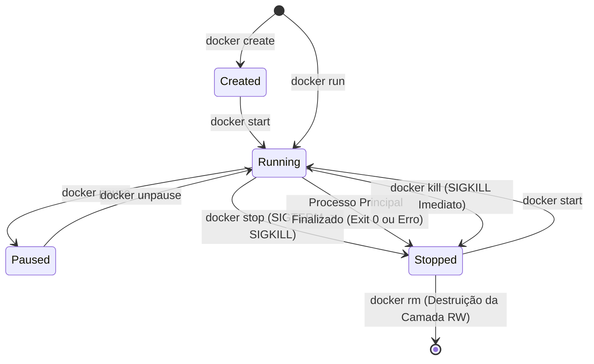

# Ciclo de Vida de Contêineres: Ativação, Gerenciamento e Exclusão

No terceiro módulo do guia de **Docker & Containerização**, você aprenderá a dominar o ciclo de vida completo de um contêiner. Vamos explorar as transições de estado, como inicializar contêineres em segundo plano com portas e variáveis de ambiente configuradas, como monitorar a saúde da aplicação, como executar comandos internos de diagnóstico e como excluir contêineres e imagens sem deixar recursos órfãos no disco.

---

## 📑 Sumário

- [1. A Máquina de Estados de um Contêiner](#1-a-máquina-de-estados-de-um-contêiner)
- [2. Ativar e Executar Contêineres (`docker run`)](#2-ativar-e-executar-contêineres-docker-run)
  - [2.1. Anatomia do Comando `docker run`](#21-anatomia-do-comando-docker-run)
  - [2.2. Execução Interativa vs. Segundo Plano (Detached Mode)](#22-execução-interativa-vs-segundo-plano-detached-mode)
  - [2.3. Políticas de Reinicialização Automática (`--restart`)](#23-políticas-de-reinicialização-automática---restart)
  - [2.4. Limites de Hardware (`--memory` e `--cpus`)](#24-limites-de-hardware---memory-e---cpus)
- [3. Gerenciamento em Tempo de Execução](#3-gerenciamento-em-tempo-de-execução)
  - [3.1. Listar Contêineres (`docker ps` vs `docker ps -a`)](#31-listar-contêineres-docker-ps-vs-docker-ps--a)
  - [3.2. Parar um Contêiner (`docker stop` vs `docker kill`)](#32-parar-um-contêiner-docker-stop-vs-docker-kill)
  - [3.3. Iniciar um Contêiner Parado (`docker start`)](#33-iniciar-um-contêiner-parado-docker-start)
  - [3.4. Pausar e Despausar Processos (`docker pause` e `unpause`)](#34-pausar-e-despausar-processos-docker-pause-e-unpause)
- [4. Inspeção, Diagnóstico e Logs](#4-inspeção-diagnóstico-e-logs)
  - [4.1. Visualizar Logs em Tempo Real (`docker logs`)](#41-visualizar-logs-em-tempo-real-docker-logs)
  - [4.2. Acessar o Interior do Contêiner (`docker exec`)](#42-acessar-o-interior-do-contêiner-docker-exec)
  - [4.3. Inspecionar Metadados JSON (`docker inspect`)](#43-inspecionar-metadados-json-docker-inspect)
  - [4.4. Monitorar Recursos em Tempo Real (`docker stats`)](#44-monitorar-recursos-em-tempo-real-docker-stats)
- [5. Exclusão e Descarte Seguro de Recursos](#5-exclusão-e-descarte-seguro-de-recursos)
  - [5.1. Excluir Contêineres (`docker rm`)](#51-excluir-contêineres-docker-rm)
  - [5.2. Excluir Imagens (`docker rmi`)](#52-excluir-imagens-docker-rmi)
- [6. Limpeza e Otimização de Disco (`docker system prune`)](#6-limpeza-e-otimização-de-disco-docker-system-prune)
- [7. Navegação](#7-navegação)

---

## 1. A Máquina de Estados de um Contêiner

Um contêiner não é estático; ele percorre diferentes estados operacionais gerenciados pelo Docker Daemon:



- **Created (Criado):** O contêiner foi instanciado a partir da imagem, seu sistema de arquivos de leitura/escrita e redes foram alocados, mas seu processo principal ainda não foi iniciado.
- **Running (Em Execução):** O processo principal (definido pelo `ENTRYPOINT`/`CMD`) está ativo na CPU e na memória.
- **Paused (Pausado):** O processo foi congelado no tempo via cgroups freezer. Nenhuma instrução de CPU é gasta, mas o estado da memória RAM é preservado intacto.
- **Stopped / Exited (Parado):** O processo principal encerrou sua execução (seja com código 0 de sucesso ou código de erro). A camada de leitura/escrita permanece íntegra no disco aguardando novo `docker start` ou `docker rm`.

---

## 2. Ativar e Executar Contêineres (`docker run`)

O comando **`docker run`** é a instrução primordial do Docker. Ele combina duas ações em uma única chamada:
1. `docker create`: Cria a camada de contêiner a partir da imagem.
2. `docker start`: Inicializa o processo principal.

### 2.1. Anatomia do Comando `docker run`

Exemplo prático executando o RabbitMQ oficial do nosso ecossistema:

```powershell
docker run -d `
  --name fcg-rabbitmq `
  -p 5672:5672 `
  -p 15672:15672 `
  -e RABBITMQ_DEFAULT_USER=guest `
  -e RABBITMQ_DEFAULT_PASS=guest `
  --restart unless-stopped `
  rabbitmq:3-management
```

#### Dissecando cada argumento:
- **`-d` (ou `--detach`):** Modo desanexado. Executa o contêiner em segundo plano e devolve o controle do terminal para você.
- **`--name <nome>`:** Atribui um nome amigável e exclusivo ao contêiner. Sem essa flag, o Docker gerará um nome aleatório (ex: `zen_turing`).
- **`-p <host>:<container>`:** Publica uma porta do contêiner na placa de rede da máquina hospedeira.
  - `-p 5672:5672`: Redireciona conexões da porta 5672 do Windows para a porta 5672 do contêiner (protocolo AMQP).
  - `-p 15672:15672`: Redireciona a porta 15672 do Windows para a interface web do RabbitMQ.
- **`-e <CHAVE>=<VALOR>`:** Injeta uma variável de ambiente no processo do contêiner.
- **`rabbitmq:3-management`:** O nome da imagem e tag a ser executada.

### 2.2. Execução Interativa vs. Segundo Plano (Detached Mode)

- **Modo Interativo com Terminal (`-it`):** Mantém a entrada padrão aberta (`-i`) e aloca um pseudo-TTY (`-t`), prendendo o seu terminal ao contêiner:
  ```powershell
  # Útil para depuração rápida ou rodar ferramentas CLI efêmeras
  docker run -it --rm alpine sh
  ```
  *(A flag `--rm` indica que o contêiner será excluído automaticamente assim que você digitar `exit`)*.
- **Modo Segundo Plano (`-d`):** Padrão absoluto para microsserviços, APIs e bancos de dados que rodam como serviços contínuos (*daemons*).

### 2.3. Políticas de Reinicialização Automática (`--restart`)

Define como o Docker Daemon deve reagir quando o processo do contêiner morre ou o computador reinicia:

| Política | Comportamento |
|---|---|
| **`no` (Padrão)** | Não reinicia o contêiner sob nenhuma hipótese. |
| **`on-failure`** | Reinicia automaticamente apenas se o processo terminar com código de erro diferente de 0 (*crash*). |
| **`always`** | Sempre reinicia o contêiner, mesmo se ele for parado manualmente ou após o reinício do Docker Engine/Windows. |
| **`unless-stopped` (Recomendado)** | Reinicia o contêiner em caso de falha ou boot da máquina, a menos que você tenha emitido um `docker stop` manual explícito anteriormente. |

### 2.4. Limites de Hardware (`--memory` e `--cpus`)

Para impedir que um contêiner com vazamento de memória (*memory leak*) trave a máquina hospedeira inteira, defina limites rígidos:

```powershell
docker run -d --name users-api `
  --memory="512m" `
  --cpus="1.0" `
  fcg02-users-api:latest
```

---

## 3. Gerenciamento em Tempo de Execução

### 3.1. Listar Contêineres (`docker ps` vs `docker ps -a`)

```powershell
# Lista apenas os contêineres ATIVOS no momento
docker ps

# Lista TODOS os contêineres (ativos, pausados, parados e com erro)
docker ps -a

# Lista apenas os IDs dos contêineres (ideal para scripts de automação)
docker ps -q
```

A saída exibe: `CONTAINER ID`, `IMAGE`, `COMMAND`, `CREATED`, `STATUS` (ex: `Up 2 hours` ou `Exited (0) 5 minutes ago`), `PORTS` e `NAMES`.

### 3.2. Parar um Contêiner (`docker stop` vs `docker kill`)

- **`docker stop <nome_ou_id>` (Parada Graciosa / Graceful Shutdown):**  
  Envia o sinal **`SIGTERM`** para o processo principal (PID 1). O ASP.NET Core intercepta esse sinal, encerra requisições HTTP em andamento, cancela `CancellationToken`s de workers do RabbitMQ e fecha conexões de banco de dados.  
  Se o contêiner não terminar em 10 segundos (tempo limite configurável via `-t`), o Docker envia o sinal forçado **`SIGKILL`**.
  ```powershell
  # Aguarda até 15 segundos para fechar conexões graciosamente
  docker stop -t 15 fcg-rabbitmq
  ```
- **`docker kill <nome_ou_id>` (Interrupção Forçada e Imediata):**  
  Envia o sinal **`SIGKILL`** imediatamente. O processo morre no mesmo milissegundo, sem tempo para limpar buffers ou fechar arquivos abertos.

### 3.3. Iniciar um Contêiner Parado (`docker start`)
Ao contrário do `docker run` (que cria um novo contêiner a partir da imagem), o comando `docker start` **revive um contêiner existente que já estava parado**:

```powershell
docker start fcg-rabbitmq
```
*(Todos os dados gravados na camada de leitura/escrita do contêiner antes de parar são mantidos intactos)*.

### 3.4. Pausar e Despausar Processos (`docker pause` e `unpause`)
Congela temporariamente todos os processos do contêiner sem derrubar o contêiner nem liberar a memória RAM:

```powershell
# Congela o contêiner
docker pause fcg-rabbitmq

# Descongela e retoma a execução exatamente de onde parou
docker unpause fcg-rabbitmq
```

---

## 4. Inspeção, Diagnóstico e Logs

### 4.1. Visualizar Logs em Tempo Real (`docker logs`)
Todo texto impresso pela aplicação na saída padrão (`Console.WriteLine`, `ILogger` do .NET) é capturado pelo Docker:

```powershell
# Exibe os últimos logs e sai
docker logs users-api

# Acompanha os logs em tempo real (modo streaming contínuo)
# -f follow Mantém a transmissão dos logs em tempo real (modo contínuo)
docker logs -f users-api

# Exibe apenas as últimas 50 linhas com carimbo de data/hora (timestamps)
# -t timestamps: Adiciona o carimbo de data e hora (timestamp) no início de cada linha de log, permitindo saber exatamente o segundo em que cada evento foi registrado dentro do container
docker logs -f --tail 50 -t users-api
```

### 4.2. Acessar o Interior do Contêiner (`docker exec`)
Permite executar um novo processo dentro de um contêiner que já está rodando. O caso de uso mais comum é abrir um terminal interativo (*shell*) para inspecionar arquivos ou rede:

```powershell
# Abre uma sessão de shell (/bin/sh) dentro do contêiner ativo
docker exec -it users-api sh

# Exemplo: testar resolução de DNS de dentro do contêiner
docker exec -it users-api ping rabbitmq-service
```

### 4.3. Inspecionar Metadados JSON (`docker inspect`)
Retorna todas as propriedades de baixo nível do contêiner (endereço IP atribuído, variáveis de ambiente resolvidas, montagens de volumes, status de healthcheck):

```powershell
# Inspeciona todo o objeto JSON
docker inspect users-api

# Filtra diretamente o endereço IP do contêiner na rede interna do Docker
docker inspect -f '{{range.NetworkSettings.Networks}}{{.IPAddress}}{{end}}' users-api
```

### 4.4. Monitorar Recursos em Tempo Real (`docker stats`)
Exibe um painel interativo no terminal com consumo ao vivo de CPU, Memória RAM, Throughput de Rede e I/O de disco de todos os contêineres ativos:

```powershell
docker stats
```

---

## 5. Exclusão e Descarte Seguro de Recursos

### 5.1. Excluir Contêineres (`docker rm`)
Um contêiner que não está mais em uso deve ser removido para liberar espaço e evitar poluição de nomes:

```powershell
# 1. Parar o contêiner primeiro
docker stop users-api

# 2. Excluir o contêiner
docker rm users-api

# Atalho: Forçar parada e remoção imediata em um único comando
docker rm -f users-api

# Remover todos os contêineres que estão com status parado (Exited)
docker container prune -f
```

### 5.2. Excluir Imagens (`docker rmi`)
Para excluir uma imagem compilada ou baixada do Docker Hub do disco:

```powershell
# Sintaxe: docker rmi <nome-da-imagem>:<tag> ou <image-id>
docker rmi fcg02-users-api:v1.0.0

# Se a imagem tiver múltiplas tags ou dependências ativas, use -f com cuidado:
docker rmi -f fcg02-users-api:latest
```

---

## 6. Limpeza e Otimização de Disco (`docker system prune`)

Com o passar dos meses desenvolvendo no Windows, builds repetidos geram centenas de camadas órfãs (*dangling images*), contêineres de teste descartados e volumes não associados que acumulam dezenas de gigabytes no disco virtual do WSL 2.

```powershell
# 1. Limpeza básica segura (remove contêineres parados, redes não usadas e imagens sem tag)
docker system prune

# 2. Limpeza profunda de produção (remove TODAS as imagens não utilizadas por nenhum container ativo)
docker system prune -a

# 3. Limpeza total extrema (inclui volumes anônimos órfãos de banco/mensageria)
# ⚠️ CUIDADO: Destrói dados de bancos locais não associados a contêineres ativos!
docker system prune -a --volumes -f
```

---

## 7. Navegação

- ⬅️ **[Voltar para a Aula 02: Dockerfile e Imagens (`02-dockerfile-dockerignore-e-imagens.md`)](02-dockerfile-dockerignore-e-imagens.md)**
- 📑 **[Ir para o Índice do Guia de Docker (`index.md`)](index.md)**
- ➡️ **[Avançar para a Aula 04: Volumes e Redes no Docker (`04-volumes-e-redes.md`)](04-volumes-e-redes.md)**
