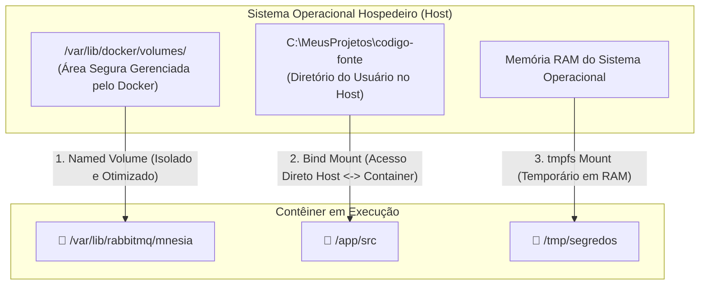
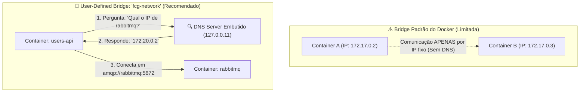
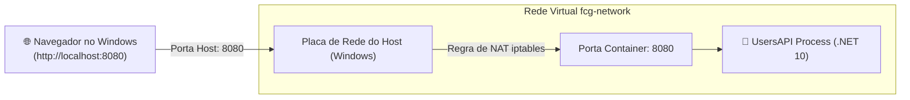

# Armazenamento e Redes no Docker: Volumes, Bind Mounts e Networking

No quarto módulo do guia de **Docker & Containerização**, exploramos os dois pilares que tornam o Docker apto para sistemas corporativos distribuídos: **Persistência de Dados** (como salvar arquivos de bancos e mensageria sem perder dados quando o contêiner morre) e **Redes Virtuais** (como os microsserviços se comunicam entre si via DNS interno e como expor portas com segurança para o mundo externo).

---

## 📑 Sumário

- [1. A Natureza Efêmera dos Contêineres e o Desafio da Persistência](#1-a-natureza-efêmera-dos-contêineres-e-o-desafio-da-persistência)
- [2. Formas de Armazenamento no Docker](#2-formas-de-armazenamento-no-docker)
  - [2.1. Named Volumes (Volumes Nomeados - Recomendado)](#21-named-volumes-volumes-nomeados---recomendado)
  - [2.2. Bind Mounts (Mapeamento de Pastas do Host)](#22-bind-mounts-mapeamento-de-pastas-do-host)
  - [2.3. tmpfs Mounts (Armazenamento em Memória RAM)](#23-tmpfs-mounts-armazenamento-em-memória-ram)
  - [2.4. Comparativo de Armazenamento](#24-comparativo-de-armazenamento)
- [3. Gerenciamento Prático de Volumes](#3-gerenciamento-prático-de-volumes)
  - [3.1. Comandos Essenciais da CLI](#31-comandos-essenciais-da-cli)
  - [3.2. Anexando Volumes a Contêineres (`-v` vs `--mount`)](#32-anexando-volumes-a-contêineres--v-vs---mount)
- [4. Redes no Docker (Docker Networking)](#4-redes-no-docker-docker-networking)
  - [4.1. Por que Redes Virtuais são Indispensáveis em Microsserviços?](#41-por-que-redes-virtuais-são-indispensáveis-em-microsserviços)
  - [4.2. Drivers de Rede no Docker (`bridge`, `host`, `none`, `overlay`)](#42-drivers-de-rede-no-docker-bridge-host-none-overlay)
- [5. Resolução de Nomes via DNS Interno (User-Defined Bridge)](#5-resolução-de-nomes-via-dns-interno-user-defined-bridge)
  - [5.1. A Rede `fcg-network` do Nosso Ecossistema](#51-a-rede-fcg-network-do-nosso-ecossistema)
  - [5.2. Como Funciona o DNS Embutido (127.0.0.11)](#52-como-funciona-o-dns-embutido-1270011)
- [6. Mapeamento e Publicação de Portas de Rede](#6-mapeamento-e-publicação-de-portas-de-rede)
- [7. Gerenciamento Prático de Redes na CLI](#7-gerenciamento-prático-de-redes-na-cli)
- [8. Navegação](#8-navegação)

---

## 1. A Natureza Efêmera dos Contêineres e o Desafio da Persistência

Por padrão arquitetural, contêineres são **stateless** (sem estado) e descartáveis:
- A camada de leitura/escrita (*Read-Write Layer*) de um contêiner é rigidamente acoplada ao ciclo de vida daquele contêiner específico.
- Se o contêiner for removido com `docker rm`, **todos os dados gerados dentro dele desaparecem para sempre**.

Para serviços que precisam reter informações (como o histórico de mensagens e filas do RabbitMQ ou bancos de dados locais de teste), precisamos desacoplar o ciclo de vida do dado do ciclo de vida do contêiner.

---

## 2. Formas de Armazenamento no Docker

O Docker disponibiliza três estratégias distintas de montagem de arquivos:



---

### 2.1. Named Volumes (Volumes Nomeados - Recomendado)

Os **Named Volumes** são pastas criadas e gerenciadas exclusivamente pelo Docker Engine em uma área protegida do disco (`/var/lib/docker/volumes/` no Linux ou dentro da VM do WSL 2 no Windows):

- **Vantagens:**
  - Imunes a exclusões de contêineres (`docker rm` não apaga o volume).
  - Melhor performance de I/O em comparação com pastas do sistema de arquivos do Windows (evita overhead de tradução NTFS/9P).
  - Podem ser compartilhados com segurança entre múltiplos contêineres simultâneos.
  - Fáceis de fazer backup e migração em rotinas de CI/CD.
- **Caso de Uso:** Filas e definições persistentes do RabbitMQ (`rabbitmq_data`).

---

### 2.2. Bind Mounts (Mapeamento de Pastas do Host)

Um **Bind Mount** mapeia um caminho absoluto da sua máquina hospedeira diretamente para uma pasta dentro do contêiner (ex: `C:\Projetos\api` $\rightarrow$ `/app`):

- **Vantagens:**
  - Qualquer alteração feita no arquivo pelo VS Code no Windows reflete imediatamente dentro do contêiner (e vice-versa).
  - Ideal para desenvolvimento local com *hot-reload* (`dotnet watch`).
- **Desvantagens:**
  - Depende da estrutura de pastas da máquina hospedeira (quebra portabilidade se outro desenvolvedor usar caminhos diferentes).
  - Pode gerar problemas de permissões de usuário entre Windows e Linux.

---

### 2.3. tmpfs Mounts (Armazenamento em Memória RAM)

Um **tmpfs mount** persiste arquivos temporários estritamente na memória volátil (RAM) do hospedeiro:
- Nunca toca o disco rígido.
- Se o contêiner for parado, os dados são descartados instantaneamente.
- **Caso de Uso:** Chaves criptográficas temporárias, tokens efêmeros ou processamento de imagens pesadas que exigem velocidade máxima de leitura/escrita sem consumir disco.

---

### 2.4. Comparativo de Armazenamento

| Critério | Named Volume | Bind Mount | tmpfs Mount |
|---|---|---|---|
| **Localização Física** | Gerenciada pelo Docker | Qualquer pasta do Host | Memória RAM do Host |
| **Portabilidade** | Alta (totalmente agnóstico) | Baixa (depende do caminho local) | Alta |
| **Sobrevive ao `docker rm`?** | **Sim** | **Sim** | Não |
| **Performance de I/O no WSL2** | **Nativa / Máxima** | Média (overhead NTFS) | Ultrarrápida |
| **Uso Recomendado** | **Bancos, Filas, Produção** | **Desenvolvimento / Hot-reload** | **Segredos em Memória** |

---

## 3. Gerenciamento Prático de Volumes

### 3.1. Comandos Essenciais da CLI

```powershell
# 1. Criar um novo volume nomeado explicitamente
docker volume create fcg_rabbitmq_data

# 2. Listar todos os volumes existentes no computador
docker volume ls

# 3. Inspecionar detalhes de um volume (ponto de montagem, driver, data de criação)
docker volume inspect fcg_rabbitmq_data

# 4. Excluir um volume que não esteja anexado a nenhum contêiner ativo
docker volume rm fcg_rabbitmq_data

# 5. Remover todos os volumes órfãos (não utilizados por nenhum container)
docker volume prune -f
```

### 3.2. Anexando Volumes a Contêineres (`-v` vs `--mount`)

Existem duas sintaxes para conectar um volume ao contêiner no `docker run`:

#### Sintaxe Moderna e Explícita (`--mount` - Recomendada):
```powershell
docker run -d --name rabbitmq `
  -p 5672:5672 -p 15672:15672 `
  --mount type=volume,source=fcg_rabbitmq_data,target=/var/lib/rabbitmq/mnesia `
  rabbitmq:3-management
```

#### Sintaxe Abreviada Clássica (`-v`):
```powershell
# Formato: -v <nome_do_volume>:<caminho_no_container>
docker run -d --name rabbitmq `
  -p 5672:5672 -p 15672:15672 `
  -v fcg_rabbitmq_data:/var/lib/rabbitmq/mnesia `
  rabbitmq:3-management
```

---

## 4. Redes no Docker (Docker Networking)

### 4.1. Por que Redes Virtuais são Indispensáveis em Microsserviços?
Em uma arquitetura distribuída com múltiplos microsserviços:
- A `UsersAPI` precisa enviar mensagens para o `RabbitMQ`;
- A `PaymentsAPI` precisa escutar eventos da `CatalogAPI`;
- Cada serviço precisa se comunicar de forma isolada, sem que serviços externos tenham acesso indiscriminado às portas internas.

O Docker cria **redes virtuais privadas com switches de software (*software bridges*)**, isolando os contêineres e controlando o fluxo de tráfego de rede.

### 4.2. Drivers de Rede no Docker (`bridge`, `host`, `none`, `overlay`)

| Driver | Características Técnicas | Cenário de Uso |
|---|---|---|
| **`bridge` (Padrão)** | Cria uma rede virtual privada isolada no host. Contêineres na mesma bridge conversam entre si e acessam a internet via NAT. | **Padrão para microsserviços locais e Docker Compose.** |
| **`host`** | Remove o isolamento de rede. O contêiner usa diretamente as portas e a placa de rede da máquina hospedeira. | Aplicações de altíssimo throughput que não toleram overhead de NAT (exclusivo Linux). |
| **`none`** | Desativa qualquer conectividade de rede para o contêiner (apenas interface de loopback `127.0.0.1`). | Tarefas isoladas de processamento em lote com segurança máxima contra vazamento de rede. |
| **`overlay`** | Cria uma rede distribuída criptografada entre múltiplos hosts Docker físicos distintos. | Clusters Docker Swarm e orquestração de produção multi-servidor. |

---

## 5. Resolução de Nomes via DNS Interno (User-Defined Bridge)

Existe uma diferença crucial entre a rede bridge padrão do Docker (`bridge`) e uma rede bridge personalizada criada por você:



### 5.1. A Rede `fcg-network` do Nosso Ecossistema
No nosso ecossistema, todos os serviços conectam-se à rede virtual customizada **`fcg-network`**. Isso permite que no arquivo `appsettings.json` ou variáveis de ambiente de qualquer API, você configure simplesmente:

```json
"RabbitMQ": {
  "HostName": "rabbitmq",
  "Port": 5672
}
```

### 5.2. Como Funciona o DNS Embutido (127.0.0.11)
Dentro de qualquer contêiner conectado a uma rede personalizada, o arquivo `/etc/resolv.conf` aponta para o endereço IP **`127.0.0.11`**. Esse é o servidor DNS interno do Docker Engine, que mantém um catálogo dinâmico relacionando o **nome do contêiner** ou **alias do serviço** ao seu respectivo IP virtual. Se um contêiner cair e subir com outro IP, o DNS atualiza o apontamento automaticamente sem interrupção!

---

## 6. Mapeamento e Publicação de Portas de Rede

Uma porta declarada com `EXPOSE` dentro do Dockerfile é acessível **apenas para outros contêineres na mesma rede**. Ela **NÃO** pode ser acessada pelo seu navegador ou Postman no Windows até ser explicitamente **publicada**:



### Sintaxe da flag `-p`:
```powershell
# -p <porta_no_windows>:<porta_no_container>
docker run -d --name users-api -p 8080:8080 fcg02-users-api:latest
```

- Se você quiser evitar conflitos de porta na máquina local:
  ```powershell
  # Mapeia a porta 5000 do Windows para a porta 8080 interna do container:
  docker run -d --name users-api -p 5000:8080 fcg02-users-api:latest
  # Acesso local via: http://localhost:5000
  ```

---

## 7. Gerenciamento Prático de Redes na CLI

```powershell
# 1. Criar uma rede virtual bridge personalizada
docker network create --driver bridge fcg-network

# 2. Listar todas as redes virtuais criadas
docker network ls

# 3. Inspecionar uma rede e ver todos os contêineres e IPs conectados a ela
docker network inspect fcg-network

# 4. Conectar um contêiner em execução a uma rede adicional em tempo real
docker network connect fcg-network users-api

# 5. Desconectar um contêiner de uma rede
docker network disconnect fcg-network users-api

# 6. Excluir uma rede que não possui contêineres conectados
docker network rm fcg-network

# 7. Remover todas as redes não utilizadas
docker network prune -f
```

---

## 8. Navegação

- ⬅️ **[Voltar para a Aula 03: Ciclo de Vida de Contêineres (`03-ciclo-de-vida-de-containers.md`)](03-ciclo-de-vida-de-containers.md)**
- 📑 **[Ir para o Índice do Guia de Docker (`index.md`)](index.md)**
- ➡️ **[Avançar para a Aula 05: Orquestração Centralizada com Docker Compose (`05-orquestracao-com-docker-compose.md`)](05-orquestracao-com-docker-compose.md)**
