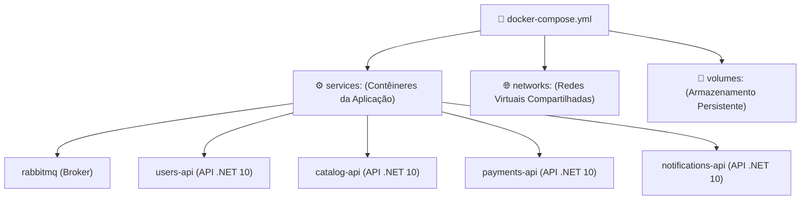
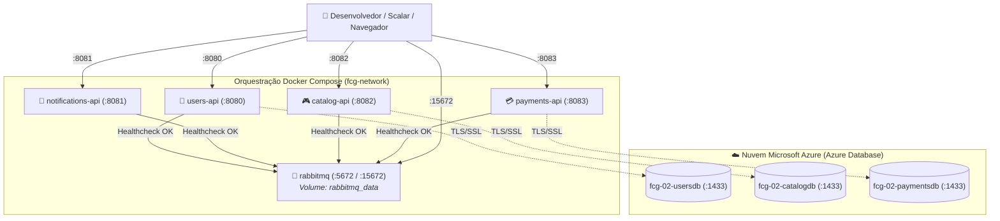

# Orquestração Centralizada com Docker Compose

No quinto módulo do guia de **Docker & Containerização**, você aprenderá a consolidar múltiplos microsserviços, redes e brokers em um único manifesto declarativo através do **Docker Compose**. Vamos dissecar o arquivo `docker-compose.yml` oficial do ecossistema **FIAP Cloud Games**, entender como orquestrar a ordem de inicialização com **Healthchecks** e dominar os comandos de automação para subir toda a arquitetura com um único comando.

---

## 📑 Sumário

- [1. Por que Usar o Docker Compose?](#1-por-que-usar-o-docker-compose)
  - [1.1. O Problema dos Múltiplos Comandos `docker run`](#11-o-problema-dos-múltiplos-comandos-docker-run)
  - [1.2. Infraestrutura como Código (IaC) com YAML](#12-infraestrutura-como-código-iac-com-yaml)
- [2. Anatomia de um Arquivo `docker-compose.yml`](#2-anatomia-de-um-arquivo-docker-composeyml)
  - [2.1. Serviços (`services`)](#21-serviços-services)
  - [2.2. Build Context e Imagens](#22-build-context-e-imagens)
  - [2.3. Variáveis de Ambiente e Connection Strings](#23-variáveis-de-ambiente-e-connection-strings)
  - [2.4. Redes (`networks`) e Volumes (`volumes`)](#24-redes-networks-e-volumes-volumes)
- [3. Controle de Dependência e Ordem de Inicialização (Healthchecks)](#3-controle-de-dependência-e-ordem-de-inicialização-healthchecks)
  - [3.1. A Falácia do `depends_on` Simples](#31-a-falácia-do-depends_on-simples)
  - [3.2. Sondas Ativas de Saúde (`healthcheck`)](#32-sondas-ativas-de-saúde-healthcheck)
  - [3.3. Inicialização Condicional (`condition: service_healthy`)](#33-inicialização-condicional-condition-service_healthy)
- [4. Estudo de Caso Real: O `docker-compose.yml` da Nossa Solução](#4-estudo-de-caso-real-o-docker-composeyml-da-nossa-solução)
  - [4.1. Topologia de Serviços do FIAP Cloud Games](#41-topologia-de-serviços-do-fiap-cloud-games)
  - [4.2. O Arquivo Completo e Comentado](#42-o-arquivo-completo-e-comentado)
  - [4.3. Integração com o Azure Database na Nuvem](#43-integração-com-o-azure-database-na-nuvem)
- [5. Guia de Operação e Comandos Essenciais da CLI](#5-guia-de-operação-e-comandos-essenciais-da-cli)
- [6. Navegação](#6-navegação)

---

## 1. Por que Usar o Docker Compose?

### 1.1. O Problema dos Múltiplos Comandos `docker run`
Imagine que para testar o ecossistema distribuído da Fase 02, você precisasse executar manualmente no terminal:
1. Criar a rede `docker network create fcg-network`;
2. Criar o volume `docker volume create rabbitmq_data`;
3. Rodar o comando `docker run` com 7 parâmetros para o RabbitMQ;
4. Compilar e rodar a `UsersAPI` com connection strings e flags de porta;
5. Repetir o processo para `CatalogAPI`, `PaymentsAPI` e `NotificationsAPI`.

Esse fluxo manual é:
- **Sujeito a Erros Humanos:** Um caractere incorreto em uma variável quebra a comunicação;
- **Frágil:** Não garante qual contêiner inicia primeiro;
- **Incompatível com CI/CD:** Difícil de automatizar e compartilhar entre membros do time.

### 1.2. Infraestrutura como Código (IaC) com YAML
O **Docker Compose** resolve esse problema através da abordagem declarativa: você define **o estado desejado de toda a infraestrutura** em um único arquivo de texto (`docker-compose.yml`). O comando:

```powershell
docker compose up -d --build
```

Lê o arquivo, compila todas as imagens pendentes, cria a rede virtual, anexa os volumes e inicializa os 4 microsserviços na ordem exata de dependência.

---

## 2. Anatomia de um Arquivo `docker-compose.yml`

Um arquivo do Docker Compose é estruturado em seções principais de alto nível:



### 2.1. Serviços (`services`)
Cada item dentro de `services:` representa um contêiner individual:
- **`container_name`:** Define o nome fixo que aparecerá no `docker ps`.
- **`ports`:** Mapeamento de portas host:container (ex: `"8080:8080"`).
- **`restart`:** Política de reinicialização (ex: `unless-stopped`).

### 2.2. Build Context e Imagens
- **`image`:** Para serviços prontos obtidos do Docker Hub (ex: `image: rabbitmq:3-management`).
- **`build`:** Para compilar imagens a partir de código-fonte local:
  ```yaml
  build:
    context: ../fcg-fase-02--users     # Caminho da pasta do microsserviço
    dockerfile: Dockerfile             # Nome do Dockerfile
  ```

### 2.3. Variáveis de Ambiente e Connection Strings
A diretiva **`environment:`** sobrescreve as configurações do `appsettings.json` do ASP.NET Core:
- O ASP.NET Core converte hierarquias de configuração separadas por dois underscores (`__`) em seções de configuração (ex: `ConnectionStrings__DefaultConnection` sobrescreve `ConnectionStrings:DefaultConnection`).

### 2.4. Redes (`networks`) e Volumes (`volumes`)
Declaram as redes e volumes gerenciados que serão compartilhados entre os contêineres:
```yaml
networks:
  fcg-network:
    driver: bridge

volumes:
  rabbitmq_data:
```

---

## 3. Controle de Dependência e Ordem de Inicialização (Healthchecks)

### 3.1. A Falácia do `depends_on` Simples
Em versões antigas do Compose, utilizava-se:
```yaml
depends_on:
  - rabbitmq
```
**O problema:** O Compose apenas aguardava o contêiner do RabbitMQ ser *criado* e entrar em estado *Running*. No entanto, o processo do RabbitMQ leva cerca de 5 a 10 segundos para inicializar o cluster Erlang e abrir a porta TCP 5672.  
As APIs .NET subiam quase instantaneamente (< 2 segundos), tentavam se conectar ao broker fechado e sofriam *crash* com erro de `BrokerUnreachableException`.

### 3.2. Sondas Ativas de Saúde (`healthcheck`)
Para solucionar esse problema em produção, declaramos uma sonda de saúde ativa (*Healthcheck*) no contêiner do broker:

```yaml
healthcheck:
  test: ["CMD", "rabbitmq-diagnostics", "-q", "ping"]
  interval: 10s       # Executa o teste a cada 10 segundos
  timeout: 5s         # Considera falha se não responder em 5 segundos
  retries: 5          # Declara status 'unhealthy' após 5 falhas consecutivas
  start_period: 15s   # Período de carência inicial para o processo dar boot
```

### 3.3. Inicialização Condicional (`condition: service_healthy`)
Nos microsserviços que dependem do broker, configuramos o `depends_on` com condição explícita:

```yaml
depends_on:
  rabbitmq:
    condition: service_healthy
```

O Docker Compose **pausa a inicialização da API** e só autoriza o boot do contêiner .NET quando o RabbitMQ responder com sucesso ao diagnóstico de ping!

---

## 4. Estudo de Caso Real: O `docker-compose.yml` da Nossa Solução

### 4.1. Topologia de Serviços do FIAP Cloud Games



### 4.2. O Arquivo Completo e Comentado

Localização: `fcg-fase-02--orchestration/docker-compose.yml`

```yaml
services:
  # ============================================================================
  # 1. MESSAGE BROKER: RabbitMQ com Painel Web de Administração
  # ============================================================================
  rabbitmq:
    image: rabbitmq:3-management
    container_name: fcg-rabbitmq
    ports:
      - "5672:5672"     # Porta padrão do protocolo AMQP
      - "15672:15672"   # Interface gráfica Web Management
    environment:
      RABBITMQ_DEFAULT_USER: guest
      RABBITMQ_DEFAULT_PASS: guest
    volumes:
      - rabbitmq_data:/var/lib/rabbitmq
    networks:
      - fcg-network
    restart: unless-stopped
    healthcheck:
      test: ["CMD", "rabbitmq-diagnostics", "-q", "ping"]
      interval: 10s
      timeout: 5s
      retries: 5
      start_period: 15s

  # ============================================================================
  # 2. MICROSSERVIÇO: UsersAPI
  # ============================================================================
  users-api:
    build:
      context: ../fcg-fase-02--users
      dockerfile: Dockerfile
    container_name: fcg-ms-users-api
    environment:
      ASPNETCORE_ENVIRONMENT: "Development"
      ConnectionStrings__DefaultConnection: "Server=tcp:fcg-server.database.windows.net,1433;Initial Catalog=fcg-02-usersdb;Persist Security Info=False;User ID=fcg-sa;Password=f1@p-cluod-gam3s;MultipleActiveResultSets=True;Encrypt=True;TrustServerCertificate=True;Connection Timeout=90;"
      RabbitMQ__HostName: "rabbitmq"
      RabbitMQ__Port: "5672"
      RabbitMQ__UserName: "guest"
      RabbitMQ__Password: "guest"
      RabbitMQ__Exchange: "fcg.users.events"
    ports:
      - "8080:8080"
    networks:
      - fcg-network
    depends_on:
      rabbitmq:
        condition: service_healthy
    restart: unless-stopped

  # ============================================================================
  # 3. MICROSSERVIÇO: NotificationsAPI (Stateless Consumer)
  # ============================================================================
  notifications-api:
    build:
      context: ../fcg-fase-02--notifications
      dockerfile: Dockerfile
    container_name: fcg-ms-notifications-api
    environment:
      ASPNETCORE_ENVIRONMENT: "Development"
      RabbitMQ__HostName: "rabbitmq"
      RabbitMQ__Port: "5672"
      RabbitMQ__UserName: "guest"
      RabbitMQ__Password: "guest"
      RabbitMQ__Exchange: "fcg.users.events"
      RabbitMQ__PaymentsExchange: "fcg.payments.events"
      RabbitMQ__Queue: "notifications.user-created"
      RabbitMQ__PaymentsQueue: "notifications.payment-processed"
    ports:
      - "8081:8080"
    networks:
      - fcg-network
    depends_on:
      rabbitmq:
        condition: service_healthy
    restart: unless-stopped

  # ============================================================================
  # 4. MICROSSERVIÇO: CatalogAPI
  # ============================================================================
  catalog-api:
    build:
      context: ../fcg-fase-02--catalog
      dockerfile: Dockerfile
    container_name: fcg-ms-catalog-api
    environment:
      ASPNETCORE_ENVIRONMENT: "Development"
      ConnectionStrings__DefaultConnection: "Server=tcp:fcg-server.database.windows.net,1433;Initial Catalog=fcg-02-catalogdb;Persist Security Info=False;User ID=fcg-sa;Password=f1@p-cluod-gam3s;MultipleActiveResultSets=True;Encrypt=True;TrustServerCertificate=True;Connection Timeout=90;"
      RabbitMQ__HostName: "rabbitmq"
      RabbitMQ__Port: "5672"
      RabbitMQ__UserName: "guest"
      RabbitMQ__Password: "guest"
      RabbitMQ__Exchange: "fcg.catalog.events"
      RabbitMQ__PaymentsExchange: "fcg.payments.events"
      RabbitMQ__PaymentProcessedQueue: "catalog.payment-processed"
      RabbitMQ__PaymentProcessedRoutingKey: "payment.*"
    ports:
      - "8082:8080"
    networks:
      - fcg-network
    depends_on:
      rabbitmq:
        condition: service_healthy
    restart: unless-stopped

  # ============================================================================
  # 5. MICROSSERVIÇO: PaymentsAPI
  # ============================================================================
  payments-api:
    build:
      context: ../fcg-fase-02--payments
      dockerfile: Dockerfile
    container_name: fcg-ms-payments-api
    environment:
      ASPNETCORE_ENVIRONMENT: "Development"
      ConnectionStrings__DefaultConnection: "Server=tcp:fcg-server.database.windows.net,1433;Initial Catalog=fcg-02-paymentsdb;Persist Security Info=False;User ID=fcg-sa;Password=f1@p-cluod-gam3s;MultipleActiveResultSets=True;Encrypt=True;TrustServerCertificate=True;Connection Timeout=90;"
      RabbitMQ__HostName: "rabbitmq"
      RabbitMQ__Port: "5672"
      RabbitMQ__UserName: "guest"
      RabbitMQ__Password: "guest"
      RabbitMQ__Exchange: "fcg.payments.events"
      RabbitMQ__CatalogExchange: "fcg.catalog.events"
      RabbitMQ__OrderPlacedQueue: "payments.order-placed"
      RabbitMQ__OrderPlacedRoutingKey: "order.placed"
    ports:
      - "8083:8080"
    networks:
      - fcg-network
    depends_on:
      rabbitmq:
        condition: service_healthy
    restart: unless-stopped

# ==============================================================================
# DEFINIÇÃO DE REDES E VOLUMES COMPARTILHADOS
# ==============================================================================
networks:
  fcg-network:
    driver: bridge

volumes:
  rabbitmq_data:
```

### 4.3. Integração com o Azure Database na Nuvem
Observe uma decisão arquitetural fundamental no arquivo:
- Não existem contêineres de banco de dados locais declarados no `docker-compose.yml`.
- A persistência é provida diretamente pelo **Azure Database** na nuvem no servidor `fcg-server.database.windows.net`.
- Isso garante que tanto os contêineres locais quanto os Pods do Kubernetes conversem com a mesma base de dados gerenciada e segura, mantendo o consumo de memória RAM do desenvolvedor extremamente enxuto (menos de 600 MB para toda a stack local).

---

## 5. Guia de Operação e Comandos Essenciais da CLI

Todos os comandos a seguir devem ser executados dentro da pasta **`fcg-fase-02--orchestration`**:

```powershell
# 1. Subir toda a solução em segundo plano, forçando a compilação de código novo
docker compose up -d --build

# 2. Verificar o status e saúde de todos os contêineres orquestrados
docker compose ps

# 3. Acompanhar os logs de TODOS os microsserviços em tempo real
docker compose logs -f

# 4. Acompanhar os logs de um único microsserviço específico
docker compose logs -f users-api
docker compose logs -f payments-api

# 5. Recompilar e reiniciar APENAS um microsserviço que você acabou de alterar
docker compose up -d --no-deps --build catalog-api

# 6. Reiniciar um serviço sem recompilar
docker compose restart rabbitmq

# 7. Parar e desmontar todos os contêineres e redes (mantendo os dados do volume)
docker compose down

# 8. Parar e APAGAR todos os dados persistentes de volumes
docker compose down -v
```

---

## 6. Navegação

- ⬅️ **[Voltar para a Aula 04: Volumes e Redes no Docker (`04-volumes-e-redes.md`)](04-volumes-e-redes.md)**
- 📑 **[Ir para o Índice do Guia de Docker (`index.md`)](index.md)**
- 🌐 **[Ir para o Fluxo Geral da Solução (`../fluxo-geral-solucao.md`)](../fluxo-geral-solucao.md)**
- 🚀 **[Voltar para o README Principal da Orquestração (`../../README.md`)](../../README.md)**
