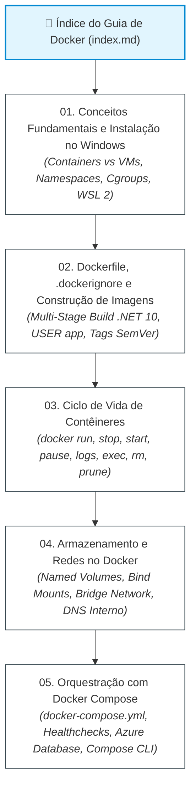

# Guia Oficial de Docker & Containerização - FIAP Cloud Games

Bem-vindo ao **Guia Oficial de Docker & Containerização** do ecossistema distribuído **FIAP Cloud Games (Fase 02)**. 

Este manual consolidado foi estruturado de forma sequencial, didática e aprofundada para capacitar desenvolvedores e arquitetos desde os fundamentos da tecnologia de contêineres até a orquestração multicontêiner com Docker Compose em ambientes de desenvolvimento e pré-produção.

---

## 🗺️ Mapa de Navegação da Trilha

---

## 📚 Módulos do Guia

### 1. [01. Conceitos Fundamentais e Instalação no Windows (`01-conceitos-e-instalacao-windows.md`)](01-conceitos-e-instalacao-windows.md)
- **O que é Containerização:** Comparativo aprofundado entre Máquinas Virtuais (VMs) e Contêineres Docker, compartilhamento do Kernel Linux e economia de recursos.
- **Mecanismos do Kernel Linux:** Como funcionam os `namespaces` (isolamento de processos, rede, disco) e `cgroups` (governança e limites de CPU e memória).
- **Arquitetura do Docker:** O modelo cliente-servidor, Docker Client (CLI), Docker Daemon (`dockerd`), Imagens imutáveis e Registries (Docker Hub / Azure Container Registry).
- **Instalação no Windows 10/11:** Ativação de virtualização na BIOS/UEFI, instalação e configuração do backend **WSL 2** e instalação do Docker Desktop.
- **Validação Prática:** Execução e diagnóstico do primeiro contêiner de teste (`docker run hello-world`).

---

### 2. [02. Dockerfile, .dockerignore e Construção de Imagens (`02-dockerfile-dockerignore-e-imagens.md`)](02-dockerfile-dockerignore-e-imagens.md)
- **Anatomia do Dockerfile:** Análise detalhada das instruções essenciais (`FROM`, `WORKDIR`, `COPY`, `RUN`, `ENV`, `EXPOSE`, `USER`, `ENTRYPOINT`, `CMD`).
- **O Arquivo `.dockerignore`:** Importância crítica para a velocidade do build context e proteção contra o vazamento de segredos corporativos (`.env`, chaves privadas, certificados).
- **Multi-Stage Build em .NET 10:** Padrão de produção que utiliza a imagem SDK pesada apenas para restaurar e compilar, descartando código-fonte e gerando uma imagem de Runtime enxuta e segura.
- **Segurança sem Root:** Configuração do usuário não-root nativo do .NET 10 (`USER app`).
- **Versionamento de Imagens e Tags:** Por que evitar a tag `:latest` em produção e como adotar Versionamento Semântico (`:v1.0.0`, `:v1.1.0`) com `docker tag`.

---

### 3. [03. Ciclo de Vida de Contêineres (`03-ciclo-de-vida-de-containers.md`)](03-ciclo-de-vida-de-containers.md)
- **Máquina de Estados de um Contêiner:** Transições entre `Created`, `Running`, `Paused` e `Stopped/Exited`.
- **Ativação e Execução (`docker run`):** Execução em segundo plano (`-d`), mapeamento de portas (`-p`), injeção de variáveis (`-e`), nomes amigáveis (`--name`) e políticas de reinício (`--restart unless-stopped`).
- **Gerenciamento em Tempo de Execução:** Diferença entre parada graciosa (`docker stop` com `SIGTERM`) e interrupção forçada (`docker kill` com `SIGKILL`), além do congelamento de processos com `docker pause`/`unpause`.
- **Diagnóstico e Observabilidade:** Leitura de logs em streaming (`docker logs -f`), acesso ao terminal interno (`docker exec -it <container> sh`), metadados JSON (`docker inspect`) e métricas ao vivo de CPU/RAM (`docker stats`).
- **Exclusão e Limpeza de Disco:** Remoção segura de contêineres (`docker rm`), imagens (`docker rmi`) e eliminação de recursos órfãos (`docker system prune -a --volumes`).

---

### 4. [04. Armazenamento e Redes no Docker (`04-volumes-e-redes.md`)](04-volumes-e-redes.md)
- **Persistência de Dados e Containers Stateless:** Por que contêineres são efêmeros e como desacoplar os dados do ciclo de vida do contêiner.
- **Estratégias de Armazenamento:** Comparativo entre **Named Volumes** (armazenamento seguro gerenciado pelo Docker, ideal para bancos e filas), **Bind Mounts** (mapeamento direto de pastas do Windows para desenvolvimento com hot-reload) e **tmpfs** (armazenamento volátil em memória RAM).
- **Redes Virtuais (Networking):** Drivers de rede `bridge`, `host`, `none` e `overlay`.
- **Resolução de Nomes via DNS Interno:** Como o servidor DNS embutido (`127.0.0.11`) do Docker viabiliza a comunicação entre microsserviços pelo próprio nome de host na rede customizada `fcg-network` (ex: `HostName=rabbitmq`).
- **Publicação de Portas:** Diferença entre porta interna (`EXPOSE`) e porta publicada na máquina hospedeira (`-p host:container`).

---

### 5. [05. Orquestração Centralizada com Docker Compose (`05-orquestracao-com-docker-compose.md`)](05-orquestracao-com-docker-compose.md)
- **O que é o Docker Compose:** Consolidação de múltiplos microsserviços, variáveis, portas e redes sob a ótica de Infraestrutura como Código (IaC).
- **Anatomia do `docker-compose.yml`:** Declaração estruturada de `services`, `build`, `environment`, `ports`, `networks` e `volumes`.
- **Controle de Dependência com Healthchecks:** Como utilizar `healthcheck` ativo (`rabbitmq-diagnostics -q ping`) e `depends_on: condition: service_healthy` para impedir que as APIs subam antes do message broker estar pronto.
- **Estudo de Caso do FIAP Cloud Games:** Análise completa do `docker-compose.yml` que orquestra as 4 APIs em .NET 10, o RabbitMQ e a conexão criptografada com os bancos de dados dedicados no **Azure Database**.
- **Comandos Essenciais de Operação:** Subir a stack unificada (`docker compose up -d --build`), inspecionar status (`docker compose ps`), acompanhar logs (`docker compose logs -f`) e desmontar recursos (`docker compose down`).

---

## ⚡ Tabela Rápida de Comandos Mais Utilizados

| Objetivo | Comando Docker CLI / Compose |
|---|---|
| **Compilar Imagem** | `docker build -t minha-api:v1.0.0 .` |
| **Executar Contêiner em Background** | `docker run -d --name api -p 8080:8080 minha-api:v1.0.0` |
| **Listar Contêineres Ativos** | `docker ps` |
| **Listar Todos os Contêineres (Inclusive Parados)** | `docker ps -a` |
| **Acompanhar Logs em Tempo Real** | `docker logs -f <nome_do_container>` |
| **Abrir Terminal Dentro do Contêiner** | `docker exec -it <nome_do_container> sh` |
| **Monitorar CPU e RAM ao Vivo** | `docker stats` |
| **Parar Contêiner Graciosamente** | `docker stop <nome_do_container>` |
| **Excluir Contêiner** | `docker rm <nome_do_container>` |
| **Excluir Imagem** | `docker rmi <nome_da_imagem>:<tag>` |
| **Limpeza Geral de Imagens e Contêineres Órfãos** | `docker system prune -a` |
| **Subir Stack Completa com Compose** | `docker compose up -d --build` |
| **Ver Status dos Serviços no Compose** | `docker compose ps` |
| **Derrubar Stack Completa com Compose** | `docker compose down` |

---

## 🔗 Navegação e Links Relacionados

- 🌐 **[Documentação do Fluxo Global da Solução](../fluxo-geral-solucao.md)**
- ☸️ **[Guia de Infraestrutura e Nuvem no Kubernetes](../k8s-infra.md)**
- 🐇 **[Guia Completo de RabbitMQ & Mensageria](../rabbitmq/index.md)**
- 📑 **[Índice Central da Documentação de Orquestração](../index.md)**
- 🚀 **[README Principal da Orquestração](../../README.md)**
