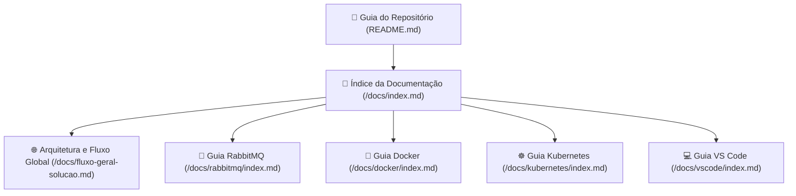

# Orquestração & Arquitetura Global - Índice da Documentação

Bem-vindo à documentação central de arquitetura e orquestração do ecossistema distribuído **FIAP Cloud Games (Fase 02)**.

---

## 📑 Sumário

- [1. Mapa de Documentação](#1-mapa-de-documentação)
- [2. Documentos Disponíveis](#2-documentos-disponíveis)
  - [2.1. Arquitetura e Fluxo Global da Solução](#21-arquitetura-e-fluxo-global-da-solução)
  - [2.2. Guia Completo de RabbitMQ & Mensageria](#22-guia-completo-de-rabbitmq--mensageria)
  - [2.3. Guia Oficial de Docker & Containerização](#23-guia-oficial-de-docker--containerização)
  - [2.4. Guia Oficial de Kubernetes (K8s)](#24-guia-oficial-de-kubernetes-k8s)
  - [2.5. Guia de Desenvolvimento .NET no VS Code](#25-guia-de-desenvolvimento-net-no-vs-code)
  - [2.6. Infraestrutura e Nuvem no Kubernetes](#26-infraestrutura-e-nuvem-no-kubernetes)
  - [2.7. Guia Rápido de Execução](#27-guia-rápido-de-execução)
  - [2.8. Automação da Jornada Ponta a Ponta (E2E)](#28-automação-da-jornada-ponta-a-ponta-e2e)

---

## 1. Mapa de Documentação

---

## 2. Documentos Disponíveis

### 2.1. Arquitetura e Fluxo Global da Solução
👉 **[🌐 Arquitetura e Fluxo Global da Solução Distribuída (`fluxo-geral-solucao.md`)](fluxo-geral-solucao.md)**
- Topologia completa de contêineres, bancos de dados dedicados no Azure Database e RabbitMQ na rede `fcg-network`.
- Diagrama comparativo lado a lado (Registro na esquerda | Login e Compra na direita).
- Diagrama de sequência global de ponta a ponta (Mermaid).
- Narrativa fluida e payloads de requisições, respostas e eventos para os 4 fluxos de negócio.
- Matriz consolidada de mensageria (Exchanges, Routing Keys, Filas e Contratos).

### 2.2. Guia Completo de RabbitMQ & Mensageria
👉 **[🐇 Guia Completo de RabbitMQ & Mensageria Distribuída (`rabbitmq/index.md`)](rabbitmq/index.md)**
- **[01. Fundamentos, Arquitetura e Tipos de Exchange](rabbitmq/01-fundamentos-e-conceitos.md):** AMQP, Producers, Brokers, Queues e funcionamento detalhado de **todos os tipos de Exchange** (`Direct`, `Fanout`, `Topic`, `Headers`, `Default`).
- **[02. Formas de Recuperar e Finalizar Mensagens](rabbitmq/02-consumo-e-confirmacao.md):** Modelos **Push** vs **Pull**, controle de vazão (**QoS / Prefetch**), estratégias de término (**BasicAck**, **BasicNack**, **BasicReject**), proteção contra mensagens venenosas (*Poison Messages*) e **Dead Letter Queues (DLQ)**.
- **[03. Instalação via Docker & Guia da Management UI](rabbitmq/03-instalacao-docker-management.md):** Imagem com painel web (`rabbitmq:3-management`), mapeamento de portas (`5672` e `15672`), healthchecks no Compose e guia passo a passo da interface gráfica.
- **[04. Implementação Prática em .NET 10 (C#)](rabbitmq/04-implementacao-dotnet.md):** Utilização do pacote assíncrono `RabbitMQ.Client` v7.x, criação do `RabbitMqEventPublisher`, consumidor em `BackgroundService`, injeção de dependências e resolução de escopo com `IServiceScopeFactory`.

### 2.3. Guia Oficial de Docker & Containerização
👉 **[🐳 Guia Oficial de Docker & Containerização (`docker/index.md`)](docker/index.md)**
- **[01. Conceitos Fundamentais e Instalação no Windows](docker/01-conceitos-e-instalacao-windows.md):** Containers vs VMs, Namespaces, Cgroups, arquitetura do Docker e instalação com backend WSL 2.
- **[02. Dockerfile, .dockerignore e Construção de Imagens](docker/02-dockerfile-dockerignore-e-imagens.md):** Instruções fundamentais, proteção do `.dockerignore`, Multi-Stage Build em .NET 10, usuário `USER app` e versionamento de tags (SemVer).
- **[03. Ciclo de Vida de Contêineres](docker/03-ciclo-de-vida-de-containers.md):** Máquina de estados, comandos `run`, `stop` (SIGTERM gracioso), `kill`, `start`, `pause`, `logs -f`, `exec -it`, `stats`, `rm` e limpeza com `system prune`.
- **[04. Armazenamento e Redes no Docker](docker/04-volumes-e-redes.md):** Named Volumes, Bind Mounts, tmpfs, drivers de rede (`bridge`), resolução de DNS interno embutido (`127.0.0.11`) e mapeamento de portas.
- **[05. Orquestração Centralizada com Docker Compose](docker/05-orquestracao-com-docker-compose.md):** Anatomia do `docker-compose.yml`, dependências seguras com Healthchecks (`condition: service_healthy`), integração com Azure Database e comandos de operação.

### 2.4. Guia Oficial de Kubernetes (K8s)
👉 **[☸️ Guia Oficial de Kubernetes (`kubernetes/index.md`)](kubernetes/index.md)**
- **[01. Conceitos, Arquitetura e Instalação no Windows](kubernetes/01-conceitos-arquitetura-e-instalacao.md):** Control Plane, Worker Nodes, Pods e ativação do Kubernetes no Docker Desktop.
- **[02. Manifestos YAML e Tipos de Configuração](kubernetes/02-manifestos-e-tipos-de-configuracao.md):** ConfigMap, Secret em Base64, Deployment com RollingUpdate, Service e manifestos unificados (All-in-One).
- **[03. Atualização de Código, Rollout de Imagens e Ciclo de Vida](kubernetes/03-atualizacao-de-codigo-rollout-e-ciclo-de-vida.md):** Build de nova imagem, rollout declarativo/imperativo, rollback instantâneo e gestão de Pods (`scale --replicas=0`).
- **[04. Redes no Kubernetes, Port-Forward e Persistência de Dados](kubernetes/04-redes-port-forward-e-armazenamento.md):** CoreDNS, túnel local com `kubectl port-forward`, PV/PVC e persistência no Azure Database PaaS.
- **[05. Recursos Avançados, Diagnóstico e Guia de Comandos](kubernetes/05-recursos-avancados-e-guia-de-comandos.md):** Namespaces, Ingress L7, sondas de saúde (`startupProbe`), diagnóstico com `describe` e tabela rápida de comandos.

### 2.5. Guia de Desenvolvimento .NET no VS Code
👉 **[💻 Guia de Desenvolvimento .NET no VS Code (`vscode/index.md`)](vscode/index.md)**
- **[01. Ambiente, Extensões e Criação de Projetos](vscode/01-ambiente-extensoes-e-dotnet-cli.md):** C# Dev Kit, formato `.slnx` moderno do .NET 10 e templates pela CLI.
- **[02. Gerenciamento de Projetos e NuGet](vscode/02-gerenciamento-de-projetos-referencias-e-nuget.md):** Adicionar/remover da solution, referências entre projetos (Clean Architecture), pesquisa e auditoria de pacotes.
- **[03. Automação com tasks.json e launch.json](vscode/03-automacao-com-tasks-e-launch.md):** Pasta `.vscode/`, `preLaunchTask`, captura de erros e portas locais.
- **[04. Execução Múltipla com Compounds](vscode/04-execucao-multiplos-projetos-e-compounds.md):** Configuração da chave `compounds` com `"stopAll": true` para rodar as 4 APIs em simultâneo.
- **[05. Depuração Profissional com coreclr](vscode/05-depuracao-profissional-debugging.md):** Breakpoints condicionais, controle de fluxo (`F5`, `F10`, `F11`), Call Stack e Debug Console.

### 2.6. Guia Rápido de Execução
👉 **[🚀 README do Repositório (`../README.md`)](../README.md)**
- Visão geral dos 5 repositórios da solução.
- Topologia de pastas recomendada para desenvolvimento.
- Como subir todo o ecossistema unificado via Docker Compose (`docker compose up -d --build`).

