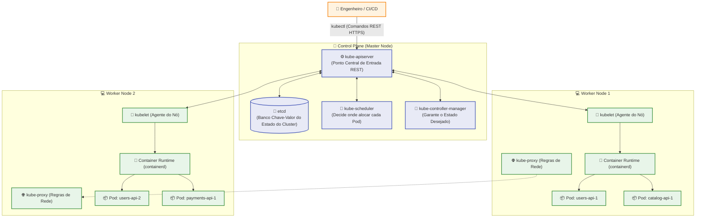
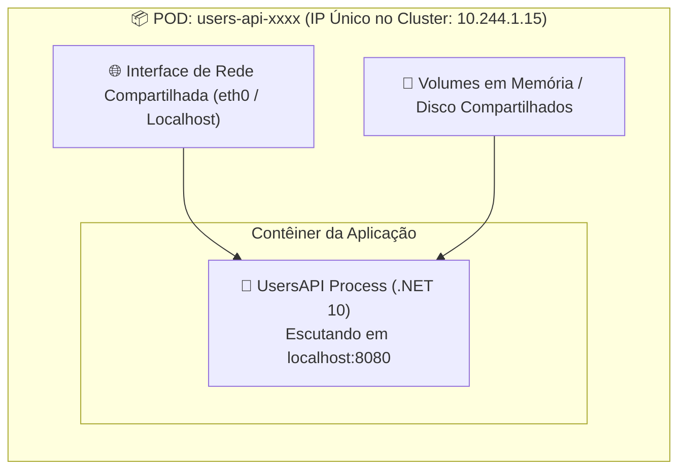

# Kubernetes (K8s): Conceitos, Arquitetura e Instalação no Windows

Bem-vindo ao primeiro módulo do guia de **Kubernetes (K8s)** do ecossistema **FIAP Cloud Games**. Este documento apresenta as motivações para a orquestração de contêineres em escala, detalha a arquitetura interna de um cluster (Control Plane e Worker Nodes), esclarece a relação entre contêineres e Pods, e fornece o passo a passo completo para ativar e validar o **Kubernetes nativo no Windows através do Docker Desktop**.

---

## 📑 Sumário

- [1. O que é o Kubernetes (K8s)?](#1-o-que-é-o-kubernetes-k8s)
  - [1.1. Do Docker Compose à Orquestração de Produção](#11-do-docker-compose-à-orquestração-de-produção)
  - [1.2. Principais Benefícios Corporativos](#12-principais-benefícios-corporativos)
  - [1.3. A Origem do Nome "K8s"](#13-a-origem-do-nome-k8s)
- [2. Arquitetura Interna de um Cluster Kubernetes](#2-arquitetura-interna-de-um-cluster-kubernetes)
  - [2.1. O Plano de Controle (Control Plane / Master Node)](#21-o-plano-de-controle-control-plane--master-node)
  - [2.2. Os Nós de Execução (Worker Nodes)](#22-os-nós-de-execução-worker-nodes)
  - [2.3. Diagrama da Topologia do Cluster](#23-diagrama-da-topologia-do-cluster)
- [3. Relação com Imagens e Contêineres: O Papel do Pod](#3-relação-com-imagens-e-contêineres-o-papel-do-pod)
  - [3.1. Por que o Kubernetes não executa Contêineres Diretamente?](#31-por-que-o-kubernetes-não-executa-contêineres-diretamente)
  - [3.2. Anatomia de um Pod](#32-anatomia-de-um-pod)
  - [3.3. Padrão Single-Container vs. Multi-Container (Sidecar)](#33-padrão-single-container-vs-multi-container-sidecar)
- [4. Instalação e Ativação no Windows 10/11](#4-instalação-e-ativação-no-windows-1011)
  - [4.1. O `kubectl` já vem instalado no Docker Desktop?](#41-o-kubectl-já-vem-instalado-no-docker-desktop)
  - [4.2. Ativando o Kubernetes no Docker Desktop Passo a Passo](#42-ativando-o-kubernetes-no-docker-desktop-passo-a-passo)
  - [4.3. Alternativas para Clusters Locais (Minikube, Kind, k3s)](#43-alternativas-para-clusters-locais-minikube-kind-k3s)
  - [4.4. Comandos de Validação e Saúde do Cluster](#44-comandos-de-validação-e-saúde-do-cluster)
- [5. Navegação](#5-navegação)

---

## 1. O que é o Kubernetes (K8s)?

O **Kubernetes** (frequentemente abreviado como **K8s**) é uma plataforma de código aberto para **orquestração, automação de implantação, escalonamento e gestão de aplicações em contêineres**. Criado originalmente pelo Google com base em seus sistemas internos (*Borg* e *Omega*), o projeto é hoje mantido pela **Cloud Native Computing Foundation (CNCF)**.

### 1.1. Do Docker Compose à Orquestração de Produção

No módulo anterior do nosso guia de Docker ([📖 Ver Módulo de Docker Compose](../docker/05-orquestracao-com-docker-compose.md)), aprendemos a utilizar o `docker-compose.yml` para subir múltiplos contêineres coordenados. Porém, o Docker Compose foi desenhado prioritariamente para **uma única máquina (Single Host)**.

Quando uma plataforma de jogos em nuvem como o **FIAP Cloud Games** entra em produção corporativa, surgem novos desafios que o Docker isolado não consegue suprir:
- O que acontece se o servidor físico onde a `UsersAPI` roda queimar ou desligar?
- Como distribuir 20 réplicas da `CatalogAPI` balanceando o tráfego entre 5 servidores distintos sem criar portas manuais?
- Como aplicar uma atualização de versão sem derrubar o sistema nem recusar nenhuma requisição HTTP (*Zero Downtime Rolling Update*)?
- Como aumentar o número de réplicas de 2 para 50 automaticamente durante a Black Friday quando a CPU ultrapassar 80% (*Horizontal Pod Autoscaling*)?

O Kubernetes nasceu exatamente para resolver esses problemas em ambientes de missão crítica.

### 1.2. Principais Benefícios Corporativos

1. **Autocura (*Self-Healing*):** Se um contêiner travar ou falhar nas sondas de saúde, o K8s o reinicia imediatamente. Se o servidor inteiro morrer, o K8s recria os Pods afetados em outro servidor saudável.
2. **Descoberta de Serviços e Balanceamento de Carga (*Service Discovery & Load Balancing*):** O K8s atribui um único ponto de entrada estável (DNS e IP virtual) e distribui as requisições em rede via Round-Robin entre todas as réplicas ativas.
3. **Escalonamento Automático (*Autoscaling*):** Aumenta ou reduz o número de réplicas horizontalmente com base no consumo de CPU, memória ou métricas de negócio (ex: mensagens acumuladas no RabbitMQ).
4. **Atualizações e Reversões Automatizadas (*Rollouts & Rollbacks*):** Atualiza os contêineres gradualmente, garantindo que sempre haja instâncias saudáveis atendendo os clientes. Se algo der errado, reverte a versão com um único comando.
5. **Gerenciamento Declarativo de Configurações e Segredos:** Desacopla senhas, variáveis e chaves criptográficas do código da aplicação sem necessidade de recompilar imagens.

### 1.3. A Origem do Nome "K8s"
"K8s" é um **numerônimo**: a letra inicial **K**, seguida pelo número **8** (representando as 8 letras omitidas: `u-b-e-r-n-e-t-e`), terminando com a letra **s**. A palavra tem origem no grego antigo (*κυβερνήτης*), que significa "timoneiro" ou "piloto de navio", simbolizando o timão de 7 raios do logotipo que pilota seus contêineres na nuvem.

---

## 2. Arquitetura Interna de um Cluster Kubernetes

Um cluster Kubernetes é formado por dois grupos de componentes cooperativos: o **Control Plane** (o "cérebro" que toma as decisões arquiteturais) e os **Worker Nodes** (os "músculos" que executam as cargas de trabalho reais).



---

### 2.1. O Plano de Controle (Control Plane / Master Node)

O Control Plane monitora continuamente o cluster e ajusta o ambiente para que o estado real corresponda ao estado declarado nos arquivos YAML:

1. **`kube-apiserver`:** O componente central do Control Plane. Expõe a API REST do Kubernetes em JSON sobre HTTPS. Todos os clientes externos (como a CLI `kubectl` ou esteiras de CI/CD do GitHub Actions) e todos os componentes internos conversam exclusivamente através do API Server.
2. **`etcd`:** Um banco de dados chave-valor distribuído, altamente consistente e tolerante a falhas. Armazena todo o estado do cluster (manifestos, segredos, nós ativos e histórico). Se o `etcd` não souber de algo, para o Kubernetes aquilo não existe.
3. **`kube-scheduler`:** Observa Pods recém-criados que ainda não possuem nó atribuído e seleciona o melhor Worker Node para executá-los com base em recursos livres (CPU/RAM), restrições de afinidade e tolerâncias.
4. **`kube-controller-manager`:** Executa loops de reconciliação contínuos. Exemplos:
   - *DeploymentController:* Se você declarou `replicas: 2` e um Pod morreu, ele solicita imediatamente a criação de outro para manter 2 réplicas ativas.
   - *NodeController:* Monitora se algum Worker Node parou de responder.

---

### 2.2. Os Nós de Execução (Worker Nodes)

Os nós de trabalho são máquinas virtuais ou servidores físicos que efetivamente hospedam e executam os contêineres:

1. **`kubelet`:** O agente primordial que roda em cada nó. Ele recebe os manifestos de Pods enviados pelo API Server e garante que os contêineres descritos estejam rodando e saudáveis através da interface CRI (*Container Runtime Interface*).
2. **`kube-proxy`:** Gerencia as regras de rede locais no nó (geralmente via regras de `iptables` ou `IPVS`). É ele quem viabiliza a comunicação de rede dos **Services** e o balanceamento de carga entre Pods.
3. **Container Runtime:** O software de baixo nível responsável por baixar imagens e rodar os contêineres Linux (hoje adota-se o padrão **containerd** ou **CRI-O**).

---

## 3. Relação com Imagens e Contêineres: O Papel do Pod

### 3.1. Por que o Kubernetes não executa Contêineres Diretamente?

No mundo Docker clássico, a menor unidade de execução é o contêiner individual ([📖 Ver Módulo de Ciclo de Vida do Docker](../docker/03-ciclo-de-vida-de-containers.md)). No entanto, no Kubernetes, **a menor unidade implantável e gerenciável é o POD**.

O Kubernetes nunca cria ou escala contêineres isolados; ele sempre instancia e escala **Pods**.

### 3.2. Anatomia de um Pod

Um **Pod** é um invólucro (*wrapper*) que encapsula um ou mais contêineres fortemente acoplados:



#### Características Fundamentais de um Pod:
- **Endereço IP Único:** Todo Pod recebe um endereço IP próprio e roteável dentro da rede interna do cluster.
- **Espaço de Rede Compartilhado (*Shared Network Namespace*):** Todos os contêineres que residem dentro do *mesmo* Pod compartilham o mesmo IP e conversam entre si instantaneamente através de `localhost:<porta>`.
- **Volumes Compartilhados:** Arquivos ou dados temporários montados no Pod podem ser acessados simultaneamente por todos os contêineres daquele Pod.

### 3.3. Padrão Single-Container vs. Multi-Container (Sidecar)

- **Single-Container Pod (Mais de 95% dos casos):** Padrão adotado em todas as nossas APIs (`UsersAPI`, `CatalogAPI`, `PaymentsAPI`, `NotificationsAPI`). Cada Pod abriga exatamente 1 contêiner da aplicação .NET 10.
- **Multi-Container Pod (*Sidecar Pattern*):** Um contêiner principal executa a regra de negócio da API, enquanto um segundo contêiner auxiliar (*Sidecar*) roda no mesmo Pod para coletar métricas de telemetria, rotacionar certificados TLS ou sincronizar logs.

---

## 4. Instalação e Ativação no Windows 10/11

### 4.1. O `kubectl` já vem instalado no Docker Desktop?

**SIM!**  
Ao instalar o **Docker Desktop** no Windows com o backend WSL 2 (conforme detalhado no [Guia de Instalação do Docker](../docker/01-conceitos-e-instalacao-windows.md)), o binário oficial da CLI do Kubernetes (**`kubectl.exe`**) **já é instalado automaticamente e configurado na variável de ambiente `PATH` do Windows**.

Você **não precisa** baixar o executável do `kubectl` separadamente caso já possua o Docker Desktop funcionando em sua máquina.

### 4.2. Ativando o Kubernetes no Docker Desktop Passo a Passo

O Docker Desktop possui um cluster Kubernetes completo de nó único (*single-node*) embutido, mas ele vem **desativado por padrão** para poupar memória RAM.

Para ativá-lo:

1. Abra o **Docker Desktop** no Windows.
2. Clique no ícone de engrenagem no canto superior direito (**Settings / Configurações**).
3. No menu lateral esquerdo, clique na aba **Kubernetes**.
4. Marque a caixa de seleção:  
   ✅ **Enable Kubernetes**.
5. *(Opcional)* Você pode marcar também:  
   ✅ *Show system containers (advanced)* se desejar visualizar os contêineres internos do Control Plane (`coredns`, `kube-proxy`, `etcd`) no painel do Docker.
6. Clique no botão azul **Apply & restart** no canto inferior direito.
7. O Docker Desktop fará o download das imagens do cluster Kubernetes e iniciará o Control Plane no WSL 2 (esse processo leva de 2 a 5 minutos na primeira vez).
8. Quando o processo terminar, observe o rodapé inferior esquerdo da janela do Docker Desktop: o ícone do timão do Kubernetes ficará **verde**, indicando **"Kubernetes running"**.

---

### 4.3. Alternativas para Clusters Locais (Minikube, Kind, k3s)

Caso prefira não utilizar o cluster do Docker Desktop ou precise de múltiplos nós:
- **Kind (*Kubernetes in Docker*):** Roda nós inteiros do Kubernetes como se fossem contêineres Docker. É ultraleve e excelente para simular múltiplos nós locais via linha de comando (`kind create cluster`).
- **Minikube:** Cria uma VM dedicada com o cluster K8s completo e painel gráfico (*Kubernetes Dashboard*).
- **K3s:** Distribuição certificada ultraleve e de alta performance criada pela Rancher, ideal para IoT, CI/CD e máquinas com baixa quantidade de memória RAM (< 4GB).

---

### 4.4. Comandos de Validação e Saúde do Cluster

Abra o terminal (PowerShell ou Terminal do VS Code) e execute os seguintes comandos para validar se a sua máquina Windows está se comunicando com o cluster local:

```powershell
# 1. Verificar a versão da CLI (Client) e do Servidor (Control Plane)
kubectl version

# 2. Exibir informações e endpoints do Control Plane e do CoreDNS
kubectl cluster-info

# 3. Listar os nós disponíveis no cluster e confirmar o status 'Ready'
kubectl get nodes
```

#### Exemplo de saída esperada:
```text
NAME             STATUS   ROLES           AGE   VERSION
docker-desktop   Ready    control-plane   10m   v1.30.2
```

Se a coluna `STATUS` exibir **`Ready`**, seu ambiente local está 100% pronto para receber manifestos e implantar microsserviços!

---

## 5. Navegação

- 📑 **[Ir para o Índice do Guia de Kubernetes (`index.md`)](index.md)**
- 🐳 **[Consultar o Guia de Criação de Imagens Docker](../docker/02-dockerfile-dockerignore-e-imagens.md)**
- ➡️ **[Avançar para a Aula 02: Tipos de Configuração e Manifestos YAML (`02-manifestos-e-tipos-de-configuracao.md`)](02-manifestos-e-tipos-de-configuracao.md)**
