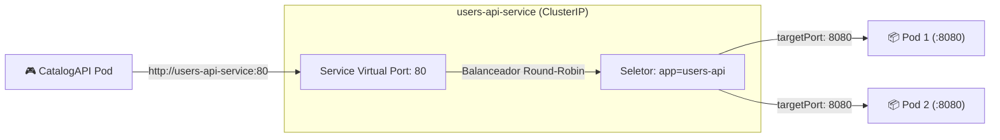
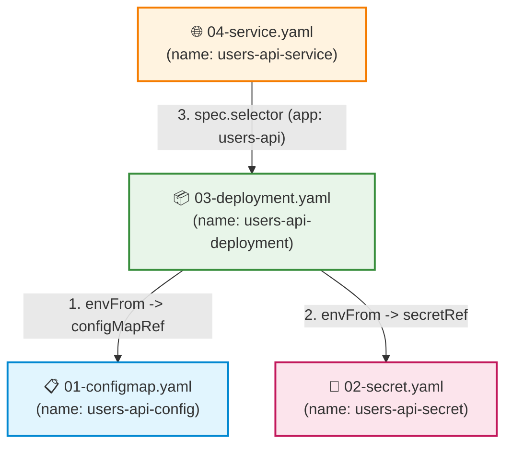

# Manifestos YAML e Tipos de Configuração no Kubernetes

Neste segundo módulo do guia de **Kubernetes (K8s)**, você aprenderá a dominar a modelagem declarativa de infraestrutura através de arquivos YAML. Vamos dissecar as quatro configurações essenciais do Kubernetes (**ConfigMap**, **Secret**, **Deployment** e **Service**), entender a função de cada campo, aprender como esses arquivos se amarram e se referenciam mutuamente, e demonstrar como consolidar todos os recursos em um único arquivo de implantação utilizando o delimitador `---`.

---

## 📑 Sumário

- [1. O Modelo Declarativo de Manifestos (YAML)](#1-o-modelo-declarativo-de-manifestos-yaml)
  - [1.1. Imperativo vs. Declarativo](#11-imperativo-vs-declarativo)
  - [1.2. A Estrutura Universal de um Manifesto Kubernetes](#12-a-estrutura-universal-de-um-manifesto-kubernetes)
- [2. ConfigMap: Configurações Públicas Desacopladas](#2-configmap-configurações-públicas-desacopladas)
  - [2.1. O que é e quando utilizar?](#21-o-que-é-e-quando-utilizar)
  - [2.2. Exemplo Real: `01-configmap.yaml`](#22-exemplo-real-01-configmapyaml)
  - [2.3. Explicação dos Campos](#23-explicação-dos-campos)
- [3. Secret: Proteção de Credenciais Sensíveis](#3-secret-proteção-de-credenciais-sensíveis)
  - [3.1. A Seção `data:` (Base64 Obrigatório) vs. `stringData:`](#31-a-seção-data-base64-obrigatório-vs-stringdata)
  - [3.2. Exemplo Real: `02-secret.yaml` (Conexão Azure Database)](#32-exemplo-real-02-secretyaml-conexão-azure-database)
  - [3.3. Como Gerar Strings em Base64 no Terminal](#33-como-gerar-strings-em-base64-no-terminal)
- [4. Deployment: Gestão de Cargas de Trabalho e Réplicas](#4-deployment-gestão-de-cargas-de-trabalho-e-réplicas)
  - [4.1. Exemplo Real: `03-deployment.yaml`](#41-exemplo-real-03-deploymentyaml)
  - [4.2. Dissecando os Campos Críticos do Deployment](#42-dissecando-os-campos-críticos-do-deployment)
  - [4.3. Estratégia de Atualização sem Downtime (`RollingUpdate`)](#43-estratégia-de-atualização-sem-downtime-rollingupdate)
  - [4.4. Governança de Recursos: `requests` vs. `limits`](#44-governança-de-recursos-requests-vs-limits)
  - [4.5. Sondas de Integridade: `readinessProbe` e `livenessProbe`](#45-sondas-de-integridade-readinessprobe-e-livenessprobe)
- [5. Service: Abstração de Rede Estável e Balanceamento](#5-service-abstração-de-rede-estável-e-balanceamento)
  - [5.1. O Problema dos IPs Voláteis dos Pods](#51-o-problema-dos-ips-voláteis-dos-pods)
  - [5.2. Tipos de Service (`ClusterIP`, `NodePort`, `LoadBalancer`)](#52-tipos-de-service-clusterip-nodeport-loadbalancer)
  - [5.3. Exemplo Real: `04-service.yaml`](#53-exemplo-real-04-serviceyaml)
  - [5.4. Relação entre `port` e `targetPort`](#54-relação-entre-port-e-targetport)
- [6. Como os Arquivos se Referenciam Mutuamente (Rastreabilidade)](#6-como-os-arquivos-se-referenciam-mutuamente-rastreabilidade)
  - [6.1. Diagrama de Relacionamento entre Recursos](#61-diagrama-de-relacionamento-entre-recursos)
- [7. Manifestos Consolidados: Todos os Recursos no Mesmo Arquivo](#7-manifestos-consolidados-todos-os-recursos-no-mesmo-arquivo)
  - [7.1. O Delimitador YAML `---`](#71-o-delimitador-yaml----)
  - [7.2. Exemplo Prático de Arquivo Único Consolidado](#72-exemplo-prático-de-arquivo-único-consolidado)
  - [7.3. Vantagens e Trade-offs (Arquivos Separados vs. Arquivo Único)](#73-vantagens-e-trade-offs-arquivos-separados-vs-arquivo-único)
- [8. Navegação](#8-navegação)

---

## 1. O Modelo Declarativo de Manifestos (YAML)

### 1.1. Imperativo vs. Declarativo
- **Abordagem Imperativa (Comandos CLI):** Você diz ao Kubernetes *o que fazer passo a passo* (ex: `kubectl create deployment api --image=...`). É rápido para testes pontuais, mas difícil de reproduzir, auditar e versionar no Git.
- **Abordagem Declarativa (Manifestos YAML):** Você declara **o estado final desejado do sistema** em um arquivo de texto e executa `kubectl apply -f meu-arquivo.yaml`. O Kubernetes compara o estado atual com o declarado e aplica apenas as mudanças necessárias para convergir o cluster ao estado desejado.

### 1.2. A Estrutura Universal de um Manifesto Kubernetes
Todo e qualquer objeto no Kubernetes (seja um Pod, ConfigMap, Secret, Service ou Deployment) possui obrigatoriamente 4 blocos raiz em sua estrutura:

```yaml
apiVersion: <grupo>/<versao>   # Versão da API do Kubernetes para este recurso específico
kind: <TipoDoObjeto>           # Qual objeto estamos criando (ConfigMap, Secret, Deployment, Service)
metadata:                      # Metadados de identificação do objeto
  name: <nome-exclusivo>       # Nome único do recurso dentro do namespace
  namespace: default           # Em qual namespace o objeto reside (default se omitido)
  labels:                      # Etiquetas chave-valor usadas para agrupamento e seleção
    app: meu-microsservico
spec:                          # Especificação detalhada do estado desejado (varia por kind)
  ...
```

---

## 2. ConfigMap: Configurações Públicas Desacopladas

### 2.1. O que é e quando utilizar?
O **ConfigMap** armazena pares de chave-valor contendo parâmetros de configuração que **não são confidenciais**: URLs de brokers, nomes de exchanges, portas de rede, nível de log e identificadores de ambiente.

Ele permite que a mesma imagem Docker ([📖 Ver Módulo de Imagens Docker](../docker/02-dockerfile-dockerignore-e-imagens.md)) execute em Desenvolvimento, Homologação ou Produção alterando apenas o ConfigMap do cluster, sem recompilar uma única linha de código.

### 2.2. Exemplo Real: `01-configmap.yaml`
Localização: `fcg-fase-02--users/k8s/01-configmap.yaml`

```yaml
apiVersion: v1
kind: ConfigMap
metadata:
  name: users-api-config
  labels:
    app: users-api
data:
  ASPNETCORE_ENVIRONMENT: "Production"
  RabbitMQ__HostName: "rabbitmq-service"
  RabbitMQ__Port: "5672"
  RabbitMQ__UserName: "guest"
  RabbitMQ__Exchange: "fcg.users.events"
  Jwt__Issuer: "FCG02.UsersAPI"
  Jwt__Audience: "FCG02.CloudGamesClients"
```

### 2.3. Explicação dos Campos
- `apiVersion: v1`: ConfigMaps pertencem ao grupo de APIs fundamental (core) do Kubernetes.
- `metadata.name: users-api-config`: O identificador que será referenciado pelo `Deployment` mais adiante.
- `data:`: Dicionário de variáveis. Observe o padrão de hierarquia do ASP.NET Core utilizando duplo underscore (`__`):  
  A chave `RabbitMQ__HostName` sobrescreve automaticamente a seção `RabbitMQ:HostName` do arquivo `appsettings.json` da API em tempo de execução.

---

## 3. Secret: Proteção de Credenciais Sensíveis

O objeto **Secret** armazena dados confidenciais: senhas de banco de dados, chaves simétricas de tokens JWT, credenciais de mensageria e certificados SSL.

### 3.1. A Seção `data:` (Base64 Obrigatório) vs. `stringData:`
O Kubernetes oferece duas formas de declarar dados em um Secret:

| Campo no YAML | Formato Esperado | Comportamento Interno |
|---|---|---|
| **`data:`** | **Estritamente Base64** | O valor já deve estar codificado em Base64 antes de ser gravado no YAML. É o formato padrão e mais seguro para auditorias. |
| **`stringData:`** | Texto Plano (Legível) | O Kubernetes lê o texto simples e o converte para Base64 nos bastidores ao criar o objeto. Não deve ser comitado em repositórios públicos. |

### 3.2. Exemplo Real: `02-secret.yaml` (Conexão Azure Database)
Localização: `fcg-fase-02--users/k8s/02-secret.yaml`

```yaml
# Secret protege dados sensíveis (senhas de bancos, senhas de mensageria, chaves JWT)
# Regra: valores declarados na seção 'data' de um manifesto Secret devem estar obrigatoriamente codificados em Base64

apiVersion: v1
kind: Secret
metadata:
  name: users-api-secret
  labels:
    app: users-api
type: Opaque
data:
  # ConnectionString completa do Azure Database (fcg-02-usersdb) em Base64
  ConnectionStrings__DefaultConnection: U2VydmVyPXRjcDpmY2ctc2VydmVyLmRhdGFiYXNlLndpbmRvd3MubmV0LDE0MzM7SW5pdGlhbCBDYXRhbG9nPWZjZy0wMi11c2Vyc2RiO1BlcnNpc3QgU2VjdXJpdHkgSW5mbz1GYWxzZTtVc2VyIElEPWZjZy1zYTtQYXNzd29yZD1mMUBwLWNsdW9kLWdhbTNzO011bHRpcGxlQWN0aXZlUmVzdWx0U2V0cz1UcnVlO0VuY3J5cHQ9VHJ1ZTtUcnVzdFNlcnZlckNlcnRpZmljYXRlPVRydWU7Q29ubmVjdGlvbiBUaW1lb3V0PTkwOw==
  # Senha do RabbitMQ (guest) em Base64
  RabbitMQ__Password: Z3Vlc3Q=
  # Chave simétrica HMAC-SHA256 do JWT em Base64
  Jwt__SecretKey: Q2hhdmVTdXBlclNlY3JldGFFRm9ydGVDb21NYWlzRGUzMkNhcmFjdGVyZXNGSUFQQ2xvdWRHYW1lczIwMjYh
```

- `type: Opaque`: Tipo padrão para segredos arbitrários definidos pelo usuário.

### 3.3. Como Gerar Strings em Base64 no Terminal

#### No PowerShell (Windows):
```powershell
[Convert]::ToBase64String([System.Text.Encoding]::UTF8.GetBytes("meu-texto-secreto"))
```

#### No Node.js (Terminal do VS Code):
```powershell
node -e "console.log(Buffer.from('meu-texto-secreto').toString('base64'))"
```

#### No Linux / WSL 2 / Git Bash:
```bash
echo -n "meu-texto-secreto" | base64
```

---

## 4. Deployment: Gestão de Cargas de Trabalho e Réplicas

O **Deployment** é o objeto mais importante para desenvolvedores. Ele gerencia o ciclo de vida dos Pods, garante que a quantidade correta de réplicas esteja em execução e automatiza atualizações de versão sem derrubar o serviço.

### 4.1. Exemplo Real: `03-deployment.yaml`
Localização: `fcg-fase-02--users/k8s/03-deployment.yaml`

```yaml
apiVersion: apps/v1
kind: Deployment
metadata:
  name: users-api-deployment
  labels:
    app: users-api
spec:
  replicas: 2
  strategy:
    type: RollingUpdate
    rollingUpdate:
      maxSurge: 1
      maxUnavailable: 0
  selector:
    matchLabels:
      app: users-api
  template:
    metadata:
      labels:
        app: users-api
    spec:
      containers:
        - name: users-api
          image: fcg02-users-api:latest
          imagePullPolicy: IfNotPresent
          ports:
            - containerPort: 8080
          envFrom:
            - configMapRef:
                name: users-api-config
            - secretRef:
                name: users-api-secret
          resources:
            requests:
              memory: "128Mi"
              cpu: "100m"
            limits:
              memory: "512Mi"
              cpu: "500m"
          readinessProbe:
            httpGet:
              path: /health
              port: 8080
            initialDelaySeconds: 5
            periodSeconds: 10
          livenessProbe:
            httpGet:
              path: /health
              port: 8080
            initialDelaySeconds: 15
            periodSeconds: 20
```

---

### 4.2. Dissecando os Campos Críticos do Deployment

1. **`replicas: 2`:** O Deployment instrui o cluster a manter **exatamente 2 instâncias ativas do Pod** simultaneamente. Se um nó cair ou um Pod sofrer falha, o K8s sobe outro instantaneamente.
2. **`selector.matchLabels` e `template.metadata.labels`:**  
   *Atenção:* O `matchLabels` **deve ser idêntico** ao `labels` do template do Pod (`app: users-api`). É através dessa etiqueta que o Deployment sabe quais Pods pertencem à sua governança.
3. **`imagePullPolicy:`**
   - `IfNotPresent` (Recomendado para dev local): Usa a imagem presente no cache local do Docker; só baixa da internet se não existir localmente.
   - `Always`: Sempre tenta contatar o registry remoto antes de subir o contêiner.
4. **`envFrom:` (Injeção de Configurações):**
   - `configMapRef: name: users-api-config`: Puxa **todas as variáveis** do ConfigMap e as injeta como variáveis de ambiente no contêiner.
   - `secretRef: name: users-api-secret`: Decodifica automaticamente todos os segredos em Base64 do Secret e os injeta como variáveis no contêiner.

---

### 4.3. Estratégia de Atualização sem Downtime (`RollingUpdate`)
A configuração `maxUnavailable: 0` e `maxSurge: 1` garante **Zero Downtime**:
- O K8s sobe 1 novo Pod com a versão atualizada (`maxSurge: 1`).
- O tráfego dos usuários continua sendo atendido pelos 2 Pods antigos.
- O K8s aguarda a sonda `readinessProbe` do Pod novo responder `200 OK`.
- Só então ele desliga 1 Pod antigo e repete o processo até substituir todos!

---

### 4.4. Governança de Recursos: `requests` vs. `limits`

- **`requests` (Garantia Mínima):** Quanto de CPU e RAM o Pod precisa para ser agendado em um nó.
  - `memory: "128Mi"`: O scheduler só coloca o Pod em um nó que tenha pelo menos 128 Megabytes livres.
  - `cpu: "100m"`: 100 millicores (ou 10% de 1 núcleo de CPU).
- **`limits` (Teto Máximo):** O limite rígido que o contêiner pode atingir.
  - Se a aplicação ultrapassar o limit de memória (`512Mi`), o Linux mata o processo com erro de **OOMKilled** (*Out Of Memory*), protegendo o servidor.

---

### 4.5. Sondas de Integridade: `readinessProbe` e `livenessProbe`

Ambas disparam requisições HTTP automáticas contra o endpoint `/health` nativo do ASP.NET Core:

- **`readinessProbe` (Estou pronto para receber tráfego?):**  
  Se a aplicação estiver subindo e o banco ainda conectando, ela responde erro. O Kubernetes **não envia tráfego de usuários para este Pod** até a sonda responder `200 OK`.
- **`livenessProbe` (Estou vivo ou travei em deadlock?):**  
  Se a aplicação congelar e parar de responder ao teste periódico, o Kubernetes mata o contêiner e o reinicia imediatamente (*Self-Healing*).

---

## 5. Service: Abstração de Rede Estável e Balanceamento

### 5.1. O Problema dos IPs Voláteis dos Pods
Cada Pod ganha um IP virtual (ex: `10.244.0.14`). Porém, Pods são efêmeros: quando você faz deploy de uma nova versão ou um Pod é reiniciado, ele ganha um **novo endereço IP aleatório**.  
Se a `CatalogAPI` tentasse chamar a `UsersAPI` pelo IP do Pod, a comunicação quebraria no primeiro deploy!

O **Service** resolve isso criando um **ponto de contato permanente**: um nome DNS estável e um IP virtual fixo (*ClusterIP*) que nunca muda.

### 5.2. Tipos de Service (`ClusterIP`, `NodePort`, `LoadBalancer`)

| Tipo | Características Técnicas | Cenário Recomendado |
|---|---|---|
| **`ClusterIP` (Padrão)** | Gera um IP virtual interno estável acessível **apenas dentro do cluster**. | **Comunicação interna entre microsserviços (Padrão do projeto).** |
| **`NodePort`** | Abre uma porta estática fixa (faixa 30000-32767) diretamente em todos os nós físicos do cluster. | Testes manuais rápidos ou clusters on-premise legados sem LoadBalancer. |
| **`LoadBalancer`** | Integra-se à nuvem pública (ex: **Azure AKS**) e provisiona um Azure Load Balancer externo com IP público real. | Expor o ponto de entrada da aplicação ou Ingress para a Internet. |
| **`ExternalName`** | Redireciona o tráfego interno do cluster para um domínio DNS externo (ex: CNAME para serviços de terceiros). | Conectar serviços internos a bancos externos na nuvem. |

---

### 5.3. Exemplo Real: `04-service.yaml`
Localização: `fcg-fase-02--users/k8s/04-service.yaml`

```yaml
apiVersion: v1
kind: Service
metadata:
  name: users-api-service
  labels:
    app: users-api
spec:
  type: ClusterIP
  selector:
    app: users-api
  ports:
    - name: http
      port: 80
      targetPort: 8080
      protocol: TCP
```

### 5.4. Relação entre `port` e `targetPort`



- **`port: 80`:** A porta em que o Service escuta dentro da rede do cluster. Outros microsserviços conectam-se usando `http://users-api-service:80`.
- **`targetPort: 8080`:** A porta real em que a aplicação .NET 10 está escutando dentro do contêiner (conforme configurado no Dockerfile com `ENV ASPNETCORE_HTTP_PORTS=8080`).
- **`selector: app: users-api`:** Qualquer Pod que possua o rótulo `app: users-api` é automaticamente incluído no pool de balanceamento deste Service.

---

## 6. Como os Arquivos se Referenciam Mutuamente (Rastreabilidade)

Entenda visualmente a amarração completa dos 4 manifestos que compõem o microsserviço:



1. O **`Deployment`** busca os nomes declarados no `metadata.name` do **`ConfigMap`** e do **`Secret`** para injetar as variáveis.
2. O **`Service`** busca a label `app: users-api` no template do **`Deployment`** para encontrar para onde encaminhar o tráfego HTTP.

---

## 7. Manifestos Consolidados: Todos os Recursos no Mesmo Arquivo

### 7.1. O Delimitador YAML `---`
No padrão oficial da especificação YAML, três hífens consecutivos (**`---`**) representam o **início de um novo documento**.

O Kubernetes suporta nativamente esse padrão: você pode concatenar o `ConfigMap`, o `Secret`, o `Deployment` e o `Service` em uma **única sequência dentro de um só arquivo `.yaml`**.

### 7.2. Exemplo Prático de Arquivo Único Consolidado

Arquivo `users-api-complete.yaml`:

```yaml
# ==============================================================================
# 1. CONFIGURAÇÕES PÚBLICAS (CONFIGMAP)
# ==============================================================================
apiVersion: v1
kind: ConfigMap
metadata:
  name: users-api-config
  labels:
    app: users-api
data:
  ASPNETCORE_ENVIRONMENT: "Production"
  RabbitMQ__HostName: "rabbitmq-service"
  RabbitMQ__Port: "5672"
  RabbitMQ__UserName: "guest"
  RabbitMQ__Exchange: "fcg.users.events"
  Jwt__Issuer: "FCG02.UsersAPI"
  Jwt__Audience: "FCG02.CloudGamesClients"

---
# ==============================================================================
# 2. CREDENCIAIS SENSÍVEIS (SECRET)
# ==============================================================================
apiVersion: v1
kind: Secret
metadata:
  name: users-api-secret
  labels:
    app: users-api
type: Opaque
data:
  ConnectionStrings__DefaultConnection: U2VydmVyPXRjcDpmY2ctc2VydmVyLmRhdGFiYXNlLndpbmRvd3MubmV0LDE0MzM7SW5pdGlhbCBDYXRhbG9nPWZjZy0wMi11c2Vyc2RiO1BlcnNpc3QgU2VjdXJpdHkgSW5mbz1GYWxzZTtVc2VyIElEPWZjZy1zYTtQYXNzd29yZD1mMUBwLWNsdW9kLWdhbTNzO011bHRpcGxlQWN0aXZlUmVzdWx0U2V0cz1UcnVlO0VuY3J5cHQ9VHJ1ZTtUcnVzdFNlcnZlckNlcnRpZmljYXRlPVRydWU7Q29ubmVjdGlvbiBUaW1lb3V0PTkwOw==
  RabbitMQ__Password: Z3Vlc3Q=
  Jwt__SecretKey: Q2hhdmVTdXBlclNlY3JldGFFRm9ydGVDb21NYWlzRGUzMkNhcmFjdGVyZXNGSUFQQ2xvdWRHYW1lczIwMjYh

---
# ==============================================================================
# 3. CARGA DE TRABALHO E RÉPLICAS (DEPLOYMENT)
# ==============================================================================
apiVersion: apps/v1
kind: Deployment
metadata:
  name: users-api-deployment
  labels:
    app: users-api
spec:
  replicas: 2
  selector:
    matchLabels:
      app: users-api
  template:
    metadata:
      labels:
        app: users-api
    spec:
      containers:
        - name: users-api
          image: fcg02-users-api:latest
          imagePullPolicy: IfNotPresent
          ports:
            - containerPort: 8080
          envFrom:
            - configMapRef:
                name: users-api-config
            - secretRef:
                name: users-api-secret
          resources:
            requests:
              memory: "128Mi"
              cpu: "100m"
            limits:
              memory: "512Mi"
              cpu: "500m"
          readinessProbe:
            httpGet:
              path: /health
              port: 8080
            initialDelaySeconds: 5
            periodSeconds: 10
          livenessProbe:
            httpGet:
              path: /health
              port: 8080
            initialDelaySeconds: 15
            periodSeconds: 20

---
# ==============================================================================
# 4. EXPOSIÇÃO DE REDE INTERNA (SERVICE)
# ==============================================================================
apiVersion: v1
kind: Service
metadata:
  name: users-api-service
  labels:
    app: users-api
spec:
  type: ClusterIP
  selector:
    app: users-api
  ports:
    - name: http
      port: 80
      targetPort: 8080
      protocol: TCP
```

Para aplicar todos os recursos de uma única vez no terminal:
```powershell
kubectl apply -f users-api-complete.yaml
```

### 7.3. Vantagens e Trade-offs (Arquivos Separados vs. Arquivo Único)

| Abordagem | Vantagens | Desvantagens | Cenário Recomendado |
|---|---|---|---|
| **Arquivos Separados (`01-..`, `02-..`)** | - Clareza e granularidade.<br/>- Controle de permissões (Segurança gerencia Secrets; Dev gerencia Deployments).<br/>- Facilita esteiras de CI/CD parciais. | Precisa aplicar múltiplos arquivos (`kubectl apply -f k8s/`). | **Padrão em projetos corporativos e no FIAP Cloud Games.** |
| **Arquivo Único Consolidado (`all-in-one.yaml`)** | - Comodidade máxima de deploy e exclusão com 1 comando.<br/>- Menos arquivos no repositório. | Fica muito extenso (> 200 linhas) e mistura permissões de segurança com deploy de código. | Demos, protótipos, documentações didáticas e testes locais. |

---

## 8. Navegação

- ⬅️ **[Voltar para a Aula 01: Conceitos e Instalação (`01-conceitos-arquitetura-e-instalacao.md`)](01-conceitos-arquitetura-e-instalacao.md)**
- 📑 **[Ir para o Índice do Guia de Kubernetes (`index.md`)](index.md)**
- ➡️ **[Avançar para a Aula 03: Atualização de Código, Rollout e Ciclo de Vida (`03-atualizacao-de-codigo-rollout-e-ciclo-de-vida.md`)](03-atualizacao-de-codigo-rollout-e-ciclo-de-vida.md)**
