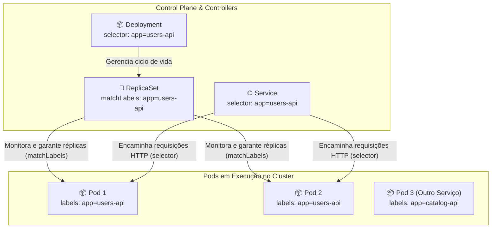
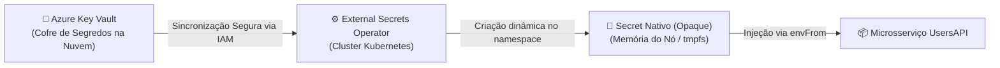
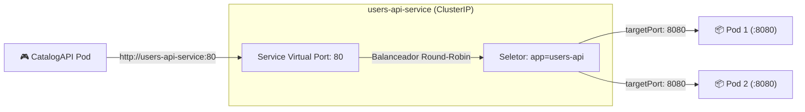
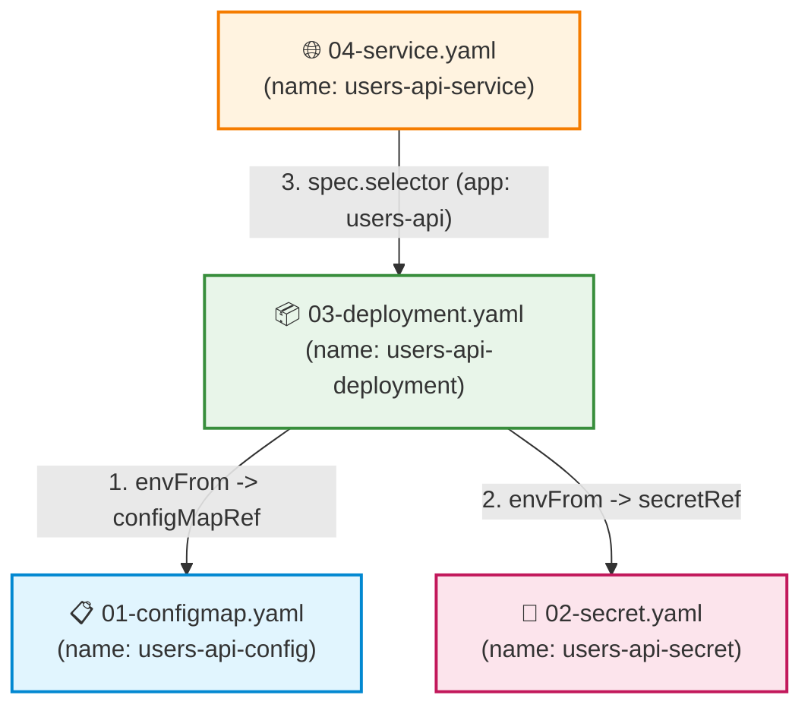

# Manifestos YAML e Tipos de Configuração no Kubernetes

Neste segundo módulo do guia de **Kubernetes (K8s)**, você aprenderá a dominar a modelagem declarativa de infraestrutura através de arquivos YAML. Vamos dissecar o funcionamento das **Labels e Selectors** (a "cola" arquitetural que conecta todo o ecossistema K8s), as quatro configurações essenciais (**ConfigMap**, **Secret** e seus diferentes tipos nativos, **Deployment** e **Service**), entender a função de cada campo, aprender como esses arquivos se amarram e se referenciam mutuamente, e demonstrar como consolidar todos os recursos em um único arquivo de implantação utilizando o delimitador `---`.

---

## 📑 Sumário

- [1. O Modelo Declarativo de Manifestos (YAML)](#1-o-modelo-declarativo-de-manifestos-yaml)
  - [1.1. Imperativo vs. Declarativo](#11-imperativo-vs-declarativo)
  - [1.2. A Estrutura Universal de um Manifesto Kubernetes](#12-a-estrutura-universal-de-um-manifesto-kubernetes)
- [2. Labels e Selectors: O Mecanismo Fundamental de Associação](#2-labels-e-selectors-o-mecanismo-fundamental-de-associação)
  - [2.1. O que são Labels e para que servem?](#21-o-que-são-labels-e-para-que-servem)
  - [2.2. Como o Kubernetes utiliza Labels internamente (Control Plane e Orquestração)](#22-como-o-kubernetes-utiliza-labels-internamente-control-plane-e-orquestração)
  - [2.3. Como o Operador e Engenheiro DevOps utilizam Labels (Filtros, Observabilidade e Operações)](#23-como-o-operador-e-engenheiro-devops-utilizam-labels-filtros-observabilidade-e-operações)
  - [2.4. Labels vs. Annotations (Quando usar cada uma?)](#24-labels-vs-annotations-quando-usar-cada-uma)
  - [2.5. Padrão Recomendado Oficial (`app.kubernetes.io/*`)](#25-padrão-recomendado-oficial-appkubernetesio)
  - [2.6. Anti-padrões: Quando NÃO devemos utilizar Labels?](#26-anti-padrões-quando-não-devemos-utilizar-labels)
- [3. ConfigMap: Configurações Públicas Desacopladas](#3-configmap-configurações-públicas-desacopladas)
  - [3.1. O que é e quando utilizar?](#31-o-que-é-e-quando-utilizar)
  - [3.2. Exemplo Real: `01-configmap.yaml`](#32-exemplo-real-01-configmapyaml)
  - [3.3. Explicação dos Campos](#33-explicação-dos-campos)
- [4. Secret: Proteção de Credenciais Sensíveis e Tipos Nativos](#4-secret-proteção-de-credenciais-sensíveis-e-tipos-nativos)
  - [4.1. A Seção `data:` (Base64 Obrigatório) vs. `stringData:`](#41-a-seção-data-base64-obrigatório-vs-stringdata)
  - [4.2. Exemplo Real: `02-secret.yaml` (Conexão Azure Database)](#42-exemplo-real-02-secretyaml-conexão-azure-database)
  - [4.3. Como Gerar Strings em Base64 no Terminal](#43-como-gerar-strings-em-base64-no-terminal)
  - [4.4. Tipos Nativos de Secrets (`type:`) no Kubernetes](#44-tipos-nativos-de-secrets-type-no-kubernetes)
    - [4.4.1. `Opaque` (Padrão genérico de dados customizados)](#441-opaque-padrão-genérico-de-dados-customizados)
    - [4.4.2. `kubernetes.io/service-account-token` (Identidade de Pods perante o cluster)](#442-kubernetesioservice-account-token-identidade-de-pods-perante-o-cluster)
    - [4.4.3. `kubernetes.io/dockercfg` e `kubernetes.io/dockerconfigjson` (ImagePullSecrets para Registries Privados)](#443-kubernetesiodockercfg-e-kubernetesiodockerconfigjson-imagepullsecrets-para-registries-privados)
    - [4.4.4. `kubernetes.io/basic-auth` (Credenciais de Autenticação Básica)](#444-kubernetesiobasic-auth-credenciais-de-autenticação-básica)
    - [4.4.5. `kubernetes.io/ssh-auth` (Chaves SSH para GitOps e Pipelines)](#445-kubernetesiossh-auth-chaves-ssh-para-gitops-e-pipelines)
    - [4.4.6. `kubernetes.io/tls` (Certificados HTTPS e Ingress)](#446-kubernetesiotls-certificados-https-e-ingress)
    - [4.4.7. `bootstrap.kubernetes.io/token` (Tokens de Ingresso de Nós no Cluster)](#447-bootstrapkubernetesiotoken-tokens-de-ingresso-de-nós-no-cluster)
  - [4.5. Segurança em Produção: Base64 NÃO é Criptografia](#45-segurança-em-produção-base64-não-é-criptografia)
- [5. Deployment: Gestão de Cargas de Trabalho e Réplicas](#5-deployment-gestão-de-cargas-de-trabalho-e-réplicas)
  - [5.1. Exemplo Real: `03-deployment.yaml`](#51-exemplo-real-03-deploymentyaml)
  - [5.2. Dissecando os Campos Críticos do Deployment](#52-dissecando-os-campos-críticos-do-deployment)
  - [5.3. Estratégia de Atualização sem Downtime (`RollingUpdate`)](#53-estratégia-de-atualização-sem-downtime-rollingupdate)
  - [5.4. Governança de Recursos: `requests` vs. `limits`](#54-governança-de-recursos-requests-vs-limits)
  - [5.5. Sondas de Integridade: `readinessProbe` e `livenessProbe`](#55-sondas-de-integridade-readinessprobe-e-livenessprobe)
- [6. Service: Abstração de Rede Estável e Balanceamento](#6-service-abstração-de-rede-estável-e-balanceamento)
  - [6.1. O Problema dos IPs Voláteis dos Pods](#61-o-problema-dos-ips-voláteis-dos-pods)
  - [6.2. Tipos de Service (`ClusterIP`, `NodePort`, `LoadBalancer`)](#62-tipos-de-service-clusterip-nodeport-loadbalancer)
  - [6.3. Exemplo Real: `04-service.yaml`](#63-exemplo-real-04-serviceyaml)
  - [6.4. Relação entre `port` e `targetPort`](#64-relação-entre-port-e-targetport)
- [7. Como os Arquivos se Referenciam Mutuamente (Rastreabilidade)](#7-como-os-arquivos-se-referenciam-mutuamente-rastreabilidade)
  - [7.1. Diagrama de Relacionamento entre Recursos](#71-diagrama-de-relacionamento-entre-recursos)
- [8. Manifestos Consolidados: Todos os Recursos no Mesmo Arquivo](#8-manifestos-consolidados-todos-os-recursos-no-mesmo-arquivo)
  - [8.1. O Delimitador YAML `---`](#81-o-delimitador-yaml----)
  - [8.2. Exemplo Prático de Arquivo Único Consolidado](#82-exemplo-prático-de-arquivo-único-consolidado)
  - [8.3. Vantagens e Trade-offs (Arquivos Separados vs. Arquivo Único)](#83-vantagens-e-trade-offs-arquivos-separados-vs-arquivo-único)
- [9. Navegação](#9-navegação)

---

## 1. O Modelo Declarativo de Manifestos (YAML)

### 1.1. Imperativo vs. Declarativo
- **Abordagem Imperativa (Comandos CLI):** Você diz ao Kubernetes *o que fazer passo a passo* (ex: `kubectl create deployment api --image=...`). É rápido para testes pontuais, mas difícil de reproduzir, auditar e versionar no Git.
- **Abordagem Declarativa (Manifestos YAML):** Você declara **o estado final desejado do sistema** em um arquivo de texto e executa `kubectl apply -f meu-arquivo.yaml`. O Kubernetes compara o estado atual com o declarado e aplica apenas as mudanças necessárias para convergir o cluster ao estado desejado.

### 1.2. A Estrutura Universal de um Manifesto Kubernetes
Todo e qualquer objeto no Kubernetes (seja um Pod, ConfigMap, Secret, Service ou Deployment) possui obrigatoriamente 4 blocos raiz em sua estrutura:

```yaml
apiVersion: <grupo>/<versao>   # Versão da API do Kubernetes para este recurso específico
kind: <TipoDoObjeto>           # Qual objeto estamos criando (ConfigMap, Secret, Deployment, Service)
metadata:                      # Metadados de identificação do objeto
  name: <nome-exclusivo>       # Nome único do recurso dentro do namespace
  namespace: default           # Em qual namespace o objeto reside (default se omitido)
  labels:                      # Etiquetas chave-valor usadas para agrupamento e seleção
    app: meu-microsservico
spec:                          # Especificação detalhada do estado desejado (varia por kind)
  ...
```

---

## 2. Labels e Selectors: O Mecanismo Fundamental de Associação

### 2.1. O que são Labels e para que servem?
No Kubernetes, **Labels** são pares de chave e valor (`key: value`) anexados aos objetos (Pods, Services, Deployments, Nós, ConfigMaps, Secrets) dentro do bloco `metadata.labels`.

Ao contrário de sistemas tradicionais que organizam componentes em pastas rígidas ou hierarquias engessadas, o Kubernetes utiliza um modelo de **organização multidimensional e fracamente acoplado (*Loose Coupling*)**:
- Um objeto pode conter **múltiplas labels simultâneas**.
- Vários objetos de tipos diferentes podem compartilhar as mesmas labels.
- Labels podem ser criadas, alteradas ou removidas em tempo de execução sem recriar ou interromper o ciclo de vida do recurso.

```yaml
metadata:
  name: users-api-deployment
  labels:
    app: users-api
    environment: production
    tier: backend
    team: core-games
```

#### Regras Sintáticas de Labels:
- **Chave (`key`):** Pode conter um prefixo opcional de domínio DNS e um nome separado por barra (`prefixo/nome`).
  - O prefixo deve ser um subdomínio DNS válido (máximo de 253 caracteres, ex: `app.kubernetes.io/` ou `fiap.com.br/`).
  - O nome é obrigatório (até 63 caracteres, iniciando e terminando com caractere alfanumérico `[a-z0-9A-Z]`, aceitando hífens `-`, sublinhados `_` e pontos `.`).
- **Valor (`value`):** Até 63 caracteres (ou vazio `""`), iniciando e terminando com alfanuméricos, aceitando hífens, sublinhados e pontos.

---

### 2.2. Como o Kubernetes utiliza Labels internamente (Control Plane e Orquestração)

O motor do Kubernetes não opera por "ponteiros fixos" entre recursos. O Control Plane e seus controladores utilizam **Label Selectors** para descobrir e conectar dinamicamente componentes em tempo real:



1. **Deployments e ReplicaSets:**  
   O Deployment gerencia um ReplicaSet. O ReplicaSet possui um campo `spec.selector.matchLabels`. O controlador do ReplicaSet conta constantemente quantos Pods no cluster possuem essa label exata. Se um Pod travar ou o nó físico cair, o controlador nota que há menos Pods do que o declarado no `replicas:` e cria outro imediatamente (*Reconciliation Loop*).
2. **Services e Endpoints / EndpointSlices:**  
   O `spec.selector` de um Service procura todos os Pods ativos que possuam os rótulos correspondentes. O Kubernetes popula automaticamente uma lista de IPs de rede privada (*Endpoints*). Quando um novo Pod fica saudável (`readinessProbe: OK`), ele é incluído no balanceamento de carga sem reiniciar o Service.
3. **NetworkPolicies (Firewall Interno de Microsserviços):**  
   Políticas de segurança de rede utilizam seletores de Pods e Namespaces. Por exemplo: *"Permitir conexões na porta 5432 do PostgreSQL apenas se o Pod de origem tiver a label `role: payments-backend`"*.
4. **Agendamento de Pods nos Nós (Scheduling com `nodeSelector` e `nodeAffinity`):**  
   Você pode rotular nós físicos do cluster (ex: `disktype: ssd`, `gpu: nvidia-a100`, `topology.kubernetes.io/zone: brazilsouth-1`) e instruir o `kube-scheduler` a posicionar Pods de banco de dados exclusivamente em nós com discos rápidos.
5. **Autoscaling com HPA (Horizontal Pod Autoscaler) e KEDA:**  
   O autoscaler monitora métricas de CPU, memória ou mensagens na fila do RabbitMQ direcionando as ações de escala para os deployments identificados pelas labels.

---

### 2.3. Como o Operador e Engenheiro DevOps utilizam Labels (Filtros, Observabilidade e Operações)

Para o operador humano, engenheiro DevOps ou pipelines de CI/CD, as labels são a principal ferramenta de busca, diagnóstico e governança.

#### 1. Filtros Baseados em Igualdade (`=`, `==`, `!=`):
Permitem buscar recursos que possuam ou não determinados valores exatos:

```powershell
# Listar apenas os Pods da UsersAPI
kubectl get pods -l app=users-api

# Filtrar por múltiplos critérios simultâneos (Operação E / AND lógica)
kubectl get pods -l app=users-api,environment=production

# Listar todos os serviços que NÃO pertencem a homologação
kubectl get services -l environment!=staging
```

#### 2. Filtros Baseados em Conjunto (`in`, `notin`, `exists`, `!exists`):
Permitem consultas ricas de múltiplos valores ou verificação de existência da chave:

```powershell
# Listar pods cujo ambiente seja staging OU production
kubectl get pods -l 'environment in (staging, production)'

# Listar pods de componentes que NÃO sejam do frontend
kubectl get pods -l 'tier notin (frontend)'

# Listar todos os pods que possuem a label 'canary' (independente do valor)
kubectl get pods -l canary

# Listar todos os pods que NÃO possuem a label 'legacy'
kubectl get pods -l '!legacy'
```

#### 3. Operações em Lote e Inspeção Visual:
```powershell
# Deletar todos os Pods de uma determinada versão para forçar recriação
kubectl delete pods -l app=users-api,version=v1.0.0

# Exibir os recursos adicionando colunas customizadas para cada label
kubectl get pods -L app,environment,version

# Listar todos os recursos imprimindo todas as suas labels completas
kubectl get pods --show-labels

# Adicionar ou modificar uma label a quente em um Pod em execução
kubectl label pod users-api-deployment-78f9b6-abc12 release=hotfix --overwrite
```

#### 4. Observabilidade e Coleta de Logs:
- **Prometheus:** Ferramentas de métricas utilizam `ServiceMonitors` que usam labels como `prometheus.io/scrape: "true"` para descobrir automaticamente quais microsserviços devem ter métricas coletadas.
- **Loki / Fluentd / Datadog:** Ao coletar logs do stdout das APIs, esses agentes anexam automaticamente todas as labels do Pod ao registro de log. Isso viabiliza consultas como `{app="users-api", environment="production"} |= "Exception"`.

---

### 2.4. Labels vs. Annotations (Quando usar cada uma?)

No bloco `metadata:`, o Kubernetes aceita tanto `labels:` quanto `annotations:`. Embora ambos sejam mapas chave-valor (`string: string`), seus propósitos arquiteturais são totalmente distintos:

| Característica | **Labels (`metadata.labels`)** | **Annotations (`metadata.annotations`)** |
|---|---|---|
| **Objetivo Principal** | **Identificação, agrupamento e seleção** de recursos. | **Armazenamento de metadados não identificadores** e anexos técnicos. |
| **Indexação pelo K8s** | **Sim.** São indexadas no banco `etcd` para consultas ultra-rápidas. | **Não.** Não são indexadas para buscas estruturadas por seletores. |
| **Suporte a Seletores CLI** | Suporta consultas via `-l` ou `--selector` no `kubectl`. | **Não pode ser consultada via seletores.** |
| **Limite de Tamanho** | Estrito: chaves e valores com **máximo de 63 caracteres**. | Amplo: suporta **strings longas, JSON, YAML e certificados (até 256 KB)**. |
| **Consumidores** | Kube-scheduler, ReplicaSets, Services, HPA, Engenheiros. | Controladores de terceiros, Ingress Controllers, ferramentas de CI/CD. |
| **Exemplos Típicos** | `app: users-api`, `env: production`, `tier: backend`. | Parâmetros de Ingress Nginx, commit SHA do Git, links de documentação. |

#### Exemplo Prático de Annotations:
```yaml
metadata:
  name: users-api-ingress
  labels:
    app.kubernetes.io/name: users-api
  annotations:
    # Instrução para o Ingress Controller Nginx reescrever a URL
    nginx.ingress.kubernetes.io/rewrite-target: /$1
    # Instrução para o cert-manager emitir certificado TLS Let's Encrypt
    cert-manager.io/cluster-issuer: "letsencrypt-production"
    # Rastreabilidade de engenharia (hash de commit do repositório)
    build.fiap.com/git-commit: "9a4f21d8e"
```

---

### 2.5. Padrão Recomendado Oficial (`app.kubernetes.io/*`)

Para evitar anarquia de nomenclatura (ex: um desenvolvedor usar `app: users`, outro `service: users-api` e um terceiro `application_name: users`), a comunidade oficial do Kubernetes e a CNCF padronizaram um conjunto de **Recommended Labels** sob o prefixo `app.kubernetes.io/`.

Essas labels são interpretadas nativamente por ferramentas do ecossistema como **Helm**, **ArgoCD**, **Kustomize**, **Portainer** e **OpenShift**:

| Label Oficial | Propósito | Exemplo no FIAP Cloud Games |
|---|---|---|
| **`app.kubernetes.io/name`** | Nome da aplicação ou microsserviço. | `users-api` |
| **`app.kubernetes.io/instance`** | Identificador único daquela implantação/instância. | `users-api-prod` |
| **`app.kubernetes.io/version`** | Versão semântica ou tag da imagem implantada. | `1.0.0` |
| **`app.kubernetes.io/component`** | Papel arquitetural do componente. | `backend` (ou `database`, `worker`) |
| **`app.kubernetes.io/part-of`** | Nome da solução ou sistema de nível superior. | `fiap-cloud-games` |
| **`app.kubernetes.io/managed-by`** | Ferramenta utilizada para gerenciar o recurso. | `kubectl` (ou `helm`, `argocd`) |

#### Exemplo com o Padrão Recomendado Aplicado:
```yaml
apiVersion: apps/v1
kind: Deployment
metadata:
  name: users-api-deployment
  labels:
    app.kubernetes.io/name: users-api
    app.kubernetes.io/instance: users-api-prod
    app.kubernetes.io/version: "1.0.0"
    app.kubernetes.io/component: backend
    app.kubernetes.io/part-of: fiap-cloud-games
    app.kubernetes.io/managed-by: kubectl
spec:
  selector:
    matchLabels:
      app.kubernetes.io/name: users-api
      app.kubernetes.io/instance: users-api-prod
  template:
    metadata:
      labels:
        app.kubernetes.io/name: users-api
        app.kubernetes.io/instance: users-api-prod
        app.kubernetes.io/version: "1.0.0"
        app.kubernetes.io/component: backend
        app.kubernetes.io/part-of: fiap-cloud-games
```

---

### 2.6. Anti-padrões: Quando NÃO devemos utilizar Labels?

Embora extremamente poderosas, o uso inadequado de labels pode causar vazamento de dados, falhas de segurança e degradação severa do cluster:

1. ❌ **Armazenar Dados Sensíveis ou Senhas:**  
   Labels **nunca são criptografadas nem ofuscadas**. Qualquer usuário com permissão mínima de visualização (`kubectl get pods --show-labels`) visualiza seus valores em texto plano. Elas também são registradas abertamente no histórico de eventos do cluster.  
   👉 **Regra:** Nunca coloque tokens JWT, senhas de banco ou chaves de API em labels. Use objetos **`Secret`**.
2. ❌ **Dados de Alta Cardinalidade ou Valores Voláteis:**  
   Colocar valores que mudam a cada requisição ou que possuem infinitas variações (ex: `order-id: 98124`, `timestamp: 1730000000`, `user-id: 5412`, `session-id: abc`) é um dos piores erros em Kubernetes.  
   O banco `etcd` mantém todas as labels em cache de memória do `kube-apiserver` para consultas rápidas. Centenas de milhares de valores únicos geram **saturação de memória no Control Plane** e lentidão generalizada no cluster.
3. ❌ **Grandes Volumes de Dados, JSONs ou Arquivos:**  
   Labels suportam no máximo 63 caracteres. Tentar comprimir parâmetros longos ou esquemas de configuração em labels causa erro de validação.  
   👉 **Regra:** Use **`ConfigMap`** ou o campo **`metadata.annotations`**.
4. ❌ **Substituir o Identificador Primário (`metadata.name`):**  
   Não utilize labels na tentativa de criar uma chave primária customizada quando o Kubernetes já fornece o campo `metadata.name` como identificador único dentro do namespace.

---

## 3. ConfigMap: Configurações Públicas Desacopladas

### 3.1. O que é e quando utilizar?
O **ConfigMap** armazena pares de chave-valor contendo parâmetros de configuração que **não são confidenciais**: URLs de brokers, nomes de exchanges, portas de rede, nível de log e identificadores de ambiente.

Ele permite que a mesma imagem Docker ([📖 Ver Módulo de Imagens Docker](../docker/02-dockerfile-dockerignore-e-imagens.md)) execute em Desenvolvimento, Homologação ou Produção alterando apenas o ConfigMap do cluster, sem recompilar uma única linha de código.

### 3.2. Exemplo Real: `01-configmap.yaml`
Localização: `fcg-fase-02--users/k8s/01-configmap.yaml`

```yaml
apiVersion: v1
kind: ConfigMap
metadata:
  name: users-api-config
  labels:
    app: users-api
data:
  ASPNETCORE_ENVIRONMENT: "Production"
  RabbitMQ__HostName: "rabbitmq-service"
  RabbitMQ__Port: "5672"
  RabbitMQ__UserName: "guest"
  RabbitMQ__Exchange: "fcg.users.events"
  Jwt__Issuer: "FCG02.UsersAPI"
  Jwt__Audience: "FCG02.CloudGamesClients"
```

### 3.3. Explicação dos Campos
- `apiVersion: v1`: ConfigMaps pertencem ao grupo de APIs fundamental (core) do Kubernetes.
- `metadata.name: users-api-config`: O identificador que será referenciado pelo `Deployment` mais adiante.
- `data:`: Dicionário de variáveis. Observe o padrão de hierarquia do ASP.NET Core utilizando duplo underscore (`__`):  
  A chave `RabbitMQ__HostName` sobrescreve automaticamente a seção `RabbitMQ:HostName` do arquivo `appsettings.json` da API em tempo de execução.

---

## 4. Secret: Proteção de Credenciais Sensíveis e Tipos Nativos

O objeto **Secret** armazena dados confidenciais: senhas de banco de dados, chaves simétricas de tokens JWT, credenciais de mensageria, chaves SSH e certificados SSL/TLS.

### 4.1. A Seção `data:` (Base64 Obrigatório) vs. `stringData:`
O Kubernetes oferece duas formas de declarar dados em um Secret:

| Campo no YAML | Formato Esperado | Comportamento Interno |
|---|---|---|
| **`data:`** | **Estritamente Base64** | O valor já deve estar codificado em Base64 antes de ser gravado no YAML. É o formato padrão e mais seguro para auditorias. |
| **`stringData:`** | Texto Plano (Legível) | O Kubernetes lê o texto simples e o converte para Base64 nos bastidores ao criar o objeto. Não deve ser comitado em repositórios públicos. |

### 4.2. Exemplo Real: `02-secret.yaml` (Conexão Azure Database)
Localização: `fcg-fase-02--users/k8s/02-secret.yaml`

```yaml
# Secret protege dados sensíveis (senhas de bancos, senhas de mensageria, chaves JWT)
# Regra: valores declarados na seção 'data' de um manifesto Secret devem estar obrigatoriamente codificados em Base64

apiVersion: v1
kind: Secret
metadata:
  name: users-api-secret
  labels:
    app: users-api
type: Opaque
data:
  # ConnectionString completa do Azure Database (fcg-02-usersdb) em Base64
  ConnectionStrings__DefaultConnection: U2VydmVyPXRjcDpmY2ctc2VydmVyLmRhdGFiYXNlLndpbmRvd3MubmV0LDE0MzM7SW5pdGlhbCBDYXRhbG9nPWZjZy0wMi11c2Vyc2RiO1BlcnNpc3QgU2VjdXJpdHkgSW5mbz1GYWxzZTtVc2VyIElEPWZjZy1zYTtQYXNzd29yZD1mMUBwLWNsdW9kLWdhbTNzO011bHRpcGxlQWN0aXZlUmVzdWx0U2V0cz1UcnVlO0VuY3J5cHQ9VHJ1ZTtUcnVzdFNlcnZlckNlcnRpZmljYXRlPVRydWU7Q29ubmVjdGlvbiBUaW1lb3V0PTkwOw==
  # Senha do RabbitMQ (guest) em Base64
  RabbitMQ__Password: Z3Vlc3Q=
  # Chave simétrica HMAC-SHA256 do JWT em Base64
  Jwt__SecretKey: Q2hhdmVTdXBlclNlY3JldGFFRm9ydGVDb21NYWlzRGUzMkNhcmFjdGVyZXNGSUFQQ2xvdWRHYW1lczIwMjYh
```

### 4.3. Como Gerar Strings em Base64 no Terminal

#### No PowerShell (Windows):
```powershell
[Convert]::ToBase64String([System.Text.Encoding]::UTF8.GetBytes("meu-texto-secreto"))
```

#### No Node.js (Terminal do VS Code):
```powershell
node -e "console.log(Buffer.from('meu-texto-secreto').toString('base64'))"
```

#### No Linux / WSL 2 / Git Bash:
```bash
echo -n "meu-texto-secreto" | base64
```

---

### 4.4. Tipos Nativos de Secrets (`type:`) no Kubernetes

O campo `type:` no cabeçalho do Secret não é meramente informativo. Ele instrui o Kubernetes sobre **a finalidade do segredo** e ativa **validações programáticas de estrutura e chaves obrigatórias**. Se você declarar um tipo específico e omitir uma chave esperada, a API do Kubernetes rejeitará a criação do recurso com erro de validação.

Abaixo estão todos os tipos nativos de Secrets suportados pelo Kubernetes:

| Tipo do Secret (`type:`) | Finalidade Principal | Chaves Obrigatórias / Esperadas |
|---|---|---|
| **`Opaque`** | Dados genéricos arbitrários de aplicação (padrão). | Chaves livres definidas pelo usuário. |
| **`kubernetes.io/service-account-token`** | Token de autenticação interna de Pods perante o cluster. | `token`, `ca.crt`, `namespace` |
| **`kubernetes.io/dockerconfigjson`** | Autenticação em Registries de Contêineres Privados (ACR, Docker Hub). | `.dockerconfigjson` |
| **`kubernetes.io/dockercfg`** | Formato legado de autenticação Docker (`~/.dockercfg`). | `.dockercfg` |
| **`kubernetes.io/basic-auth`** | Autenticação HTTP Básica (RFC 7617). | `username`, `password` |
| **`kubernetes.io/ssh-auth`** | Chaves criptográficas SSH para pipelines e GitOps. | `ssh-privatekey` (opcional: `known_hosts`) |
| **`kubernetes.io/tls`** | Terminação de criptografia TLS/HTTPS e certificados digitais. | `tls.crt`, `tls.key` |
| **`bootstrap.kubernetes.io/token`** | Tokens de bootstrap de nós em inicialização via `kubeadm`. | `token-id`, `token-secret`, `usage-bootstrap-*` |

---

#### 4.4.1. `Opaque` (Padrão genérico de dados customizados)
É o tipo utilizado quando o campo `type:` é omitido ou explicitamente definido como `Opaque`. Não impõe restrições de formato às chaves. É o formato ideal para armazenar strings de conexão do banco de dados, chaves de criptografia JWT, credenciais de mensageria e tokens de APIs de terceiros.

```yaml
apiVersion: v1
kind: Secret
metadata:
  name: users-api-secret
type: Opaque
data:
  RabbitMQ__Password: Z3Vlc3Q=
```

---

#### 4.4.2. `kubernetes.io/service-account-token` (Identidade de Pods perante o cluster)
Utilizado para autenticar requisições que partem de dentro de um Pod diretamente para a API do Kubernetes (`kube-apiserver`).
- Contém o certificado raiz do cluster (`ca.crt`) e o token JWT assinado (`token`).
- *Evolução Técnica:* Em versões modernas do Kubernetes (1.24+), os tokens de ServiceAccount são projetados dinamicamente em volumes efêmeros com validade curta via *Bound Service Account Token Volume*, mas o tipo `Secret` continua amplamente utilizado para tokens de longa duração exigidos por esteiras externas de CI/CD.

---

#### 4.4.3. `kubernetes.io/dockercfg` e `kubernetes.io/dockerconfigjson` (ImagePullSecrets para Registries Privados)
Quando você armazena as imagens Docker dos microsserviços em um registry privado — como o **Azure Container Registry (ACR)**, **AWS ECR** ou repositórios privados do **Docker Hub** —, os nós do Kubernetes não conseguem baixar as imagens sem autenticação prévia.

O Secret do tipo `kubernetes.io/dockerconfigjson` empacota as credenciais do registry em formato JSON padronizado na chave `.dockerconfigjson`.

##### Criação via linha de comando imperativa (`kubectl`):
```powershell
kubectl create secret docker-registry acr-secret `
  --docker-server=fcgregistry.azurecr.io `
  --docker-username=fcg-sp `
  --docker-password=senha-do-service-principal `
  --docker-email=devops@fiapcloudgames.com
```

##### Como utilizar no Deployment (`imagePullSecrets`):
```yaml
apiVersion: apps/v1
kind: Deployment
metadata:
  name: users-api-deployment
spec:
  template:
    spec:
      # Instrução ao kubelet para utilizar o Secret ao autenticar no ACR
      imagePullSecrets:
        - name: acr-secret
      containers:
        - name: users-api
          image: fcgregistry.azurecr.io/users-api:1.0.0
```

---

#### 4.4.4. `kubernetes.io/basic-auth` (Credenciais de Autenticação Básica)
Padroniza credenciais para sistemas que operam com autenticação básica HTTP (RFC 7617). O Kubernetes valida a presença de duas chaves na seção `data` ou `stringData`:
- `username`: Nome do usuário em Base64.
- `password`: Senha correspondente em Base64.

Muito utilizado por operadores e Ingress Controllers para proteger rotas públicas de monitoramento (ex: endpoints do Prometheus ou RabbitMQ Management) exigindo usuário e senha no navegador.

---

#### 4.4.5. `kubernetes.io/ssh-auth` (Chaves SSH para GitOps e Pipelines)
Armazena chaves privadas para autenticação via SSH sem senha.
- **Chave obrigatória:** `ssh-privatekey` (contendo o conteúdo da chave privada RSA ou Ed25519 em Base64).
- **Chave opcional:** `known_hosts` (para evitar vulnerabilidades de *Man-In-The-Middle* verificando a assinatura do servidor remoto).

É o padrão adotado por operadores GitOps como **ArgoCD** e **FluxCD** para autenticar e clonar repositórios Git corporativos privados via `git@github.com:...`.

---

#### 4.4.6. `kubernetes.io/tls` (Certificados HTTPS e Ingress)
Padroniza a terminação de criptografia de ponta a ponta na camada de rede. O Kubernetes exige obrigatoriamente duas chaves e valida se o formato corresponde a arquivos PEM legítimos:
- **`tls.crt`:** O certificado público X.509 assinado (incluindo as cadeias intermediárias).
- **`tls.key`:** A chave criptográfica privada correspondente.

Esse tipo de Secret é consumido nativamente por **Ingress Controllers** (ex: Nginx Ingress, Traefik, Azure Application Gateway Ingress Controller - AGIC) e gerado automaticamente pelo operador **cert-manager** com renovação automática via Let's Encrypt.

##### Exemplo de Uso no Ingress:
```yaml
apiVersion: networking.k8s.io/v1
kind: Ingress
metadata:
  name: cloud-games-ingress
spec:
  tls:
    - hosts:
        - api.fiapcloudgames.com
      secretName: cloudgames-tls-secret  # Secret do tipo kubernetes.io/tls
  rules:
    - host: api.fiapcloudgames.com
      http:
        paths:
          - path: /users
            pathType: Prefix
            backend:
              service:
                name: users-api-service
                port:
                  number: 80
```

---

#### 4.4.7. `bootstrap.kubernetes.io/token` (Tokens de Ingresso de Nós no Cluster)
Tipo especializado utilizado quase que exclusivamente durante a criação de clusters via ferramentas de orquestração como o `kubeadm`. Armazena tokens com formato rigoroso (`[a-z0-9]{6}\.[a-z0-9]{16}`) utilizados para autorizar com segurança a entrada de novos servidores físicos ou virtuais (*Worker Nodes*) no pool do cluster.

---

### 4.5. Segurança em Produção: Base64 NÃO é Criptografia

> ⚠️ **ALERTA CRÍTICO DE SEGURANÇA**  
> **Base64 é apenas um método de codificação (*encoding*) reversível, e NÃO criptografia (*encryption*)!**  
> Qualquer pessoa ou script com permissão de leitura sobre o manifesto pode decodificar os valores instantaneamente através de `echo "U2VydmVy..." | base64 --decode`.  
> **Nunca comite arquivos `Secret.yaml` com valores reais em repositórios Git públicos.**

Para garantir segurança rigorosa em ambientes corporativos e em produção na nuvem, adote as seguintes práticas recomendadas:



1. **Controle de Acesso Baseado em Papéis (RBAC):**  
   Restrinja as permissões da API do Kubernetes para que desenvolvedores comuns e ServiceAccounts não possuam privilégios de `get` ou `list` em recursos do tipo `secrets`.
2. **Criptografia em Repouso no etcd (*Encryption at Rest*):**  
   Por padrão, o Kubernetes grava os dados no `etcd` sem criptografia. Em clusters de produção (como o **Azure AKS**), a criptografia em repouso deve ser ativada utilizando um provedor KMS (*Key Management Service*), garantindo que os dados armazenados em disco estejam cifrados por hardware.
3. **Secrets Imutáveis (`immutable: true`):**  
   Adicionar `immutable: true` ao cabeçalho do Secret impede que seus dados sejam modificados acidentalmente e desativa a checagem periódica do `kubelet`, reduzindo drasticamente o consumo de CPU do `kube-apiserver` em clusters com milhares de Pods.
4. **Padrão Moderno Cloud: External Secrets Operator (ESO) ou Secrets Store CSI Driver:**  
   Em arquiteturas modernas de nuvem e GitOps, o manifesto YAML comitado no repositório **não contém credencial alguma**. As senhas reais residem em um cofre corporativo como o **Azure Key Vault** ou **AWS Secrets Manager**. O operador (ex: External Secrets Operator) autentica-se com segurança via identidade gerenciada na nuvem e provisiona o `Secret` diretamente na memória do cluster.

---

## 5. Deployment: Gestão de Cargas de Trabalho e Réplicas

O **Deployment** é o objeto mais importante para desenvolvedores. Ele gerencia o ciclo de vida dos Pods, garante que a quantidade correta de réplicas esteja em execução e automatiza atualizações de versão sem derrubar o serviço.

### 5.1. Exemplo Real: `03-deployment.yaml`
Localização: `fcg-fase-02--users/k8s/03-deployment.yaml`

```yaml
apiVersion: apps/v1
kind: Deployment
metadata:
  name: users-api-deployment
  labels:
    app: users-api
spec:
  replicas: 2
  strategy:
    type: RollingUpdate
    rollingUpdate:
      maxSurge: 1
      maxUnavailable: 0
  selector:
    matchLabels:
      app: users-api
  template:
    metadata:
      labels:
        app: users-api
    spec:
      containers:
        - name: users-api
          image: fcg02-users-api:latest
          imagePullPolicy: IfNotPresent
          ports:
            - containerPort: 8080
          envFrom:
            - configMapRef:
                name: users-api-config
            - secretRef:
                name: users-api-secret
          resources:
            requests:
              memory: "128Mi"
              cpu: "100m"
            limits:
              memory: "512Mi"
              cpu: "500m"
          readinessProbe:
            httpGet:
              path: /health
              port: 8080
            initialDelaySeconds: 5
            periodSeconds: 10
          livenessProbe:
            httpGet:
              path: /health
              port: 8080
            initialDelaySeconds: 15
            periodSeconds: 20
```

---

### 5.2. Dissecando os Campos Críticos do Deployment

1. **`replicas: 2`:** O Deployment instrui o cluster a manter **exatamente 2 instâncias ativas do Pod** simultaneamente. Se um nó cair ou um Pod sofrer falha, o K8s sobe outro instantaneamente.
2. **`selector.matchLabels` e `template.metadata.labels`:**  
   *Atenção:* O `matchLabels` **deve ser idêntico** ao `labels` do template do Pod (`app: users-api`). É através dessa etiqueta que o Deployment sabe quais Pods pertencem à sua governança.
3. **`imagePullPolicy:`**
   - `IfNotPresent` (Recomendado para dev local): Usa a imagem presente no cache local do Docker; só baixa da internet se não existir localmente.
   - `Always`: Sempre tenta contatar o registry remoto antes de subir o contêiner.
4. **`envFrom:` (Injeção de Configurações):**
   - `configMapRef: name: users-api-config`: Puxa **todas as variáveis** do ConfigMap e as injeta como variáveis de ambiente no contêiner.
   - `secretRef: name: users-api-secret`: Decodifica automaticamente todos os segredos em Base64 do Secret e os injeta como variáveis no contêiner.

---

### 5.3. Estratégia de Atualização sem Downtime (`RollingUpdate`)
A configuração `maxUnavailable: 0` e `maxSurge: 1` garante **Zero Downtime**:
- O K8s sobe 1 novo Pod com a versão atualizada (`maxSurge: 1`).
- O tráfego dos usuários continua sendo atendido pelos 2 Pods antigos.
- O K8s aguarda a sonda `readinessProbe` do Pod novo responder `200 OK`.
- Só então ele desliga 1 Pod antigo e repete o processo até substituir todos!

---

### 5.4. Governança de Recursos: `requests` vs. `limits`

- **`requests` (Garantia Mínima):** Quanto de CPU e RAM o Pod precisa para ser agendado em um nó.
  - `memory: "128Mi"`: O scheduler só coloca o Pod em um nó que tenha pelo menos 128 Megabytes livres.
  - `cpu: "100m"`: 100 millicores (ou 10% de 1 núcleo de CPU).
- **`limits` (Teto Máximo):** O limite rígido que o contêiner pode atingir.
  - Se a aplicação ultrapassar o limit de memória (`512Mi`), o Linux mata o processo com erro de **OOMKilled** (*Out Of Memory*), protegendo o servidor.

---

### 5.5. Sondas de Integridade: `readinessProbe` e `livenessProbe`

Ambas disparam requisições HTTP automáticas contra o endpoint `/health` nativo do ASP.NET Core:

- **`readinessProbe` (Estou pronto para receber tráfego?):**  
  Se a aplicação estiver subindo e o banco ainda conectando, ela responde erro. O Kubernetes **não envia tráfego de usuários para este Pod** até a sonda responder `200 OK`.
- **`livenessProbe` (Estou vivo ou travei em deadlock?):**  
  Se a aplicação congelar e parar de responder ao teste periódico, o Kubernetes mata o contêiner e o reinicia imediatamente (*Self-Healing*).

---

## 6. Service: Abstração de Rede Estável e Balanceamento

### 6.1. O Problema dos IPs Voláteis dos Pods
Cada Pod ganha um IP virtual (ex: `10.244.0.14`). Porém, Pods são efêmeros: quando você faz deploy de uma nova versão ou um Pod é reiniciado, ele ganha um **novo endereço IP aleatório**.  
Se a `CatalogAPI` tentasse chamar a `UsersAPI` pelo IP do Pod, a comunicação quebraria no primeiro deploy!

O **Service** resolve isso criando um **ponto de contato permanente**: um nome DNS estável e um IP virtual fixo (*ClusterIP*) que nunca muda.

### 6.2. Tipos de Service (`ClusterIP`, `NodePort`, `LoadBalancer`)

| Tipo | Características Técnicas | Cenário Recomendado |
|---|---|---|
| **`ClusterIP` (Padrão)** | Gera um IP virtual interno estável acessível **apenas dentro do cluster**. | **Comunicação interna entre microsserviços (Padrão do projeto).** |
| **`NodePort`** | Abre uma porta estática fixa (faixa 30000-32767) diretamente em todos os nós físicos do cluster. | Testes manuais rápidos ou clusters on-premise legados sem LoadBalancer. |
| **`LoadBalancer`** | Integra-se à nuvem pública (ex: **Azure AKS**) e provisiona um Azure Load Balancer externo com IP público real. | Expor o ponto de entrada da aplicação ou Ingress para a Internet. |
| **`ExternalName`** | Redireciona o tráfego interno do cluster para um domínio DNS externo (ex: CNAME para serviços de terceiros). | Conectar serviços internos a bancos externos na nuvem. |

---

### 6.3. Exemplo Real: `04-service.yaml`
Localização: `fcg-fase-02--users/k8s/04-service.yaml`

```yaml
apiVersion: v1
kind: Service
metadata:
  name: users-api-service
  labels:
    app: users-api
spec:
  type: ClusterIP
  selector:
    app: users-api
  ports:
    - name: http
      port: 80
      targetPort: 8080
      protocol: TCP
```

### 6.4. Relação entre `port` e `targetPort`



- **`port: 80`:** A porta em que o Service escuta dentro da rede do cluster. Outros microsserviços conectam-se usando `http://users-api-service:80`.
- **`targetPort: 8080`:** A porta real em que a aplicação .NET 10 está escutando dentro do contêiner (conforme configurado no Dockerfile com `ENV ASPNETCORE_HTTP_PORTS=8080`).
- **`selector: app: users-api`:** Qualquer Pod que possua o rótulo `app: users-api` é automaticamente incluído no pool de balanceamento deste Service.

---

## 7. Como os Arquivos se Referenciam Mutuamente (Rastreabilidade)

Entenda visualmente a amarração completa dos 4 manifestos que compõem o microsserviço:



1. O **`Deployment`** busca os nomes declarados no `metadata.name` do **`ConfigMap`** e do **`Secret`** para injetar as variáveis.
2. O **`Service`** busca a label `app: users-api` no template do **`Deployment`** para encontrar para onde encaminhar o tráfego HTTP.

---

## 8. Manifestos Consolidados: Todos os Recursos no Mesmo Arquivo

### 8.1. O Delimitador YAML `---`
No padrão oficial da especificação YAML, três hífens consecutivos (**`---`**) representam o **início de um novo documento**.

O Kubernetes suporta nativamente esse padrão: você pode concatenar o `ConfigMap`, o `Secret`, o `Deployment` e o `Service` em uma **única sequência dentro de um só arquivo `.yaml`**.

### 8.2. Exemplo Prático de Arquivo Único Consolidado

Arquivo `users-api-complete.yaml`:

```yaml
# ==============================================================================
# 1. CONFIGURAÇÕES PÚBLICAS (CONFIGMAP)
# ==============================================================================
apiVersion: v1
kind: ConfigMap
metadata:
  name: users-api-config
  labels:
    app: users-api
data:
  ASPNETCORE_ENVIRONMENT: "Production"
  RabbitMQ__HostName: "rabbitmq-service"
  RabbitMQ__Port: "5672"
  RabbitMQ__UserName: "guest"
  RabbitMQ__Exchange: "fcg.users.events"
  Jwt__Issuer: "FCG02.UsersAPI"
  Jwt__Audience: "FCG02.CloudGamesClients"

---
# ==============================================================================
# 2. CREDENCIAIS SENSÍVEIS (SECRET)
# ==============================================================================
apiVersion: v1
kind: Secret
metadata:
  name: users-api-secret
  labels:
    app: users-api
type: Opaque
data:
  ConnectionStrings__DefaultConnection: U2VydmVyPXRjcDpmY2ctc2VydmVyLmRhdGFiYXNlLndpbmRvd3MubmV0LDE0MzM7SW5pdGlhbCBDYXRhbG9nPWZjZy0wMi11c2Vyc2RiO1BlcnNpc3QgU2VjdXJpdHkgSW5mbz1GYWxzZTtVc2VyIElEPWZjZy1zYTtQYXNzd29yZD1mMUBwLWNsdW9kLWdhbTNzO011bHRpcGxlQWN0aXZlUmVzdWx0U2V0cz1UcnVlO0VuY3J5cHQ9VHJ1ZTtUcnVzdFNlcnZlckNlcnRpZmljYXRlPVRydWU7Q29ubmVjdGlvbiBUaW1lb3V0PTkwOw==
  RabbitMQ__Password: Z3Vlc3Q=
  Jwt__SecretKey: Q2hhdmVTdXBlclNlY3JldGFFRm9ydGVDb21NYWlzRGUzMkNhcmFjdGVyZXNGSUFQQ2xvdWRHYW1lczIwMjYh

---
# ==============================================================================
# 3. CARGA DE TRABALHO E RÉPLICAS (DEPLOYMENT)
# ==============================================================================
apiVersion: apps/v1
kind: Deployment
metadata:
  name: users-api-deployment
  labels:
    app: users-api
spec:
  replicas: 2
  selector:
    matchLabels:
      app: users-api
  template:
    metadata:
      labels:
        app: users-api
    spec:
      containers:
        - name: users-api
          image: fcg02-users-api:latest
          imagePullPolicy: IfNotPresent
          ports:
            - containerPort: 8080
          envFrom:
            - configMapRef:
                name: users-api-config
            - secretRef:
                name: users-api-secret
          resources:
            requests:
              memory: "128Mi"
              cpu: "100m"
            limits:
              memory: "512Mi"
              cpu: "500m"
          readinessProbe:
            httpGet:
              path: /health
              port: 8080
            initialDelaySeconds: 5
            periodSeconds: 10
          livenessProbe:
            httpGet:
              path: /health
              port: 8080
            initialDelaySeconds: 15
            periodSeconds: 20

---
# ==============================================================================
# 4. EXPOSIÇÃO DE REDE INTERNA (SERVICE)
# ==============================================================================
apiVersion: v1
kind: Service
metadata:
  name: users-api-service
  labels:
    app: users-api
spec:
  type: ClusterIP
  selector:
    app: users-api
  ports:
    - name: http
      port: 80
      targetPort: 8080
      protocol: TCP
```

Para aplicar todos os recursos de uma única vez no terminal:
```powershell
kubectl apply -f users-api-complete.yaml
```

### 8.3. Vantagens e Trade-offs (Arquivos Separados vs. Arquivo Único)

| Abordagem | Vantagens | Desvantagens | Cenário Recomendado |
|---|---|---|---|
| **Arquivos Separados (`01-..`, `02-..`)** | - Clareza e granularidade.<br/>- Controle de permissões (Segurança gerencia Secrets; Dev gerencia Deployments).<br/>- Facilita esteiras de CI/CD parciais. | Precisa aplicar múltiplos arquivos (`kubectl apply -f k8s/`). | **Padrão em projetos corporativos e no FIAP Cloud Games.** |
| **Arquivo Único Consolidado (`all-in-one.yaml`)** | - Comodidade máxima de deploy e exclusão com 1 comando.<br/>- Menos arquivos no repositório. | Fica muito extenso (> 200 linhas) e mistura permissões de segurança com deploy de código. | Demos, protótipos, documentações didáticas e testes locais. |

---

## 9. Navegação

- ⬅️ **[Voltar para a Aula 01: Conceitos e Instalação (`01-conceitos-arquitetura-e-instalacao.md`)](01-conceitos-arquitetura-e-instalacao.md)**
- 📑 **[Ir para o Índice do Guia de Kubernetes (`index.md`)](index.md)**
- ➡️ **[Avançar para a Aula 03: Atualização de Código, Rollout e Ciclo de Vida (`03-atualizacao-de-codigo-rollout-e-ciclo-de-vida.md`)](03-atualizacao-de-codigo-rollout-e-ciclo-de-vida.md)**
