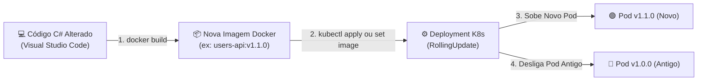
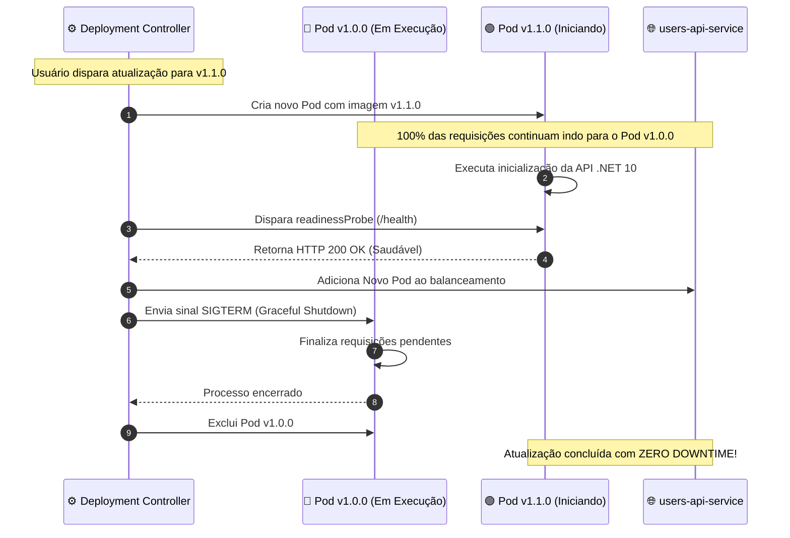

# Atualização de Código, Rollout de Imagens e Ciclo de Vida de Pods

No terceiro módulo do guia de **Kubernetes (K8s)**, você aprenderá como funciona o ciclo de desenvolvimento contínuo ao trabalhar com contêineres e clusters. Vamos entender por que alterar o código-fonte no editor não atualiza o contêiner automaticamente, o passo a passo para gerar uma nova imagem Docker versionada, como comandar o Kubernetes para atualizar a aplicação sem um único segundo de indisponibilidade (*Zero Downtime*), como reverter versões (*Rollback*) e como gerenciar o ciclo de vida dos Pods (ativação, suspensão e exclusão).

---

## 📑 Sumário

- [1. O Ciclo de Desenvolvimento no Kubernetes](#1-o-ciclo-de-desenvolvimento-no-kubernetes)
  - [1.1. "Alterei o Código em C#, Por que o Pod não Atualizou?"](#11-alterei-o-código-em-c-por-que-o-pod-não-atualizou)
  - [1.2. O Ciclo de Vida do Deploy (Código $\rightarrow$ Imagem $\rightarrow$ Pod)](#12-o-ciclo-de-vida-do-deploy-código--imagem--pod)
- [2. Passo 1: Construindo e Versionando a Nova Imagem Docker](#2-passo-1-construindo-e-versionando-a-nova-imagem-docker)
  - [2.1. O Padrão de Versionamento Semântico](#21-o-padrão-de-versionamento-semântico)
  - [2.2. Compilação Local com Nova Tag](#22-compilação-local-com-nova-tag)
- [3. Passo 2: Atualizando a Aplicação em Execução no Cluster](#3-passo-2-atualizando-a-aplicação-em-execução-no-cluster)
  - [3.1. Método 1: Atualização Declarativa (Recomendado)](#31-método-1-atualização-declarativa-recomendado)
  - [3.2. Método 2: Atualização Imperativa via CLI (`kubectl set image`)](#32-método-2-atualização-imperativa-via-cli-kubectl-set-image)
  - [3.3. Método 3: Reinício Forçado (`kubectl rollout restart`)](#33-método-3-reinício-forçado-kubectl-rollout-restart)
  - [3.4. O que Acontece nos Bastidores durante o RollingUpdate](#34-o-que-acontece-nos-bastidores-durante-o-rollingupdate)
- [4. Observabilidade, Histórico e Rollback Instantâneo](#4-observabilidade-histórico-e-rollback-instantâneo)
  - [4.1. Acompanhar o Status da Atualização (`rollout status`)](#41-acompanhar-o-status-da-atualização-rollout-status)
  - [4.2. Inspecionar o Histórico de Versões (`rollout history`)](#42-inspecionar-o-histórico-de-versões-rollout-history)
  - [4.3. Revertendo uma Versão com Falha (`rollout undo`)](#43-revertendo-uma-versão-com-falha-rollout-undo)
- [5. Gerenciando o Ciclo de Vida dos Pods](#5-gerenciando-o-ciclo-de-vida-dos-pods)
  - [5.1. O Mito de Excluir Pods Avulsos (O Papel do ReplicaSet)](#51-o-mito-de-excluir-pods-avulsos-o-papel-do-replicaset)
  - [5.2. Como "Desativar" ou Pausar um Serviço (`scale --replicas=0`)](#52-como-desativar-ou-pausar-um-serviço-scale---replicas0)
  - [5.3. Como "Reativar" o Serviço](#53-como-reativar-o-serviço)
  - [5.4. Como Excluir Definitivamente Recursos do Cluster](#54-como-excluir-definitivamente-recursos-do-cluster)
- [6. Navegação](#6-navegação)

---

## 1. O Ciclo de Desenvolvimento no Kubernetes

### 1.1. "Alterei o Código em C#, Por que o Pod não Atualizou?"

Uma das dúvidas mais comuns de desenvolvedores iniciantes no Kubernetes é:  
> *"Eu modifiquei um endpoint na UsersAPI no Visual Studio Code, salvei o arquivo, mas quando faço a requisição no Postman ou Scalar, a alteração não aparece! Por quê?"*

A resposta reside na **imutabilidade das imagens e contêineres**:
1. O Kubernetes não lê a pasta do seu projeto nem tem acesso ao arquivo `.cs` salvo no Windows.
2. O Pod está executando binários pré-compilados que foram empacotados dentro de uma **imagem Docker imutável** ([📖 Ver Módulo de Imagens](../docker/02-dockerfile-dockerignore-e-imagens.md)).
3. Portanto, para que uma alteração de código chegue ao cluster, é necessário seguir o fluxo: **Compilar nova imagem $\rightarrow$ Publicar/Disponibilizar a imagem $\rightarrow$ Atualizar o Deployment**.

### 1.2. O Ciclo de Vida do Deploy (Código $\rightarrow$ Imagem $\rightarrow$ Pod)



---

## 2. Passo 1: Construindo e Versionando a Nova Imagem Docker

### 2.1. O Padrão de Versionamento Semântico
Evite trabalhar continuamente com a tag `:latest` no Kubernetes:
- Se você usar `:latest`, o Kubernetes pode assumir que a imagem não mudou e manter o Pod antigo em cache (`IfNotPresent`).
- Adote tags incrementais que representem a versão real do software (ex: `v1.0.0` $\rightarrow$ `v1.1.0` ou baseadas no commit SHA do Git).

### 2.2. Compilação Local com Nova Tag
Abra o terminal na pasta do microsserviço que você alterou e gere a nova imagem:

```powershell
# Exemplo na pasta da UsersAPI:
cd fcg-fase-02--users

# Compila a versão 1.1.0 da aplicação
docker build -t fcg02-users-api:v1.1.0 .
```

Como o Docker utiliza *Layer Caching* ([📖 Ver Módulo 02 de Docker](../docker/02-dockerfile-dockerignore-e-imagens.md)), o restore dos pacotes NuGet será reaproveitado do cache, e apenas a etapa de compilação do seu código modificado será executada (levando menos de 10 segundos).

---

## 3. Passo 2: Atualizando a Aplicação em Execução no Cluster

Com a imagem `fcg02-users-api:v1.1.0` gerada no Docker local, você possui três estratégias para aplicá-la ao cluster Kubernetes:

### 3.1. Método 1: Atualização Declarativa (Recomendado)
É a abordagem padrão em ambientes corporativos e esteiras GitOps:

1. Abra o arquivo `03-deployment.yaml` do microsserviço.
2. Altere o campo `spec.template.spec.containers[0].image`:
   ```yaml
   spec:
     template:
       spec:
         containers:
           - name: users-api
             image: fcg02-users-api:v1.1.0   # <- Atualize a tag aqui
   ```
3. Aplique o manifesto atualizado no cluster:
   ```powershell
   kubectl apply -f fcg-fase-02--users/k8s/03-deployment.yaml
   ```

---

### 3.2. Método 2: Atualização Imperativa via CLI (`kubectl set image`)
Útil durante o desenvolvimento ágil, pois altera a imagem diretamente sem exigir edição manual de arquivos YAML:

```powershell
# Sintaxe: kubectl set image deployment/<nome-deployment> <nome-container>=<nova-imagem>
kubectl set image deployment/users-api-deployment users-api=fcg02-users-api:v1.1.0
```

---

### 3.3. Método 3: Reinício Forçado (`kubectl rollout restart`)
Caso você esteja desenvolvendo localmente utilizando a mesma tag (por exemplo, `fcg02-users-api:latest`) e recompilou a imagem com `docker build -t fcg02-users-api:latest .`:
- O Deployment não detectará mudança de texto no YAML (já que a tag continuou sendo `:latest`).
- Para forçar o Kubernetes a recriar os Pods puxando a imagem recompilada, execute:
  ```powershell
  kubectl rollout restart deployment/users-api-deployment
  ```

---

### 3.4. O que Acontece nos Bastidores durante o RollingUpdate



---

## 4. Observabilidade, Histórico e Rollback Instantâneo

### 4.1. Acompanhar o Status da Atualização (`rollout status`)
Para acompanhar visualmente o processo de substituição dos Pods em tempo real:

```powershell
kubectl rollout status deployment/users-api-deployment
```

#### Saída típica:
```text
Waiting for deployment "users-api-deployment" rollout to finish: 1 out of 2 new replicas have been updated...
Waiting for deployment "users-api-deployment" rollout to finish: 1 old replicas are pending termination...
deployment "users-api-deployment" successfully rolled out
```

### 4.2. Inspecionar o Histórico de Versões (`rollout history`)
O Kubernetes mantém um histórico detalhado de todas as alterações aplicadas ao Deployment:

```powershell
kubectl rollout history deployment/users-api-deployment
```

#### Exemplo de histórico:
```text
REVISION  CHANGE-CAUSE
1         <none>
2         kubectl set image deployment/users-api-deployment users-api=fcg02-users-api:v1.1.0
```

### 4.3. Revertendo uma Versão com Falha (`rollout undo`)
Imagine que a versão `v1.1.0` subiu com um bug crítico de lógica que quebrou o login dos jogadores:

```powershell
# Reverte instantaneamente para a versão imediatamente anterior (v1.0.0)
kubectl rollout undo deployment/users-api-deployment

# Ou reverta para uma revisão específica do histórico:
kubectl rollout undo deployment/users-api-deployment --to-revision=1
```

O Kubernetes aplicará um novo *RollingUpdate* inverso, substituindo os Pods com defeito pelas instâncias da versão anterior estável em segundos!

---

## 5. Gerenciando o Ciclo de Vida dos Pods

### 5.1. O Mito de Excluir Pods Avulsos (O Papel do ReplicaSet)

Um erro clássico cometido por desenvolvedores é tentar "desligar" uma aplicação executando:

```powershell
# ⚠️ TENTATIVA ERRADA DE DESLIGAR A APLICAÇÃO:
kubectl delete pod users-api-deployment-78b9d-xyz12
```

#### O que realmente acontece?
O Pod será destruído, mas em **menos de 500 milissegundos um novo Pod surgirá no lugar com outro ID!**

**Por quê?**  
Porque você não gerencia Pods diretamente; quem gerencia os Pods é o **`ReplicaSet`** controlado pelo **`Deployment`**. O `Deployment` possui a regra inviolável: `replicas: 2`. Se você deletar 1 Pod, o controlador detecta que existem apenas 1 de 2 réplicas e instancia um novo Pod imediatamente para cumprir o contrato de alta disponibilidade (*Self-Healing*).

> 💡 **Dica de Teste:** Deletar um Pod intencionalmente é uma excelente prática para testar se a sua aplicação tolera falhas e se o balanceador de carga não interrompe a experiência dos usuários!

---

### 5.2. Como "Desativar" ou Pausar um Serviço (`scale --replicas=0`)

Para realmente parar um microsserviço sem excluir seus manifestos nem suas configurações do cluster, basta **escalar a quantidade de réplicas desejadas para zero**:

```powershell
# Desliga todos os Pods da UsersAPI
kubectl scale deployment users-api-deployment --replicas=0
```

- Todos os Pods associados receberão o sinal de término e serão desmontados.
- **Consumo de CPU e RAM no cluster: ZERO.**
- As configurações (`ConfigMap`, `Secret`, `Service`) continuam registradas intactas no cluster.

---

### 5.3. Como "Reativar" o Serviço

Para reativar a aplicação, basta escalar o Deployment de volta para o número de instâncias desejado:

```powershell
# Sobe 2 réplicas ativas novamente
kubectl scale deployment users-api-deployment --replicas=2
```

Em poucos segundos, o Kubernetes baixa a imagem (se necessário), executa os contêineres e reata o tráfego de rede do Service aos novos Pods.

---

### 5.4. Como Excluir Definitivamente Recursos do Cluster

Quando um microsserviço ou ambiente não for mais utilizado e você desejar remover todos os objetos definitivamente:

```powershell
# 1. Excluir a partir da pasta de manifestos (remove ConfigMap, Secret, Deployment e Service de uma vez)
kubectl delete -f fcg-fase-02--users/k8s/

# 2. Ou excluir recursos individualmente pelo nome:
kubectl delete deployment users-api-deployment
kubectl delete service users-api-service
kubectl delete configmap users-api-config
kubectl delete secret users-api-secret

# 3. Remover todos os Deployments de uma só vez (use com cautela!):
kubectl delete deployments --all
```

---

## 6. Navegação

- ⬅️ **[Voltar para a Aula 02: Tipos de Configuração e Manifestos (`02-manifestos-e-tipos-de-configuracao.md`)](02-manifestos-e-tipos-de-configuracao.md)**
- 📑 **[Ir para o Índice do Guia de Kubernetes (`index.md`)](index.md)**
- ➡️ **[Avançar para a Aula 04: Redes, Port-Forward e Armazenamento (`04-redes-port-forward-e-armazenamento.md`)](04-redes-port-forward-e-armazenamento.md)**
