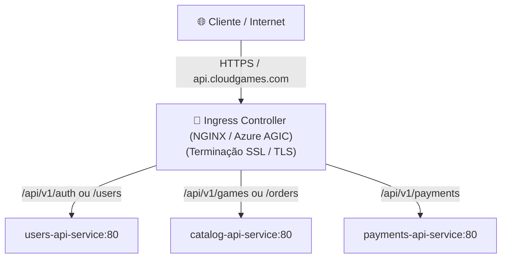
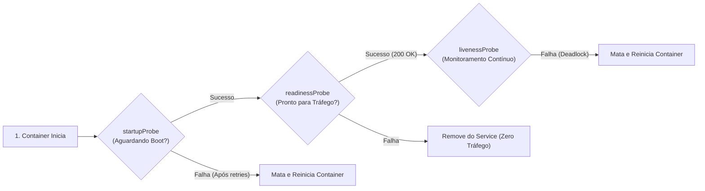

# Recursos Avançados, Diagnóstico e Guia de Comandos do kubectl

No quinto e último módulo do guia de **Kubernetes (K8s)**, você aprenderá recursos avançados de governança e operação de clusters: isolamento de ambientes com **Namespaces**, roteamento de tráfego HTTP/HTTPS com **Ingress Controllers**, técnicas de observabilidade e depuração com `kubectl describe`, um dicionário para solucionar os erros mais frequentes do Kubernetes e uma tabela de referência rápida dos comandos essenciais da CLI.

---

## 📑 Sumário

- [1. Segregação Lógica com Namespaces](#1-segregação-lógica-com-namespaces)
  - [1.1. O que é um Namespace?](#11-o-que-é-um-namespace)
  - [1.2. Namespaces Padrão do Sistema](#12-namespaces-padrão-do-sistema)
  - [1.3. Como Criar e Gerenciar Namespaces](#13-como-criar-e-gerenciar-namespaces)
- [2. Roteamento Externo de Borda com Ingress](#2-roteamento-externo-de-borda-com-ingress)
  - [2.1. Service (L4) vs. Ingress (L7)](#21-service-l4-vs-ingress-l7)
  - [2.2. Anatomia de um Manifesto de Ingress](#22-anatomia-de-um-manifesto-de-ingress)
  - [2.3. Roteamento Baseado em Caminhos (*Path-Based Routing*)](#23-roteamento-baseado-em-caminhos-path-based-routing)
- [3. Sondas de Integridade Avançadas (Health Checks)](#3-sondas-de-integridade-avançadas-health-checks)
  - [3.1. A Tríade de Sondas: `startupProbe`, `readinessProbe` e `livenessProbe`](#31-a-tríade-de-sondas-startupprobe-readinessprobe-e-livenessprobe)
  - [3.2. Como Proteger Aplicações Lentas com `startupProbe`](#32-como-proteger-aplicações-lentas-com-startupprobe)
- [4. Diagnóstico, Troubleshooting e Observabilidade](#4-diagnóstico-troubleshooting-e-observabilidade)
  - [4.1. O Comando Mais Importante: `kubectl describe`](#41-o-comando-mais-importante-kubectl-describe)
  - [4.2. Agregação de Logs por Rótulo (`kubectl logs -l`)](#42-agregação-de-logs-por-rótulo-kubectl-logs--l)
  - [4.3. Monitoramento de Métricas ao Vivo (`kubectl top`)](#43-monitoramento-de-métricas-ao-vivo-kubectl-top)
- [5. Dicionário de Erros Frequentes e Soluções](#5-dicionário-de-erros-frequentes-e-soluções)
  - [5.1. `CrashLoopBackOff`](#51-crashloopbackoff)
  - [5.2. `ImagePullBackOff` ou `ErrImagePull`](#52-imagepullbackoff-ou-errimagepull)
  - [5.3. `OOMKilled` (Out Of Memory)](#53-oomkilled-out-of-memory)
  - [5.4. `Pending`](#54-pending)
- [6. Tabela de Referência Rápida do `kubectl`](#6-tabela-de-referência-rápida-do-kubectl)
- [7. Navegação](#7-navegação)

---

## 1. Segregação Lógica com Namespaces

### 1.1. O que é um Namespace?
Um **Namespace** é uma partição virtual dentro do mesmo cluster físico de Kubernetes. Ele permite separar equipes, projetos ou ambientes de ciclo de vida (ex: `desenvolvimento`, `homologacao`, `producao`) compartilhando o mesmo hardware sem risco de colisões de nomes de recursos.

### 1.2. Namespaces Padrão do Sistema
Quando você instala o Kubernetes, ele cria automaticamente 4 namespaces nativos:
- **`default`:** O namespace padrão onde os comandos operam se nenhum namespace for especificado.
- **`kube-system`:** Onde rodam os contêineres vitais do próprio Control Plane (como o `CoreDNS`, `kube-proxy` e drivers CNI). **Nunca altere ou exclua recursos desta pasta!**
- **`kube-public`:** Recursos públicos legíveis por qualquer cliente, mesmo não autenticado.
- **`kube-node-lease`:** Mantém os contratos de batimento cardíaco (*heartbeats*) de cada nó para detecção rápida de falhas.

### 1.3. Como Criar e Gerenciar Namespaces

```powershell
# 1. Criar um novo namespace imperativamente
kubectl create namespace fcg-prod

# 2. Listar todos os namespaces existentes no cluster
kubectl get namespaces

# 3. Aplicar um manifesto em um namespace específico
kubectl apply -f fcg-fase-02--users/k8s/03-deployment.yaml -n fcg-prod

# 4. Listar os Pods de um namespace específico
kubectl get pods -n fcg-prod

# 5. Listar Pods de TODOS os namespaces simultaneamente
kubectl get pods --all-namespaces
```

---

## 2. Roteamento Externo de Borda com Ingress

### 2.1. Service (L4) vs. Ingress (L7)

- **`Service` (Camada 4 - Transporte):** Trabalha no nível de pacotes TCP/UDP. Ele não entende URLs, caminhos (`/api/v1/auth`), cabeçalhos HTTP ou certificados SSL. Para expor 4 microsserviços via `LoadBalancer`, você precisaria pagar por 4 IPs públicos e 4 balanceadores de carga na nuvem.
- **`Ingress` (Camada 7 - Aplicação):** É o roteador inteligente de borda. Com **um único IP público** e um único balanceador, ele inspeciona o cabeçalho HTTP da requisição e a encaminha para o Service correto com base no domínio ou caminho da URL:



---

### 2.2. Anatomia de um Manifesto de Ingress

Exemplo de manifesto unificado de borda para o ecossistema FIAP Cloud Games:

```yaml
apiVersion: networking.k8s.io/v1
kind: Ingress
metadata:
  name: fcg-gateway-ingress
  annotations:
    nginx.ingress.kubernetes.io/rewrite-target: /$2
spec:
  rules:
    - host: api.cloudgames.com
      http:
        paths:
          - path: /users(/|$)(.*)
            pathType: ImplementationSpecific
            backend:
              service:
                name: users-api-service
                port:
                  number: 80
          - path: /catalog(/|$)(.*)
            pathType: ImplementationSpecific
            backend:
              service:
                name: catalog-api-service
                port:
                  number: 80
          - path: /payments(/|$)(.*)
            pathType: ImplementationSpecific
            backend:
              service:
                name: payments-api-service
                port:
                  number: 80
```

---

## 3. Sondas de Integridade Avançadas (Health Checks)

### 3.1. A Tríade de Sondas: `startupProbe`, `readinessProbe` e `livenessProbe`



### 3.2. Como Proteger Aplicações Lentas com `startupProbe`
Aplicações pesadas que realizam migrações complexas de banco de dados na inicialização podem levar 30 segundos para subir. Se você configurar uma `livenessProbe` estrita de 10 segundos, o Kubernetes matará o contêiner antes mesmo dele concluir a migração, entrando em loop infinito de reinicialização!

O **`startupProbe`** desativa temporariamente a `livenessProbe` e a `readinessProbe` até que a aplicação responda pela primeira vez com sucesso.

---

## 4. Diagnóstico, Troubleshooting e Observabilidade

### 4.1. O Comando Mais Importante: `kubectl describe`
Quando um Pod não sobe ou fica em estado de erro, o comando `kubectl get pods` apenas informa que há algo errado. O comando **`kubectl describe`** informa **o motivo exato**:

```powershell
kubectl describe pod users-api-deployment-78b9d-xyz12
```

Role até o final da saída na seção **`Events:`**. É lá que o Kubernetes registra cronologicamente todos os eventos do nó:
- Se a imagem não foi encontrada no Docker Hub;
- Se a sonda de healthcheck `/health` falhou com HTTP 500;
- Se o nó ficou sem memória RAM suficiente para agendar o Pod.

---

### 4.2. Agregação de Logs por Rótulo (`kubectl logs -l`)
Em vez de buscar o nome específico de um Pod aleatório para ver seus logs, você pode acompanhar os logs de **todas as réplicas do microsserviço simultaneamente através da label `app`**:

```powershell
# Acompanha os logs das 2 réplicas da UsersAPI agregados em tempo real
kubectl logs -f -l app=users-api

# Ver os logs do contêiner ANTERIOR que sofreu crash (para descobrir por que ele morreu)
kubectl logs users-api-deployment-78b9d-xyz12 --previous
```

---

### 4.3. Monitoramento de Métricas ao Vivo (`kubectl top`)
Caso o componente *Metrics Server* esteja habilitado no cluster, você pode monitorar o consumo real de hardware:

```powershell
# Exibe consumo de CPU e Memória de cada nó do cluster
kubectl top nodes

# Exibe consumo de CPU e Memória de cada Pod ativo
kubectl top pods
```

---

## 5. Dicionário de Erros Frequentes e Soluções

### 5.1. `CrashLoopBackOff`
- **Sintoma:** O contêiner inicia, morre após 1 ou 2 segundos, o K8s tenta reiniciar, ele morre de novo e o tempo de espera entre reinícios aumenta exponencialmente (*Back-Off*).
- **Causas Comuns em .NET:**
  1. Erro não tratado na inicialização do `Program.cs`.
  2. Falha de conexão inicial com o RabbitMQ ou com o Azure Database.
  3. Variável de ambiente obrigatória ausente no `ConfigMap` ou `Secret`.
- **Como Diagnosticar:**
  ```powershell
  kubectl logs <nome-do-pod> --previous
  ```

---

### 5.2. `ImagePullBackOff` ou `ErrImagePull`
- **Sintoma:** O Kubernetes não consegue iniciar o Pod porque não consegue obter a imagem Docker.
- **Causas Comuns:**
  1. Você errou a grafia do nome ou da tag da imagem no `03-deployment.yaml`.
  2. A imagem foi compilada localmente no Docker, mas o cluster está tentando baixá-la do Docker Hub porque você não configurou `imagePullPolicy: IfNotPresent`.
  3. A imagem está em um registro privado (Azure ACR) e você esqueceu de configurar o `imagePullSecrets`.

---

### 5.3. `OOMKilled` (Out Of Memory)
- **Sintoma:** O Pod morre subitamente e a coluna `STATUS` exibe `OOMKilled` (Exit Code 137).
- **Causa:** A aplicação consumiu mais memória RAM do que o teto configurado no campo `resources.limits.memory` (ex: consumiu 520MB quando o limit era 512Mi).
- **Solução:** Aumente o limite de memória no manifesto ou investigue vazamentos de memória (*memory leaks*) no código C#.

---

### 5.4. `Pending`
- **Sintoma:** O Pod é criado, mas fica permanentemente no estado `Pending` sem nunca ir para `Running`.
- **Causa:** O `kube-scheduler` não encontrou nenhum nó no cluster com CPU ou memória livre suficiente para satisfazer a garantia mínima solicitada no campo `resources.requests`.
- **Como Diagnosticar:** Execute `kubectl describe pod <nome>` e verifique a mensagem *"0/1 nodes are available: insufficient cpu/memory"*.

---

## 6. Tabela de Referência Rápida do `kubectl`

| Objetivo | Comando `kubectl` |
|---|---|
| **Aplicar / Atualizar Manifestos** | `kubectl apply -f k8s/` |
| **Listar Pods com IPs e Nós** | `kubectl get pods -o wide` |
| **Listar Services** | `kubectl get svc` |
| **Listar Deployments** | `kubectl get deployments` |
| **Listar ConfigMaps e Secrets** | `kubectl get configmaps,secrets` |
| **Inspecionar Detalhes e Eventos de Erro** | `kubectl describe pod <nome_do_pod>` |
| **Acompanhar Logs em Tempo Real** | `kubectl logs -f -l app=<nome_da_app>` |
| **Abrir Terminal Interativo no Pod** | `kubectl exec -it <nome_do_pod> -- sh` |
| **Criar Túnel Local (Port-Forward)** | `kubectl port-forward svc/<nome_do_service> 8080:80` |
| **Acompanhar Status de Atualização** | `kubectl rollout status deployment/<nome_do_deployment>` |
| **Reverter Versão Imediatamente** | `kubectl rollout undo deployment/<nome_do_deployment>` |
| **Pausar Serviço (Escalar para Zero)** | `kubectl scale deployment <nome_do_deployment> --replicas=0` |
| **Reativar Serviço (Escalar para 2 Réplicas)** | `kubectl scale deployment <nome_do_deployment> --replicas=2` |
| **Reiniciar Forçadamente os Pods** | `kubectl rollout restart deployment/<nome_do_deployment>` |
| **Excluir Recursos Declarados na Pasta** | `kubectl delete -f k8s/` |

---

## 7. Navegação

- ⬅️ **[Voltar para a Aula 04: Redes, Port-Forward e Armazenamento (`04-redes-port-forward-e-armazenamento.md`)](04-redes-port-forward-e-armazenamento.md)**
- 📑 **[Ir para o Índice do Guia de Kubernetes (`index.md`)](index.md)**
- 🐳 **[Acessar o Guia Oficial de Docker & Containerização](../docker/index.md)**
- 🌐 **[Consultar o Fluxo Global da Solução](../fluxo-geral-solucao.md)**
- 🚀 **[Voltar para o README Principal da Orquestração](../../README.md)**
