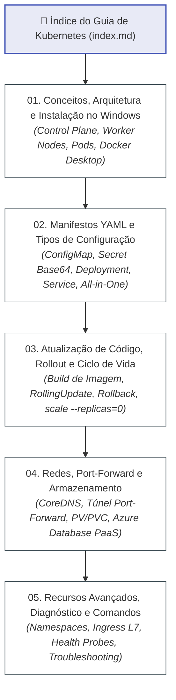

# Guia Oficial de Kubernetes (K8s) - FIAP Cloud Games

Bem-vindo ao **Guia Oficial de Kubernetes (K8s)** do ecossistema distribuído **FIAP Cloud Games (Fase 02)**.

Este manual técnico consolidado foi elaborado para capacitar arquitetos e engenheiros de software na orquestração corporativa de microsserviços conteinerizados, desde os fundamentos arquiteturais do cluster até o ciclo de desenvolvimento contínuo, governança de manifestos YAML, resolução de DNS interno e técnicas avançadas de diagnóstico e observabilidade.

---

## 🗺️ Mapa de Navegação da Trilha

---

## 📚 Módulos do Guia

### 1. [01. Conceitos, Arquitetura e Instalação no Windows (`01-conceitos-arquitetura-e-instalacao.md`)](01-conceitos-arquitetura-e-instalacao.md)
- **O que é o Kubernetes:** Do Docker Compose à orquestração corporativa distribuída (autocura, escalabilidade horizontal HPA, zero downtime).
- **Arquitetura do Cluster:** Control Plane (`kube-apiserver`, `etcd`, `kube-scheduler`, `kube-controller-manager`) e Worker Nodes (`kubelet`, `kube-proxy`, Container Runtime).
- **A Abstração do Pod:** Por que o K8s não gerencia contêineres avulsos e como funciona o isolamento compartilhado de rede e volumes no Pod.
- **Instalação no Windows 10/11:** Confirmação de que o `kubectl` já é instalado nativamente pelo Docker Desktop, passo a passo para ativar o cluster embutido e validação via CLI (`kubectl get nodes`).

---

### 2. [02. Manifestos YAML e Tipos de Configuração (`02-manifestos-e-tipos-de-configuracao.md`)](02-manifestos-e-tipos-de-configuracao.md)
- **O Modelo Declarativo:** Estrutura universal de manifestos K8s (`apiVersion`, `kind`, `metadata`, `spec`).
- **Labels e Selectors:** Funcionamento da associação dinâmica, padrão recomendado oficial (`app.kubernetes.io/*`), filtros CLI do operador, observabilidade, diferenças para Annotations e anti-padrões.
- **ConfigMap:** Armazenamento desacoplado de parâmetros públicos e mapeamento com duplo underscore (`__`) no ASP.NET Core.
- **Secret e Tipos Nativos:** Proteção de dados confidenciais em Base64 vs `stringData`, catálogo completo de tipos nativos (`Opaque`, `service-account-token`, `dockerconfigjson`, `basic-auth`, `ssh-auth`, `tls`, `bootstrap.token`) e segurança corporativa (RBAC, KMS, External Secrets Operator).
- **Deployment:** Especificação de réplicas, estratégia `RollingUpdate` sem downtime, injeção em lote via `envFrom`, governança de recursos (`requests`/`limits`) e sondas `/health`.
- **Service:** Abstração de rede estável (`ClusterIP`, `NodePort`, `LoadBalancer`) e a relação entre `port` e `targetPort`.
- **Rastreabilidade:** Diagrama Mermaid detalhando como os 4 manifestos se amarram mutuamente.
- **Manifestos Consolidados:** Como agrupar múltiplos recursos em um único arquivo utilizando o separador `---`.

---

### 3. [03. Atualização de Código, Rollout de Imagens e Ciclo de Vida (`03-atualizacao-de-codigo-rollout-e-ciclo-de-vida.md`)](03-atualizacao-de-codigo-rollout-e-ciclo-de-vida.md)
- **O Fluxo de Desenvolvimento:** Por que alterar o código C# não altera o Pod automaticamente (imutabilidade da imagem Docker).
- **Geração de Imagens Versionadas:** Padrão de compilação semântica local (`docker build -t ...:v1.1.0 .`).
- **Atualização do Cluster:** Método declarativo com YAML, método imperativo com `kubectl set image` e reinício forçado com `kubectl rollout restart`.
- **Diagrama de Sequência do RollingUpdate:** Rastreabilidade passo a passo da substituição de instâncias antigas por novas sem queda de requisições.
- **Observabilidade e Rollback:** Acompanhamento do status (`rollout status`), histórico (`rollout history`) e reversão imediata (`rollout undo`).
- **Ciclo de Vida dos Pods:** Por que deletar Pods faz o ReplicaSet recriá-los imediatamente, como pausar serviços desocupando CPU/RAM (`scale --replicas=0`) e como excluí-los de forma limpa.

---

### 4. [04. Redes no Kubernetes, Port-Forward e Persistência de Dados (`04-redes-port-forward-e-armazenamento.md`)](04-redes-port-forward-e-armazenamento.md)
- **Modelo de Redes do Kubernetes:** Rede plana (*Flat Network*) direta Pod-to-Pod sem NAT e o papel do CNI.
- **Descoberta de Serviços com CoreDNS:** Nomes FQDN padronizados (`<service>.<namespace>.svc.cluster.local`).
- **O Poder do `kubectl port-forward`:** Como criar túneis locais no Windows para testar as APIs no Scalar (`:8080`, `:8082`, `:8083`) e o painel do RabbitMQ (`:15672`).
- **Armazenamento no Cluster:** Volumes efêmeros (`emptyDir`), `PersistentVolume` (PV), `PersistentVolumeClaim` (PVC) e provisionamento dinâmico com `StorageClass`.
- **Microsserviços Stateless e Nuvem PaaS:** Decisão arquitetural de delegar toda a persistência ao **Azure Database** (`fcg-server.database.windows.net`), permitindo escalabilidade elástica de Pods sem sobrecarga de discos estaduais no cluster.

---

### 5. [05. Recursos Avançados, Diagnóstico e Guia de Comandos (`05-recursos-avancados-e-guia-de-comandos.md`)](05-recursos-avancados-e-guia-de-comandos.md)
- **Namespaces:** Segregação lógica de ambientes de ciclo de vida (`dev`, `homol`, `prod`).
- **Ingress Controller (L7):** Ponto único de entrada, terminação SSL/TLS e roteamento inteligente baseado em caminhos de URL (*Path-Based Routing*).
- **Sondas Avançadas:** Proteção de inicializações lentas com `startupProbe`.
- **Técnicas de Diagnóstico:** Inspecionar eventos de nós com `kubectl describe`, logs agregados por label (`kubectl logs -f -l app=...`) e métricas com `kubectl top`.
- **Dicionário de Erros:** Diagnóstico e resolução de `CrashLoopBackOff`, `ImagePullBackOff`, `OOMKilled` e `Pending`.
- **Tabela Rápida de Comandos:** Guia prático dos comandos mais utilizados no dia a dia.

---

## ⚡ Tabela Rápida de Comandos Mais Utilizados

| Objetivo | Comando `kubectl` |
|---|---|
| **Verificar Status dos Nós do Cluster** | `kubectl get nodes` |
| **Aplicar Todos os Manifestos de uma Pasta** | `kubectl apply -f k8s/` |
| **Listar Pods com Detalhes e IPs** | `kubectl get pods -o wide` |
| **Listar Services e Portas** | `kubectl get svc` |
| **Listar Deployments Ativos** | `kubectl get deployments` |
| **Inspecionar Detalhes e Eventos de Erro de um Pod** | `kubectl describe pod <nome_do_pod>` |
| **Acompanhar Logs de Todas as Réplicas ao Vivo** | `kubectl logs -f -l app=<nome_da_app>` |
| **Abrir Terminal Interativo Dentro do Pod** | `kubectl exec -it <nome_do_pod> -- sh` |
| **Criar Túnel Local para Teste (Port-Forward)** | `kubectl port-forward svc/<service> 8080:80` |
| **Atualizar Imagem do Deployment** | `kubectl set image deployment/<dep> <container>=<imagem:tag>` |
| **Acompanhar Status de Atualização** | `kubectl rollout status deployment/<nome_do_deployment>` |
| **Reverter Atualização Defeituosa (Rollback)** | `kubectl rollout undo deployment/<nome_do_deployment>` |
| **Pausar Serviço (Escalar para Zero)** | `kubectl scale deployment <nome_do_deployment> --replicas=0` |
| **Reativar Serviço (Escalar Réplicas)** | `kubectl scale deployment <nome_do_deployment> --replicas=2` |
| **Excluir Todos os Recursos Criados** | `kubectl delete -f k8s/` |

---

## 🔗 Navegação e Links Relacionados

- 🐳 **[Guia Oficial de Docker & Containerização](../docker/index.md)**
- 🌐 **[Documentação do Fluxo Global da Solução](../fluxo-geral-solucao.md)**
- ☸️ **[Arquitetura de Infraestrutura K8s do Ecossistema](../k8s-infra.md)**
- 🐇 **[Guia Completo de RabbitMQ & Mensageria](../rabbitmq/index.md)**
- 📑 **[Índice Central da Documentação de Orquestração](../index.md)**
- 🚀 **[README Principal da Orquestração](../../README.md)**
