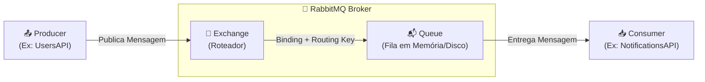
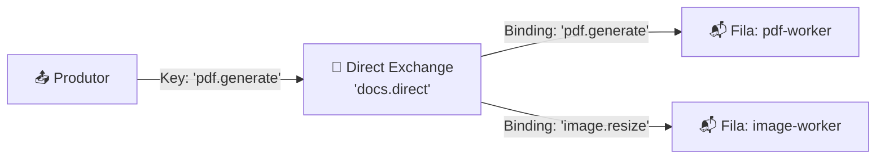
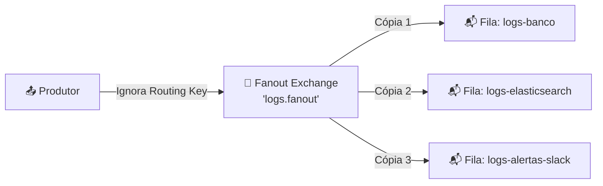
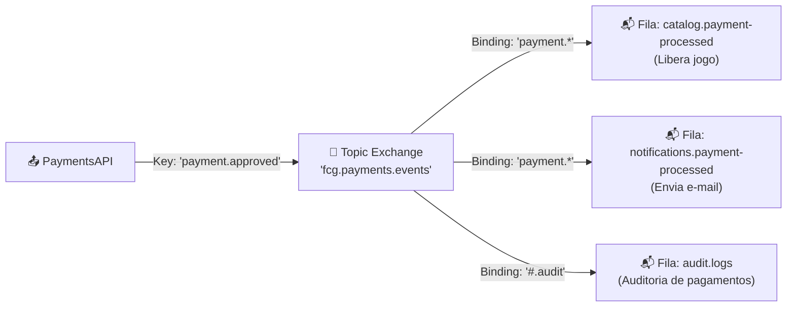
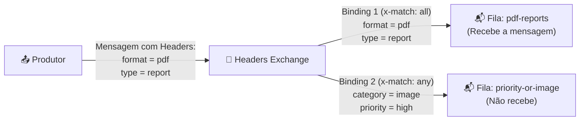

# RabbitMQ: Fundamentos, Arquitetura e Tipos de Exchange

Este guia apresenta os conceitos fundamentais do **RabbitMQ**, o protocolo **AMQP 0-9-1**, a mecânica de roteamento de mensagens através de **Exchanges**, **Bindings**, **Routing Keys** e **Filas (Queues)**, ilustrado com exemplos práticos do ecossistema **FIAP Cloud Games**.

---

## 📑 Sumário

- [1. O que é o RabbitMQ e o Protocolo AMQP](#1-o-que-é-o-rabbitmq-e-o-protocolo-amqp)
- [2. Anatomia Básica: Producer, Broker e Consumer](#2-anatomia-básica-producer-broker-e-consumer)
- [3. O Papel Central do Exchange](#3-o-papel-central-do-exchange)
- [4. Todos os Tipos de Exchange](#4-todos-os-tipos-de-exchange)
  - [4.1. Direct Exchange (Roteamento Exato)](#41-direct-exchange-roteamento-exato)
  - [4.2. Fanout Exchange (Broadcast / Difusão Total)](#42-fanout-exchange-broadcast--difusão-total)
  - [4.3. Topic Exchange (Roteamento por Padrões / Wildcards)](#43-topic-exchange-roteamento-por-padrões--wildcards)
  - [4.4. Headers Exchange (Roteamento por Metadados)](#44-headers-exchange-roteamento-por-metadados)
  - [4.5. Default Exchange (Exchange Sem Nome / Direto à Fila)](#45-default-exchange-exchange-sem-nome--direto-à-fila)
- [5. Filas (Queues) e suas Propriedades](#5-filas-queues-e-suas-propriedades)
- [6. Bindings e Routing Keys: A Conexão do Roteamento](#6-bindings-e-routing-keys-a-conexão-do-roteamento)
- [7. Mapeamento de Exchanges no FIAP Cloud Games](#7-mapeamento-de-exchanges-no-fiap-cloud-games)

---

## 1. O que é o RabbitMQ e o Protocolo AMQP

O **RabbitMQ** é um dos message brokers open-source mais populares e confiáveis do mundo. Ele atua como um intermediário inteligente para a troca assíncrona de dados entre sistemas distribuídos.

### Por que usar um Message Broker?
- **Desacoplamento:** O remetente da informação não precisa saber quem é o consumidor, onde ele está hospedado ou em qual linguagem foi escrito.
- **Assincronismo:** A aplicação que envia o evento não precisa ficar travada (bloqueada) aguardando o processamento do destinatário.
- **Buffer & Nivelamento de Carga (*Load Leveling*):** Picos repentinos de requisições ficam enfileirados de forma segura, evitando a sobrecarga de serviços críticos ou bancos de dados.
- **Resiliência:** Se o microsserviço consumidor falhar ou for reiniciado, a mensagem permanece preservada na fila até que ele se recupere.

### O Protocolo AMQP 0-9-1
O RabbitMQ implementa nativamente o **AMQP (Advanced Message Queuing Protocol)**, um padrão aberto e binário de rede que define:
1. Como as mensagens são estruturadas (payload binário + cabeçalhos/propriedades).
2. Como o broker roteia, armazena e entrega mensagens.
3. Garantias de entrega (*At-least-once*, *At-most-once*).

---

## 2. Anatomia Básica: Producer, Broker e Consumer



1. **Producer (Produtor):** A aplicação que cria e envia a mensagem (ex: a `UsersAPI` quando cadastra um novo usuário). **Importante:** No protocolo AMQP, o produtor **NUNCA** envia uma mensagem diretamente para uma fila. Ele sempre publica para um **Exchange**.
2. **Broker (RabbitMQ):** O servidor intermediário responsável por receber, rotear, armazenar e despachar as mensagens.
3. **Queue (Fila):** O buffer de armazenamento de mensagens dentro do RabbitMQ.
4. **Consumer (Consumidor):** A aplicação cliente que se conecta a uma fila para processar as mensagens enfileiradas (ex: a `NotificationsAPI` escutando eventos de criação de conta).

---

## 3. O Papel Central do Exchange

O **Exchange** é o agente roteador do RabbitMQ. Ele recebe a mensagem enviada pelo produtor e inspeciona:
- O tipo do Exchange (`Direct`, `Fanout`, `Topic` ou `Headers`).
- A **Routing Key** (etiqueta/chave de roteamento anexada à mensagem).
- As regras de ligação (**Bindings**) configuradas entre ele e as filas.

Com base nessas regras, o Exchange decide se a mensagem deve ser:
- Entregue a **uma** fila específica.
- Replicada para **múltiplas** filas simultaneamente.
- Descartada silenciosamente (caso nenhuma fila tenha interesse nela).

---

## 4. Todos os Tipos de Exchange

O AMQP define **quatro tipos principais de Exchange**, além de um Exchange especial padrão (*Default*). A escolha do tipo correto define a topologia de mensageria da sua aplicação:

| Tipo de Exchange | Algoritmo de Roteamento | Velocidade | Caso de Uso Típico |
|---|---|---|---|
| **Direct** | Correspondência exata da `routing key` | Muito Alta | Tarefas direcionadas a um trabalhador específico |
| **Fanout** | Ignora a `routing key` (Broadcast total) | Máxima | Notificações em massa, cache invalidation |
| **Topic** | Casamento por padrões (*wildcards* `*` e `#`) | Alta | Event-Driven Architecture, sistemas pub/sub ricos |
| **Headers** | Ignora `routing key`; avalia cabeçalhos da mensagem | Média | Roteamento por múltiplos metadados complexos |
| **Default** | Direct implícito onde a key é o nome da fila | Muito Alta | Comunicação simples ponto-a-ponto |

---

### 4.1. Direct Exchange (Roteamento Exato)

Uma mensagem vai para a fila cuja chave de ligação (**binding key**) seja **estritamente idêntica** à chave de roteamento (**routing key**) da mensagem.



- Se a mensagem tiver a routing key `pdf.generate`, ela vai **apenas** para a fila `pdf-worker`.
- Se tiver a chave `image.resize`, vai para `image-worker`.
- Se tiver `video.convert` (sem binding cadastrado), ela é **descartada**.

---

### 4.2. Fanout Exchange (Broadcast / Difusão Total)

O Fanout ignora completamente qualquer routing key informada. Ele simplesmente pega a mensagem recebida e faz uma **cópia idêntica para TODAS as filas vinculadas a ele**.



- **Vantagem:** Extremamente rápido porque não faz análise de strings ou expressões.
- **Caso de uso:** Quando vários serviços precisam reagir exatamente à mesma ocorrência (ex: limpeza de cache global em todos os nós).

---

### 4.3. Topic Exchange (Roteamento por Padrões / Wildcards)

O **Topic Exchange** é o tipo mais poderoso e flexível do RabbitMQ, sendo o padrão arquitetural escolhido no **FIAP Cloud Games**. 

Ele permite roteamento sofisticado baseado em nomes hierárquicos separados por pontos (ex: `modulo.submodulo.evento`).

#### Caracteres Curinga (*Wildcards*):
- **`*` (asterisco):** Substitui **exatamente uma** palavra delimitada por ponto.
- **`#` (sustenido / hash):** Substitui **zero ou mais** palavras.



#### Exemplos Práticos de Combinação:
- Se a mensagem for publicada com `payment.approved`:
  - Casa com `payment.*` -> Entregue a `catalog.payment-processed` e `notifications.payment-processed`.
- Se a mensagem for publicada com `payment.rejected`:
  - Casa com `payment.*` -> Entregue a `notifications.payment-processed` e também à fila `catalog.payment-processed`.
- Se a mensagem for publicada com `game.action.audit`:
  - Casa com `#.audit` -> Entregue à fila de auditoria.


> 🔍 **Ponto de Observação Arquitetural: O que o Catálogo faz ao receber `payment.rejected`?**
> 
> Como a fila `catalog.payment-processed` foi vinculada à exchange com a chave curinga **`payment.*`**, o RabbitMQ entregará nela tanto mensagens de aprovação (`payment.approved`) quanto de rejeição (`payment.rejected`).
> 
> **O que acontece na prática dentro do Worker da `CatalogAPI`?**
> 1. **Consumo e Desserialização:** O worker em segundo plano (`PaymentProcessedConsumerService`) recebe a mensagem normalmente da fila e faz o parse do JSON para o evento `PaymentProcessedIntegrationEvent`.
> 2. **Avaliação da Condição de Negócio:** O código inspeciona a propriedade booleana `if (paymentEvent.IsApproved)`. Ao constatar que o pagamento foi recusado, o worker **ignora a inclusão do jogo na tabela `UserLibraries` do Azure Database** e grava um log estruturado informando o motivo da recusa (`Reason`).
> 3. **Confirmação Manual (`BasicAck`):** O worker emite o `BasicAck` para remover a mensagem da fila. Isso é correto porque **não houve falha técnica de sistema** (o banco e a rede operaram normalmente); tratou-se apenas de um desfecho de negócio (recusa da operadora/gateway), finalizando o ciclo de vida daquela mensagem com sucesso.
> 
> 💡 *Trade-off Arquitetural:* Essa estratégia foi adotada para conceder ao catálogo visibilidade total do ciclo de vida das ordens de compra (permitindo cancelar pedidos pendentes ou liberar reservas de estoque). Caso o catálogo futuramente não tenha qualquer interesse em falhas, bastaria restringir o binding da fila para **`payment.approved`**, fazendo com que o próprio RabbitMQ descarte a entrega para o catálogo e direcione `payment.rejected` **exclusivamente** para a `NotificationsAPI`.

---

### 4.4. Headers Exchange (Roteamento por Metadados)

O **Headers Exchange** ignora a routing key e avalia os atributos definidos no dicionário de **Headers** (cabeçalhos) da mensagem em comparação com os argumentos configurados no **Binding** da fila.

#### 1. Onde fica o `x-match`?
O `x-match` **NÃO** faz parte da mensagem enviada pelo produtor! Ele é um argumento exclusivo do **Binding** (a regra que conecta a Fila ao Exchange), indicando ao RabbitMQ como avaliar os pares chave/valor:
- **`x-match: all` (padrão / operador E):** A mensagem precisa conter **todos** os pares chave/valor definidos no binding para ser entregue à fila.
- **`x-match: any` (operador OU):** A mensagem será entregue se contiver **ao menos um** dos pares chave/valor definidos no binding.

#### 2. Unicidade de Chaves (É possível ter chaves duplicadas?)
**Não.** No protocolo AMQP (e em qualquer estrutura de `Dictionary` no C# ou JSON), **as chaves devem ser estritamente únicas**. Não é permitido declarar `format=png` e `format=jpg` no mesmo dicionário de cabeçalhos.

Como resolver cenários onde uma fila aceita múltiplos valores para a mesma chave?
- **Padrão de Múltiplos Bindings (Recomendado):** A mesma fila é vinculada duas vezes ao Exchange:
  - *Binding 1:* `{ "format": "png" }`
  - *Binding 2:* `{ "format": "jpg" }`
- **Uso do `x-match: any` com Chaves Distintas:** O `x-match: any` é ideal para avaliar atributos diferentes (ex: `category: "image"` OU `priority: "high"`).



#### Exemplo em Código .NET 10:

```csharp
// 1. No Consumidor: Configuração do Binding com x-match: all
var bindingArgs = new Dictionary<string, object?>
{
    { "x-match", "all" },
    { "format", "pdf" },
    { "type", "report" }
};
await channel.QueueBindAsync("pdf-reports", "docs.headers", routingKey: string.Empty, arguments: bindingArgs);

// 2. No Produtor: Apenas envia os cabeçalhos de negócio na mensagem (SEM x-match)
var properties = new BasicProperties
{
    Headers = new Dictionary<string, object?>
    {
        { "format", "pdf" },
        { "type", "report" }
    }
};
await channel.BasicPublishAsync("docs.headers", routingKey: string.Empty, basicProperties: properties, body: body);
```

---

### 4.5. Default Exchange (Exchange Sem Nome / Direto à Fila)

O RabbitMQ disponibiliza um Exchange pré-declarado sem nome (conhecido como `""` - string vazia) do tipo **Direct**.
- Toda fila criada no RabbitMQ é **automaticamente associada a esse Default Exchange**.
- A `binding key` padrão é exatamente o **próprio nome da fila**.
- Se um produtor publica uma mensagem para `exchange: ""` com `routingKey: "minha-fila"`, ela vai diretamente para a fila chamada `minha-fila`.

---

## 5. Filas (Queues) e suas Propriedades

As filas são estruturas FIFO (*First-In, First-Out*) que armazenam mensagens até que um consumidor as processe. Ao criar uma fila, configuram-se propriedades fundamentais de confiabilidade:

1. **Durable (Durável vs Transitória):**
   - **`Durable = true` (Recomendado para Produção):** A definição da fila e suas mensagens persistidas sobrevivem ao reinício do contêiner RabbitMQ.
   - **`Durable = false`:** A fila é excluída da memória se o RabbitMQ reiniciar.

2. **Exclusive (Exclusiva):**
   - **`Exclusive = true`:** Apenas a conexão que a criou pode consumi-la. Quando essa conexão cai, a fila é automaticamente deletada (útil para filas temporárias de resposta RPC).
   - **`Exclusive = false`:** Vários microsserviços e réplicas podem consumir da mesma fila simultaneamente (divisão de carga).

3. **Auto-Delete (Auto-Exclusão):**
   - Se `true`, a fila é apagada automaticamente assim que o último consumidor se desconectar dela.

4. **Argumentos Opcionais (*Queue Arguments*):**
   - `x-message-ttl` (Time-To-Live): Tempo máximo (em milissegundos) que uma mensagem pode permanecer na fila antes de ser descartada ou movida para uma DLQ.
   - `x-max-length`: Número máximo de mensagens permitidas na fila.
   - `x-dead-letter-exchange`: Exchange para onde a mensagem é despachada caso seja rejeitada (`BasicReject` / `BasicNack`) ou expire.

---

## 6. Bindings e Routing Keys: A Conexão do Roteamento

- **Routing Key:** A "etiqueta de remetente/conteúdo" anexada à mensagem pelo **Produtor** no momento do envio.
- **Binding:** O canal de ligação criado entre um **Exchange** e uma **Fila**.
- **Binding Key:** O critério/filtro de interesse que a fila declara ao Exchange.

> 💡 **Analogia da Agência dos Correios:**
> - O **Exchange** é a agência central de triagem de correspondências.
> - O **Producer** coloca uma carta na caixa com um CEP escrito (**Routing Key**).
> - As **Filas** são as caixas de correio dos destinatários.
> - O **Binding** é a regra de entrega que diz: *"Toda carta cujo CEP coincida com este padrão deve ser colocada nesta caixa de correio"*.

---

## 7. Mapeamento de Exchanges no FIAP Cloud Games

No ecossistema **FIAP Cloud Games (Fase 02)**, adotamos o padrão **Topic Exchange** em todos os microsserviços, proporcionando máximo desacoplamento e capacidade de evolução:

| Exchange | Tipo | Finalidade de Negócio | Produtor | Routing Keys Utilizadas |
|---|---|---|---|---|
| **`fcg.users.events`** | `Topic` | Eventos de ciclo de vida do usuário | `UsersAPI` | `user.created` |
| **`fcg.catalog.events`** | `Topic` | Pedidos de compra e atualizações de catálogo | `CatalogAPI` | `order.placed` |
| **`fcg.payments.events`** | `Topic` | Resultados do processamento financeiro | `PaymentsAPI` | `payment.approved`, `payment.rejected` |
