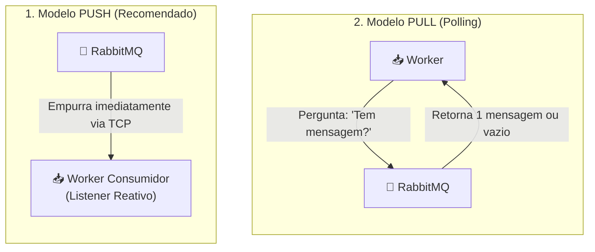
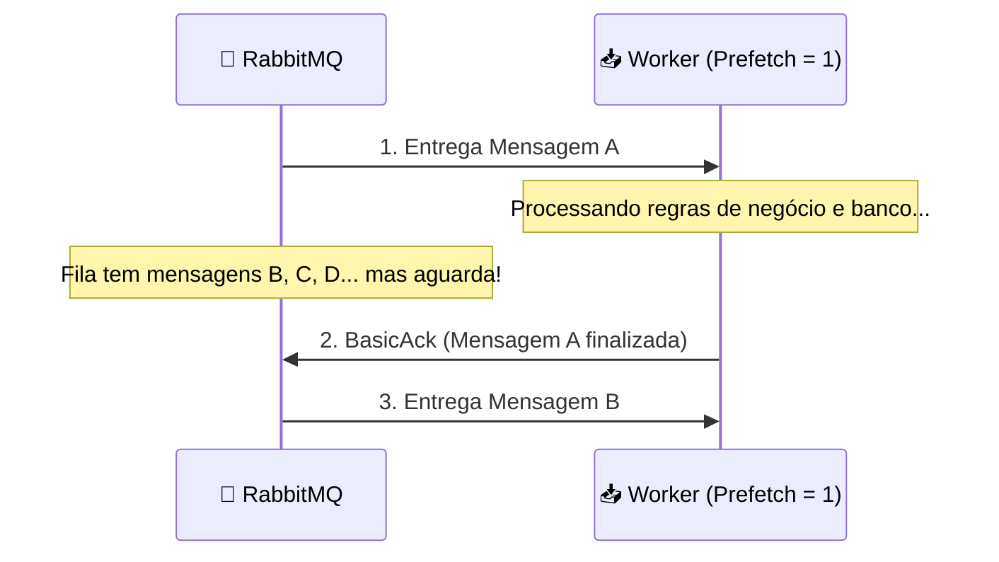
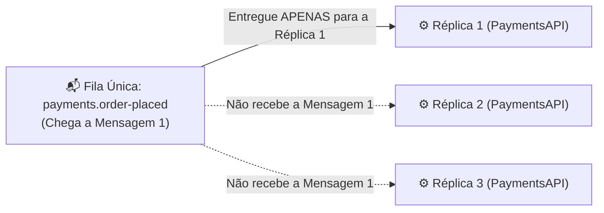
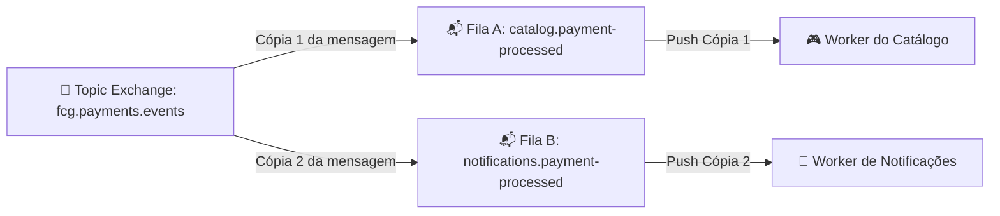
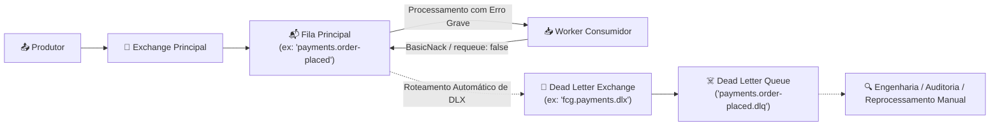

# RabbitMQ: Formas de Recuperar e Finalizar Mensagens (Consumo & Confirmação)

Neste documento, exploramos em profundidade o ciclo de vida do consumo de mensagens no **RabbitMQ**: como os microsserviços recuperam dados da fila, o controle de fluxo (**QoS / Prefetch**) e as estratégias de finalização (**Ack**, **Nack**, **Reject**) com suporte a **Dead Letter Queues (DLQ)**.

---

## 📑 Sumário

- [1. Formas de Recuperar Mensagens da Fila](#1-formas-de-recuperar-mensagens-da-fila)
  - [1.1. Modelo Push: `BasicConsume` (Orientado a Eventos - Recomendado)](#11-modelo-push-basicconsume-orientado-a-eventos---recomendado)
  - [1.2. Modelo Pull: `BasicGet` (Busca Ativa / Polling)](#12-modelo-pull-basicget-busca-ativa--polling)
  - [1.3. Comparativo: Push vs Pull](#13-comparativo-push-vs-pull)
- [2. Controle de Fluxo e Fair Dispatch (QoS & Prefetch Count)](#2-controle-de-fluxo-e-fair-dispatch-qos--prefetch-count)
- [3. Formas de Finalizar o Processamento da Mensagem](#3-formas-de-finalizar-o-processamento-da-mensagem)
  - [3.1. Auto-Ack (`autoAck = true`): Alto Risco](#31-auto-ack-autoack--true-alto-risco)
  - [3.2. Confirmação Manual Positiva: `BasicAck`](#32-confirmação-manual-positiva-basicack)
  - [3.3. Confirmação Manual Negativa: `BasicNack`](#33-confirmação-manual-negativa-basicnack)
  - [3.4. Rejeição Unitária: `BasicReject`](#34-rejeição-unitária-basicreject)
- [4. Múltiplos Consumidores e Concorrência: Competing Consumers vs Pub-Sub](#4-múltiplos-consumidores-e-concorrência-competing-consumers-vs-pub-sub)
  - [4.1. Cenário 1: Uma Única Fila com Múltiplos Trabalhadores (Divisão de Carga)](#41-cenário-1-uma-única-fila-com-múltiplos-trabalhadores-divisão-de-carga)
  - [4.2. Cenário 2: Quando Todos Devem Receber (Múltiplas Filas Independentes)](#42-cenário-2-quando-todos-devem-receber-múltiplas-filas-independentes)
  - [4.3. Matriz de Comportamento entre Filas Isoladas](#43-matriz-de-comportamento-entre-filas-isoladas)
- [5. Tratamento de Falhas: O Problema do Loop Infinito (*Poison Message*)](#5-tratamento-de-falhas-o-problema-do-loop-infinito-poison-message)
- [6. Dead Letter Exchanges (DLX) e Dead Letter Queues (DLQ)](#6-dead-letter-exchanges-dlx-e-dead-letter-queues-dlq)
- [7. Boas Práticas de Resiliência em Produção](#7-boas-práticas-de-resiliência-em-produção)

---

## 1. Formas de Recuperar Mensagens da Fila

O RabbitMQ suporta duas estratégias para que uma aplicação consuma dados de uma fila:



### 1.1. Modelo Push: `BasicConsume` (Orientado a Eventos - Recomendado)

No modelo **Push**, a aplicação assina uma fila e registra uma função de retorno (*callback* ou evento). O broker RabbitMQ mantém a conexão TCP aberta e **empurra ativamente** as mensagens assim que elas chegam.

- **Vantagem:** Latência quase zero (tempo real), uso eficiente de CPU e rede (não gera tráfego de requisições vazias).
- **No .NET:** Implementado através do `AsyncEventingBasicConsumer` associado a um `IChannel.BasicConsumeAsync()`.
- **Uso:** É o padrão adotado em todos os workers de segundo plano (`BackgroundService`) do **FIAP Cloud Games**.

### 1.2. Modelo Pull: `BasicGet` (Busca Ativa / Polling)

No modelo **Pull**, a aplicação faz uma chamada síncrona explícita para o broker perguntando: *"Existe alguma mensagem nesta fila agora?"*.

- **Comportamento:** Se houver mensagem, o broker retorna uma única mensagem (`BasicGetResult`); se a fila estiver vazia, retorna `null`.
- **Desvantagem:** Se feito em loop contínuo (*polling*), gera altíssimo consumo de CPU e saturação de rede.
- **Uso Recomendado:** Apenas para rotinas pontuais de lote (ex: uma tarefa Cron noturna que lê poucas mensagens pendentes e desliga).

### 1.3. Comparativo: Push vs Pull

| Critério | Push (`BasicConsume`) | Pull (`BasicGet`) |
|---|---|---|
| **Mecanismo** | Broker empurra via evento | Consumidor faz requisição explícita |
| **Latência** | Milissegundos (Tempo Real) | Depende do intervalo de polling |
| **Sobrecarga de Rede** | Mínima | Alta em loops contínuos |
| **Uso em Microsserviços** | **Padrão Absoluto** | Excepcional |

---

## 2. Controle de Fluxo e Fair Dispatch (QoS & Prefetch Count)

Por padrão, se 1.000 mensagens caírem em uma fila e você tiver dois consumidores conectados no modelo Push, o RabbitMQ tentará descarregar todas as mensagens imediatamente para a memória desses consumidores em blocos proporcionais (*Round-Robin ingênuo*).

Se uma mensagem for muito pesada de processar, um consumidor pode ficar sobrecarregado com memória esgotada enquanto o outro fica ocioso.

### A Solução: `BasicQos` com `prefetchCount`

O parâmetro **`prefetchCount`** define o número máximo de mensagens não confirmadas (*unacknowledged*) que o broker pode entregar a um trabalhador específico simultaneamente:

```csharp
// Instrução para o RabbitMQ: "Não me envie mais de 1 mensagem por vez.
// Só me entregue a próxima após eu emitir o BasicAck da anterior!"
await channel.BasicQosAsync(prefetchSize: 0, prefetchCount: 1, global: false);
```



- **`prefetchCount: 1`:** Máxima justiça na distribuição de trabalho (*Fair Dispatch*). Ideal para tarefas assíncronas com tempos de execução variáveis.
- **`prefetchCount: 10 a 50`:** Excelente equilíbrio para mensagens rápidas em microsserviços de alto throughput.

---

## 3. Formas de Finalizar o Processamento da Mensagem

Quando um consumidor recebe uma mensagem, o RabbitMQ a marca temporariamente no estado **`Unacked`** (despachada, mas aguardando confirmação). O consumidor deve informar explicitamente ao broker o que fazer com ela.

---

### 3.1. Auto-Ack (`autoAck = true`): Alto Risco

Se você configurar `autoAck: true`, o RabbitMQ considera a mensagem como "finalizada com sucesso" **no exato instante em que ela sai da placa de rede do broker**.
- **Perigo:** Se a aplicação consumidora sofrer uma pane (*crash*), faltar memória ou perder conexão antes de salvar os dados no banco de dados, **a mensagem é perdida para sempre**.
- **Regra:** Nunca utilize `autoAck: true` em sistemas financeiros, e-commerce ou arquiteturas orientadas a eventos corporativas.

---

### 3.2. Confirmação Manual Positiva: `BasicAck`

Informa ao broker que a mensagem foi processada com pleno sucesso e que ela pode ser **removida permanentemente da fila**.

```csharp
// DeliveryTag: Identificador numérico único da mensagem no canal
await channel.BasicAckAsync(deliveryTag: ea.DeliveryTag, multiple: false);
```

- **`multiple: false`:** Confirma apenas a mensagem identificada pelo `deliveryTag`.
- **`multiple: true`:** Confirma em lote todas as mensagens até aquele `deliveryTag` (otimização de throughput).

---

### 3.3. Confirmação Manual Negativa: `BasicNack`

Informa ao broker que ocorreu um erro durante o processamento. O `BasicNack` oferece a flexibilidade de devolver a mensagem para a fila ou descartá-la:

```csharp
// Sintaxe: BasicNackAsync(ulong deliveryTag, bool multiple, bool requeue)
await channel.BasicNackAsync(deliveryTag: ea.DeliveryTag, multiple: false, requeue: false);
```

- **`requeue: true`:** O RabbitMQ coloca a mensagem de volta na fila para ser reprocessada.
- **`requeue: false`:** O RabbitMQ **não** devolve a mensagem à fila original. Se houver uma **Dead Letter Queue (DLQ)** configurada, a mensagem é enviada para ela; caso contrário, é deletada.

---

### 3.4. Rejeição Unitária: `BasicReject`

O `BasicReject` possui comportamento idêntico ao `BasicNack`, porém opera **exclusivamente sobre uma única mensagem** (não possui o argumento `multiple`).

```csharp
// Sintaxe: BasicRejectAsync(ulong deliveryTag, bool requeue)
await channel.BasicRejectAsync(deliveryTag: ea.DeliveryTag, requeue: false);
```

---

## 4. Múltiplos Consumidores e Concorrência: Competing Consumers vs Pub-Sub

Uma dúvida muito frequente em arquiteturas orientadas a eventos é:  
*"Se uma fila tiver múltiplos assinantes conectados e uma mensagem chegar via push, o que acontece se cada um tiver um tempo de processamento diferente e um deles emitir `BasicAck` enquanto os outros ainda estão processando?"*

Para responder a essa pergunta, é fundamental compreender a **regra de ouro** de como o RabbitMQ gerencia filas:

### 4.1. Cenário 1: Uma Única Fila com Múltiplos Trabalhadores (Divisão de Carga)

> ⚠️ **A Regra Fundamental:** Se múltiplos consumidores estiverem conectados à **MESMA fila**, a mensagem **NUNCA** é entregue a todos eles!

No RabbitMQ, uma única fila com múltiplos assinantes implementa o padrão **Competing Consumers (Consumidores Concorrentes)**:
- Cada mensagem individual é entregue para **apenas UM trabalhador** (distribuída em Round-Robin pelo broker).
- Os outros trabalhadores conectados à mesma fila **não recebem cópia dessa mensagem** e continuam aguardando as próximas mensagens da fila.



#### O que acontece com a Mensagem 1 nos diferentes desfechos do Trabalhador 1?

1. **Sucesso (`BasicAck` pelo Trabalhador 1):**
   - O Trabalhador 1 conclui o processamento e emite `BasicAck`.
   - O RabbitMQ apaga a Mensagem 1 da fila permanentemente.
   - As Réplicas 2 e 3 nunca a viram e continuam processando as Mensagens 2 e 3.

2. **Falha com Reenfileiramento (`BasicNack(requeue: true)` pelo Trabalhador 1):**
   - O Trabalhador 1 sofre um erro transitório e devolve a mensagem.
   - O RabbitMQ recoloca a Mensagem 1 no início da fila.
   - Como o Trabalhador 1 acabou de falhar, a Mensagem 1 será imediatamente entregue para o **Trabalhador 2** ou **Trabalhador 3** (aquele que estiver com slot de `prefetchCount` disponível).

3. **Falha sem Reenfileiramento (`BasicNack(requeue: false)` pelo Trabalhador 1):**
   - A Mensagem 1 é retirada da fila e despachada para a **Dead Letter Queue (DLQ)**. Nenhum outro trabalhador tentará processá-la.

4. **Crash / Queda do Trabalhador 1 (Sem Ack nem Nack):**
   - Se o contêiner do Trabalhador 1 cair no meio do processamento, a conexão TCP morre.
   - O RabbitMQ detecta a desconexão, retorna a mensagem do estado `Unacked` para `Ready` e a **entrega imediatamente a outro trabalhador ativo**.

---

### 4.2. Cenário 2: Quando Todos Devem Receber (Múltiplas Filas Independentes)

Se a sua regra de negócio exige que **múltiplos microsserviços distintos processem a MESMA mensagem simultaneamente** (padrão Publish/Subscribe / Fan-Out), você **NÃO** conecta todos na mesma fila.

A arquitetura correta exige que cada microsserviço possua a sua **própria fila dedicada**, todas vinculadas ao mesmo **Exchange**:



Nesse padrão:
- O RabbitMQ faz a **duplicação física do pacote em nível de rede**.
- A **Fila A** armazena a sua Cópia 1 independente.
- A **Fila B** armazena a sua Cópia 2 independente.

---

### 4.3. Matriz de Comportamento entre Filas Isoladas

Como as filas são totalmente autônomas, **o ciclo de vida de uma mensagem em uma fila não afeta em nada a outra fila**:

| Cenário | Comportamento no Catálogo (Fila A) | Comportamento nas Notificações (Fila B) | Resultado Global no RabbitMQ |
|---|---|---|---|
| **Tempos de Processamento Distintos** | Processamento rápido (**50ms**). Emite **`BasicAck`**. | Processamento lento (**3 segundos** para envio de e-mail). | A cópia da Fila A é apagada imediatamente. A cópia da Fila B permanece como `Unacked` até o envio do e-mail terminar, sem qualquer travamento. |
| **Ambos com Sucesso** | Emite **`BasicAck`** (jogo inserido no Azure Database). | Emite **`BasicAck`** (e-mail disparado). | Ambas as filas ficam limpas (zero mensagens residuais). |
| **Um tem Sucesso e o Outro Falha COM Reenfileiramento** | Emite **`BasicAck`**. A cópia da Fila A é **finalizada e nunca mais volta**. | O servidor de e-mail caiu. Emite **`BasicNack(requeue: true)`**. | Apenas a **Fila B** recebe a mensagem de volta para tentar reprocessar. O Catálogo **NÃO** reprocessa nada (evita duplicar jogo na biblioteca). |
| **Um tem Sucesso e o Outro Falha SEM Reenfileiramento** | Emite **`BasicAck`** com sucesso. | Erro irrecuperável. Emite **`BasicNack(requeue: false)`**. | A cópia da Fila B vai para a **DLQ de Notificações**. A operação do Catálogo permanece válida e concluída. |

---

## 5. Tratamento de Falhas: O Problema do Loop Infinito (*Poison Message*)

Um dos erros mais comuns de iniciantes é fazer:

```csharp
try 
{
    ProcessarMensagem(msg);
    await channel.BasicAckAsync(ea.DeliveryTag, false);
}
catch (Exception)
{
    // CUIDADO! Se a mensagem tiver um JSON corrompido, ela volta para a fila,
    // é entregue de novo imediatamente, falha de novo e trava a CPU em loop infinito!
    await channel.BasicNackAsync(ea.DeliveryTag, false, requeue: true); 
}
```

Uma mensagem com defeito de validação permanente é chamada de **Poison Message** (Mensagem Venenosa). Com `requeue: true`, ela é reentregue milhões de vezes por segundo, saturando logs e derrubando a aplicação.

---

## 6. Dead Letter Exchanges (DLX) e Dead Letter Queues (DLQ)

Para lidar com mensagens com falha de forma profissional e sem perda de dados, utiliza-se o padrão **Dead Letter Queue (DLQ)**.

Quando uma mensagem atinge uma condição de "morte", ela é automaticamente republicada pelo RabbitMQ para um Exchange de descarte (**Dead Letter Exchange**), que a encaminha para uma fila de análise técnica.



### Quando uma mensagem é enviada para a DLQ?
1. O consumidor faz **`BasicNack(requeue: false)`** ou **`BasicReject(requeue: false)`**.
2. A mensagem atinge o tempo limite de vida definido por TTL (**`x-message-ttl`**).
3. A fila atinge o limite máximo de mensagens configurado (**`x-max-length`**).

### Como Configurar uma Fila com Suporte a DLQ:
Ao declarar a fila principal, passam-se os argumentos de DLX:

```csharp
var args = new Dictionary<string, object?>
{
    // Define qual Exchange receberá mensagens rejeitadas
    { "x-dead-letter-exchange", "fcg.payments.dlx" },
    // Define a routing key usada no redirecionamento para a DLQ
    { "x-dead-letter-routing-key", "payments.order-placed.dead" }
};

await channel.QueueDeclareAsync(
    queue: "payments.order-placed",
    durable: true,
    exclusive: false,
    autoDelete: false,
    arguments: args);
```

---

## 7. Boas Práticas de Resiliência em Produção

1. **Sempre use `autoAck: false`:** Só confirme a mensagem após persistir a alteração no banco de dados.
2. **Evite `requeue: true` incondicional:** Prefira um padrão de tentativas limitadas (Retry Pattern) ou envie direto para a DLQ após 3 falhas.
3. **Projete Consumidores Idempotentes:** No mundo distribuído, uma mensagem pode ser entregue mais de uma vez devido a quedas transitórias de rede no momento do Ack (*At-least-once delivery*). Garanta que processar a mesma mensagem duas vezes resulte no mesmo estado (ex: chaves compostas exclusivas no banco).
4. **Sempre defina `prefetchCount`:** Configure entre 1 e 50 para evitar consumo excessivo de memória no container.
