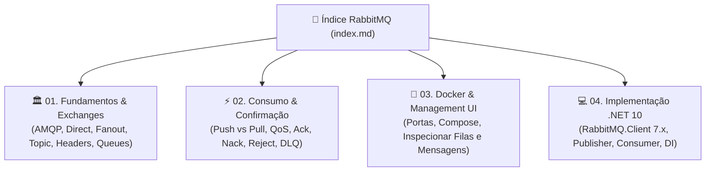

# RabbitMQ: Guia Completo de Mensageria Distribuída

Bem-vindo ao guia técnico oficial de **RabbitMQ** do ecossistema **FIAP Cloud Games**. Este módulo consolida desde os conceitos fundamentais do protocolo AMQP 0-9-1 até a implementação prática e resiliente em **.NET 10** e **Docker**.

---

## 📑 Sumário

- [1. Visão Geral da Trilha](#1-visão-geral-da-trilha)
- [2. Mapa Visual dos Módulos](#2-mapa-visual-dos-módulos)
- [3. Módulos Disponíveis](#3-módulos-disponíveis)
- [4. Relação com os Microsserviços do FIAP Cloud Games](#4-relação-com-os-microsserviços-do-fiap-cloud-games)

---

## 1. Visão Geral da Trilha

A mensageria assíncrona é a espinha dorsal da arquitetura orientada a eventos (**Event-Driven Architecture - EDA**) da nossa plataforma. Através do RabbitMQ, garantimos que picos de tráfego, falhas transitórias e operações demoradas (como envio de e-mails e transações com gateways bancários) sejam executados sem bloquear a experiência do usuário.

---

## 2. Mapa Visual dos Módulos

---

## 3. Módulos Disponíveis

| Módulo | Título | Conteúdo Principal |
|---|---|---|
| **01** | **[🏛️ Fundamentos, Arquitetura e Tipos de Exchange](01-fundamentos-e-conceitos.md)** | Protocolo AMQP, Producers, Brokers, Queues e o funcionamento aprofundado de **todos os tipos de Exchange** (`Direct`, `Fanout`, `Topic`, `Headers`, `Default`). |
| **02** | **[⚡ Formas de Recuperar e Finalizar Mensagens](02-consumo-e-confirmacao.md)** | Modelos de recuperação (**Push** vs **Pull**), controle de fluxo (**QoS / Prefetch**), estratégias de término (**BasicAck**, **BasicNack**, **BasicReject**), proteção contra loops infinitos (*Poison Messages*) e **Dead Letter Queues (DLQ)**. |
| **03** | **[🐳 Instalação via Docker & Guia da Management UI](03-instalacao-docker-management.md)** | Imagem `rabbitmq:3-management`, mapeamento de portas (`5672` e `15672`), integração ao `docker-compose.yml`, verificação com `healthcheck` e como inspecionar/publicar mensagens pela interface web. |
| **04** | **[💻 Implementação Prática em .NET 10 (C#)](04-implementacao-dotnet.md)** | Utilização do pacote assíncrono `RabbitMQ.Client` v7.x, implementação do `RabbitMqEventPublisher`, consumidor resiliente em `BackgroundService`, injeção de dependências e resolução de escopo com `IServiceScopeFactory`. |

---

## 4. Relação com os Microsserviços do FIAP Cloud Games

Todos os exemplos deste guia são baseados diretamente nos microsserviços do nosso ecossistema:
- **`fcg-fase-02--users`:** Publica `UserCreatedEvent` na exchange Topic `fcg.users.events`.
- **`fcg-fase-02--notifications`:** Consome eventos em segundo plano e despacha e-mails transacionais com confirmação manual (`BasicAck`).
- **`fcg-fase-02--catalog`:** Publica `OrderPlacedEvent` e consome `PaymentProcessedEvent` para liberar jogos na biblioteca.
- **`fcg-fase-02--payments`:** Consome pedidos na fila `payments.order-placed`, executa o simulador determinístico e publica o resultado para múltiplos consumidores (*Fan-Out* seletivo).

👉 **[Voltar para o Índice Geral da Documentação (`../index.md`)](../index.md)**
