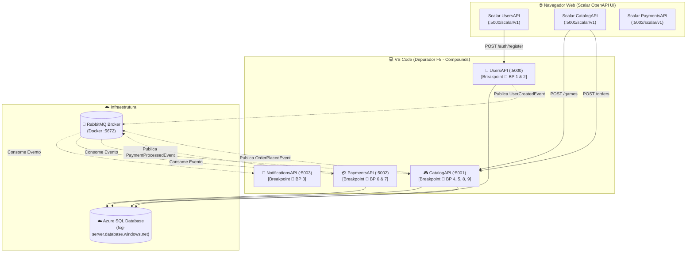

# Teste Integrado Ponta a Ponta em Modo Depuração no VS Code com Scalar

Este documento contém instruções para configuração e executação de **Teste Integrado Ponta a Ponta em Modo de Depuração (Debug Mode - F5) no Visual Studio Code (VS Code)**, realizando **100% dos disparos e validações diretamente pela interface gráfica interativa do Scalar** no seu navegador web.

Você verá como utilizar as **Configurações Compostas (`compounds`)** no arquivo `.vscode/launch.json` para lançar as 4 APIs simultaneamente nas portas amigáveis (`5000`, `5001`, `5002` e `5003`), posicionar **Breakpoints estratégicos** e ver o depurador do VS Code congelar a execução a cada clique nos botões **"Send Request"** do Scalar!

---

## 📑 Sumário

- [1. Visão Geral da Arquitetura de Testes com Scalar](#1-visão-geral-da-arquitetura-de-testes-com-scalar)
- [2. Passo 1: Pré-Requisitos e Extensões Obrigatórias no VS Code](#2-passo-1-pré-requisitos-e-extensões-obrigatórias-no-vs-code)
- [3. Passo 2: Preparação do Ambiente no Docker (Setup Limpo)](#3-passo-2-preparação-do-ambiente-no-docker-setup-limpo)
- [4. Passo 3: Configuração dos Arquivos `.vscode`](#4-passo-3-configuração-dos-arquivos-vscode)
  - [4.1. Arquivo de Compilação: `.vscode/tasks.json`](#41-arquivo-de-compilação-vscodetasksjson)
  - [4.2. Arquivo de Inicialização e Depuração: `.vscode/launch.json`](#42-arquivo-de-inicialização-e-depuração-vscodelaunchjson)
- [5. Passo 4: O Mapa Estratégico de Breakpoints no VS Code](#5-passo-4-o-mapa-estratégico-de-breakpoints-no-vs-code)
- [6. Passo 5: Iniciando a Sessão de Depuração Composta (`F5`)](#6-passo-5-iniciando-a-sessão-de-depuração-composta-f5)
- [7. Passo 6: Executando a Jornada Completa pelo Scalar](#7-passo-6-executando-a-jornada-completa-pelo-scalar)
  - [7.1. Hub de URLs Amigáveis do Scalar](#71-hub-de-urls-amigáveis-do-scalar)
  - [7.2. Etapa 1: Cadastro do Jogador e Disparo de E-mail (UsersAPI -> NotificationsAPI)](#72-etapa-1-cadastro-do-jogador-e-disparo-de-e-mail-usersapi---notificationsapi)
  - [7.3. Etapa 2: Autenticação do Jogador e do Administrador (UsersAPI)](#73-etapa-2-autenticação-do-jogador-e-do-administrador-usersapi)
  - [7.4. Etapa 3: Cadastro de Jogo no Catálogo com Perfil Admin (CatalogAPI)](#74-etapa-3-cadastro-de-jogo-no-catálogo-com-perfil-admin-catalogapi)
  - [7.5. Etapa 4: Pedido de Compra do Jogador e Orquestração Assíncrona (CatalogAPI -> PaymentsAPI -> CatalogAPI)](#75-etapa-4-pedido-de-compra-do-jogador-e-orquestração-assíncrona-catalogapi---paymentsapi---catalogapi)
  - [7.6. Etapa 5: Validação da Entrega do Jogo na Biblioteca (CatalogAPI)](#76-etapa-5-validação-da-entrega-do-jogo-na-biblioteca-catalogapi)
  - [7.7. Etapa 6 (Opcional): Auditoria da Transação Financeira (PaymentsAPI)](#77-etapa-6-opcional-auditoria-da-transação-financeira-paymentsapi)
- [8. Dicas de Produtividade no Depurador do VS Code com Scalar](#8-dicas-de-produtividade-no-depurador-do-vs-code-com-scalar)
- [9. Navegação](#9-navegação)

---

## 1. Visão Geral da Arquitetura de Testes com Scalar

Em vez de depender de scripts PowerShell ou ferramentas externas como Postman ou Insomnia, o ecossistema **FIAP Cloud Games** integra nativamente o **Scalar** (`Scalar.AspNetCore`). 

Cada microsserviço disponibiliza uma documentação OpenAPI rica, moderna e interativa na rota **`/scalar/v1`**, onde você pode preencher parâmetros, autenticar com Bearer Tokens JWT e disparar requisições HTTP diretamente pelo navegador.

Enquanto você clica nos botões do Scalar no navegador, o **VS Code pausa a execução nos métodos de aplicação, entidades de domínio e consumidores de mensageria**, permitindo inspecionar cada variável em tempo real:



---

## 2. Passo 1: Pré-Requisitos e Extensões Obrigatórias no VS Code

Certifique-se de ter instalado no seu VS Code:

1. **C# Dev Kit** (extensão oficial da Microsoft: `ms-dotnettools.csdevkit`).
2. **C#** (extensão base com depurador `coreclr`: `ms-dotnettools.csharp`).
3. **.NET 10 SDK** instalado no sistema. Confirme com o comando:
   ```bash
   dotnet --version
   ```
   *(Deve retornar `10.0.xxx`)*.

---

## 3. Passo 2: Preparação do Ambiente no Docker (Setup Limpo)

Como os bancos de dados estão hospedados no **Azure SQL Database** (`fcg-server.database.windows.net`), a única infraestrutura que precisa rodar no Docker local é o **RabbitMQ**.

> ⚠️ **ATENÇÃO CRÍTICA (Evitar Concorrência no RabbitMQ):**  
> Os contêineres das APIs no Docker **devem estar parados**. Se os contêineres estiverem ligados, eles competirão pelo consumo das filas do RabbitMQ com as instâncias do VS Code em regime de *Round-Robin*, fazendo com que os breakpoints nos consumers nunca sejam atingidos!

Abra um terminal na pasta `fcg-fase-02--orchestration` e execute:

```powershell
# 1. Parar todos os containers de microsserviços
docker compose stop users-api catalog-api payments-api notifications-api

# 2. Garantir que apenas o RabbitMQ está em execução
docker compose up -d rabbitmq

# 3. Confirmar que apenas o rabbitmq está ativo
docker compose ps
```

---

## 4. Passo 3: Configuração dos Arquivos `.vscode`

Na raiz da workspace (`fiap-cloud-games--fase-02/`), crie a pasta **`.vscode`** com os dois arquivos de automação abaixo:

### 4.1. Arquivo de Compilação: `.vscode/tasks.json`

```json
{
  "version": "2.0.0",
  "tasks": [
    {
      "label": "build-users",
      "command": "dotnet",
      "type": "process",
      "args": [
        "build",
        "${workspaceFolder}/fcg-fase-02--users/src/FCG02.UsersAPI.API/FCG02.UsersAPI.API.csproj",
        "/property:GenerateFullPaths=true",
        "/consoleloggerparameters:NoSummary"
      ],
      "problemMatcher": "$msCompile"
    },
    {
      "label": "build-catalog",
      "command": "dotnet",
      "type": "process",
      "args": [
        "build",
        "${workspaceFolder}/fcg-fase-02--catalog/src/FCG02.CatalogAPI.API/FCG02.CatalogAPI.API.csproj",
        "/property:GenerateFullPaths=true",
        "/consoleloggerparameters:NoSummary"
      ],
      "problemMatcher": "$msCompile"
    },
    {
      "label": "build-payments",
      "command": "dotnet",
      "type": "process",
      "args": [
        "build",
        "${workspaceFolder}/fcg-fase-02--payments/src/FCG02.PaymentsAPI.API/FCG02.PaymentsAPI.API.csproj",
        "/property:GenerateFullPaths=true",
        "/consoleloggerparameters:NoSummary"
      ],
      "problemMatcher": "$msCompile"
    },
    {
      "label": "build-notifications",
      "command": "dotnet",
      "type": "process",
      "args": [
        "build",
        "${workspaceFolder}/fcg-fase-02--notifications/src/FCG02.NotificationsAPI.API/FCG02.NotificationsAPI.API.csproj",
        "/property:GenerateFullPaths=true",
        "/consoleloggerparameters:NoSummary"
      ],
      "problemMatcher": "$msCompile"
    },
    {
      "label": "build-all",
      "dependsOn": [
        "build-users",
        "build-catalog",
        "build-payments",
        "build-notifications"
      ],
      "problemMatcher": []
    }
  ]
}
```

---

### 4.2. Arquivo de Inicialização e Depuração: `.vscode/launch.json`

Este arquivo define como cada API é iniciada nas portas amigáveis (`5000` a `5003`) e agrupa-as no compound **`"🚀 Todos os Microsserviços (Fase 02)"`**:

```json
{
  "version": "0.2.0",
  "configurations": [
    {
      "name": "UsersAPI",
      "type": "coreclr",
      "request": "launch",
      "preLaunchTask": "build-users",
      "program": "${workspaceFolder}/fcg-fase-02--users/src/FCG02.UsersAPI.API/bin/Debug/net10.0/FCG02.UsersAPI.API.dll",
      "args": [],
      "cwd": "${workspaceFolder}/fcg-fase-02--users/src/FCG02.UsersAPI.API",
      "stopAtEntry": false,
      "env": {
        "ASPNETCORE_ENVIRONMENT": "Development",
        "ASPNETCORE_URLS": "http://localhost:5000"
      }
    },
    {
      "name": "CatalogAPI",
      "type": "coreclr",
      "request": "launch",
      "preLaunchTask": "build-catalog",
      "program": "${workspaceFolder}/fcg-fase-02--catalog/src/FCG02.CatalogAPI.API/bin/Debug/net10.0/FCG02.CatalogAPI.API.dll",
      "args": [],
      "cwd": "${workspaceFolder}/fcg-fase-02--catalog/src/FCG02.CatalogAPI.API",
      "stopAtEntry": false,
      "env": {
        "ASPNETCORE_ENVIRONMENT": "Development",
        "ASPNETCORE_URLS": "http://localhost:5001"
      }
    },
    {
      "name": "PaymentsAPI",
      "type": "coreclr",
      "request": "launch",
      "preLaunchTask": "build-payments",
      "program": "${workspaceFolder}/fcg-fase-02--payments/src/FCG02.PaymentsAPI.API/bin/Debug/net10.0/FCG02.PaymentsAPI.API.dll",
      "args": [],
      "cwd": "${workspaceFolder}/fcg-fase-02--payments/src/FCG02.PaymentsAPI.API",
      "stopAtEntry": false,
      "env": {
        "ASPNETCORE_ENVIRONMENT": "Development",
        "ASPNETCORE_URLS": "http://localhost:5002"
      }
    },
    {
      "name": "NotificationsAPI",
      "type": "coreclr",
      "request": "launch",
      "preLaunchTask": "build-notifications",
      "program": "${workspaceFolder}/fcg-fase-02--notifications/src/FCG02.NotificationsAPI.API/bin/Debug/net10.0/FCG02.NotificationsAPI.API.dll",
      "args": [],
      "cwd": "${workspaceFolder}/fcg-fase-02--notifications/src/FCG02.NotificationsAPI.API",
      "stopAtEntry": false,
      "env": {
        "ASPNETCORE_ENVIRONMENT": "Development",
        "ASPNETCORE_URLS": "http://localhost:5003"
      }
    }
  ],
  "compounds": [
    {
      "name": "🚀 Todos os Microsserviços (Fase 02)",
      "configurations": [
        "UsersAPI",
        "CatalogAPI",
        "PaymentsAPI",
        "NotificationsAPI"
      ],
      "stopAll": true
    }
  ]
}
```

---

## 5. Passo 4: O Mapa Estratégico de Breakpoints no VS Code

Abra os arquivos indicados abaixo no VS Code (`Ctrl + P` para busca rápida) e insira um **Breakpoint (`F9` ou clique na margem esquerda)**:

| # | Microsserviço | Caminho Completo do Arquivo | O que inspecionar no painel Variables / Locals |
|---|---|---|---|
| **BP 1** | `UsersAPI` | `fcg-fase-02--users/src/FCG02.UsersAPI.Application/Services/UserService.cs`<br/>Método `RegisterAsync:` 👉 **Linha 30** (`ArgumentNullException.ThrowIfNull...`) | Payload do DTO vindo do Scalar, geração do salt/hash BCrypt e criação do usuário. |
| **BP 2** | `UsersAPI` | `fcg-fase-02--users/src/FCG02.UsersAPI.Infrastructure/Messaging/RabbitMqEventPublisher.cs`<br/>Método `PublishAsync:` 👉 **Linha 59** (`var connection = await GetConnectionAsync...`) | Payload JSON serializado do `UserCreatedEvent`, exchange `fcg.users.events`. |
| **BP 3** | `NotificationsAPI` | `fcg-fase-02--notifications/src/FCG02.NotificationsAPI.API/Services/RabbitMqConsumerService.cs`<br/>Método `ReceivedAyncs:` 👉 **Linha 130** (`var body = ea.Body.ToArray()...`) | O evento chegando no worker em background! Inspecionar dados do destinatário e log do e-mail. |
| **BP 4** | `CatalogAPI` | `fcg-fase-02--catalog/src/FCG02.CatalogAPI.Application/Services/OrderService.cs`<br/>Método `PlaceOrderAsync` 👉 **Linha 27** (`ArgumentNullException.ThrowIfNull...`) | Extração do `UserId` da claim JWT do Gamer, validação do jogo e preço. |
| **BP 5** | `CatalogAPI` | `fcg-fase-02--catalog/src/FCG02.CatalogAPI.Infrastructure/Messaging/RabbitMqEventPublisher.cs`<br/>Método `PublishAsync:` 👉 **Linha 67** (`var connection = await GetConnectionAsync...`) | Objeto `OrderPlacedEvent` montado com `OrderId`, `GameId` e `Price`. |
| **BP 6** | `CatalogAPI` | `fcg-fase-02--catalog/src/FCG02.CatalogAPI.Infrastructure/Messaging/PaymentProcessedConsumerService.cs`<br/>Método `OnMessageReceivedAsync:` 👉 **Linha 111** (`var rawBody = @event.Body.ToArray()...`) | Retorno do evento com `IsApproved == true` vindo do broker. |
| **BP 7** | `CatalogAPI` | `fcg-fase-02--catalog/src/FCG02.CatalogAPI.Application/Services/UserLibraryService.cs`<br/>Método `AddGameToLibraryASync:` 👉 **Linha 38** (`var game = await _gameRepository...`) | Adição da entidade `LibraryItem` ao Agregado `UserLibrary`, gravação no Azure SQL `fcg-02-catalogdb` e envio do `BasicAckAsync`. |
| **BP 8** | `PaymentsAPI` | `fcg-fase-02--payments/src/FCG02.PaymentsAPI.Infrastructure/Messaging/OrderPlacedConsumerService.cs`<br/>Método `OnMessageReceivedAsync:` 👉 **Linha 105** (`var rawBody = @event.Body.ToArray()...`) | O worker de pagamentos acorda ao receber a mensagem da fila `payments.order-placed`! |
| **BP 9** | `PaymentsAPI` | `fcg-fase-02--payments/src/FCG02.PaymentsAPI.Application/Services/PaymentService.cs`<br/>Método `ProcessOrderPaymentAsync:` 👉 **Linha 29** (`var existingTransaction = await _repository...`) | Aprovação pelo `IPaymentGatewaySimulator`, persistência no Azure SQL `fcg-02-paymentsdb` e emissão do evento `PaymentProcessedIntegrationEvent`. |


---

## 6. Passo 5: Iniciando a Sessão de Depuração Composta (`F5`)

1. Pressione **`Ctrl + Shift + D`** para abrir o menu **Run and Debug** no VS Code.
2. No menu dropdown no topo, selecione:  
   **`🚀 Todos os Microsserviços (Fase 02)`**.
3. Pressione a tecla **`F5`**.
4. O VS Code compilará os 4 projetos e iniciará todas as APIs com os depuradores conectados.
5. Na janela lateral **Call Stack**, você verá os 4 processos ativos:
   - `UsersAPI: Running (porta 5000)`
   - `CatalogAPI: Running (porta 5001)`
   - `PaymentsAPI: Running (porta 5002)`
   - `NotificationsAPI: Running (porta 5003)`

---

## 7. Passo 6: Executando a Jornada Completa pelo Scalar

Abra as interfaces do Scalar no seu navegador de preferência:

### 7.1. Hub de URLs Amigáveis do Scalar

| Microsserviço | URL do Scalar no Navegador | Porta Local |
|---|---|---|
| **UsersAPI** | **`http://localhost:5000/scalar/v1`** | **`5000`** |
| **CatalogAPI** | **`http://localhost:5001/scalar/v1`** | **`5001`** |
| **PaymentsAPI** | **`http://localhost:5002/scalar/v1`** | **`5002`** |

---

### 7.2. Etapa 1: Cadastro do Administrador/Jogador e Disparo de E-mail (UsersAPI -> NotificationsAPI)

1. No navegador, acesse **`http://localhost:5000/scalar/v1`**.
2. Na barra lateral esquerda, clique em **Auth** -> **`POST /api/v1/auth/register`**.
3. Na aba **Body**, insira o JSON do novo administrador:
   ```json
   {
     "name": "Administrador Um",
     "email": "administrador.um@administrador.com",
     "password": "SenhaForte123!",
     "role": 2
   }
   ```
4. Clique no botão azul **Send Request**:
   - ⚡ **O VS Code pausará imediatamente no BP 1 (`UserService.cs`)!**
   - No VS Code, olhe a janela **Variables -> Locals**: você verá `dto.Name = "Administrador Um"` e `dto.Role = Admin`.
   - Pressione **`F10`** para ver o hashing BCrypt e a criação da entidade.
   - Pressione **`F5` (Continue)**.
   - ⚡ **O VS Code pausará no BP 2 (`RabbitMqEventPublisher.cs`)**:
     - Inspecione a serialização do `UserCreatedEvent`.
     - Pressione **`F5` (Continue)**.
   - ⚡ **O VS Code saltará para o processo de NotificationsAPI no BP 3 (`RabbitMqConsumerService.cs`)**:
     - Observe como o depurador mudou de contexto automaticamente!
     - Inspecione a variável `eventData`: o email `kratos@sparta.com` foi entregue via RabbitMQ.
     - Pressione **`F5` (Continue)**.
     - Veja no console do NotificationsAPI o log do envio simulado do e-mail de boas-vindas.
5. Volte ao Scalar no navegador: a resposta será exibida com status **`201 Created`** contendo o ID do usuário gerado.
6. Volte para o passo 1 para cadastrar o Jogador. 
  ```json
   {
     "name": "Jogador Um",
     "email": "jogador.um@jogador.com",
     "password": "SenhaForte123!",
     "role": 1
   }
   ```

---

### 7.3. Etapa 2: Autenticação do Administrador e do Jogador (UsersAPI)

1. No Scalar de UsersAPI, selecione **`POST /api/v1/auth/login`**.
2. No corpo da requisição, informe:
   ```json
   {
     "email": "administrador.um@administrador.com",
     "password": "SenhaForte123!"
   }
   ```
3. Clique em **Send Request**.
4. A resposta retornará **`200 OK`**. **Copie o valor do campo `"token"`**.
5. Voltei para o passo 1 para autenticar o jogador.
  ```json
   {
     "email": "jogador.um@jogador.com",
     "password": "SenhaForte123!"
   }
   ```

OBS: O token do administrador será chamado (neste documento) de ADMIN_TOKEN e o token do jogador será chamado de GAMER_TOKEN.

---

### 7.4. Etapa 3: Cadastro de Jogo no Catálogo com Perfil Admin (CatalogAPI)

1. No navegador, acesse **`http://localhost:5001/scalar/v1`** (CatalogAPI).
2. Na barra lateral esquerda, clique em **Games** -> **`POST /api/v1/games`**.
3. **Configurando a Autorização no Scalar:**
   - Na parte superior da tela de detalhes da requisição, localize a seção **Auth / Security** (ou o botão **Authorize**).
   - Selecione o tipo **Bearer Token** e cole o seu **`ADMIN_TOKEN`**.
4. No **Body**, insira os dados do novo jogo:
   ```json
   {
     "title": "Elden Ring: Shadow of the Erdtree",
     "description": "Aclamado RPG de ação e fantasia em mundo aberto.",
     "price": 199.90,
     "category": 2,
     "tags": ["rpg", "souls", "goty"]
   }
   ```
5. Clique em **Send Request**.
6. A resposta retornará **`201 Created`**. **Copie o campo `"id"` do jogo gerado** (ex: `01931a23-4567-...`).

---

### 7.5. Etapa 4: Pedido de Compra do Jogador e Orquestração Assíncrona (CatalogAPI -> PaymentsAPI -> CatalogAPI)

Esta é a etapa mais impressionante da depuração, onde você acompanhará a **Saga coreografada completa** acontecendo entre os processos!

1. No Scalar de CatalogAPI (`http://localhost:5001/scalar/v1`), selecione **Orders** -> **`POST /api/v1/orders`**.
2. **Atualize o Token no Scalar:**
   - Altere a autenticação Bearer para usar o seu **`GAMER_TOKEN`** (o token do jogador Kratos).
3. No **Body**, envie o `gameId` que você copiou no passo anterior:
   ```json
   {
     "gameId": "COLE_AQUI_O_ID_DO_JOGO"
   }
   ```
4. Clique no botão azul **Send Request**:
   - ⚡ **O VS Code pausará no BP 4 (`CatalogAPI -> OrderService.cs`)**:
     - Inspecione a variável `userId`: ela foi extraída automaticamente das claims do token JWT do Scalar!
     - Pressione **`F10`** e veja a verificação de que o jogador ainda não possui o jogo.
     - Pressione **`F5` (Continue)**.
   - ⚡ **O VS Code pausará no BP 5 (`CatalogAPI -> RabbitMqEventPublisher.cs`)**:
     - Veja o `OrderPlacedEvent` com o valor `199.90` pronto para ser publicado no RabbitMQ.
     - Pressione **`F5` (Continue)**.
     - O Scalar no navegador já responderá com **`202 Accepted`** (`status: "PendingPayment"`).
   - ⚡ **Instantaneamente, o VS Code saltará para a sessão de PaymentsAPI no BP 6 (`OrderPlacedConsumerService.cs`)**:
     - O worker de pagamentos foi acordado pelo RabbitMQ com a mensagem da fila!
     - Pressione **`F5` (Continue)**.
   - ⚡ **O depurador pausará no BP 7 (`PaymentsAPI -> PaymentService.cs`)**:
     - Veja a aprovação da cobrança (`status = Approved`).
     - Pressione **`F10`** e veja a entidade sendo salva no Azure SQL (`paymentsdb`).
     - Pressione **`F5` (Continue)**. O evento `PaymentProcessedIntegrationEvent` é publicado.
   - ⚡ **O depurador saltará de volta para o CatalogAPI no BP 8 (`PaymentProcessedConsumerService.cs`)**:
     - O CatalogAPI recebeu a confirmação de liquidação financeira!
     - Pressione **`F5` (Continue)**.
   - ⚡ **O depurador pausará no BP 9 (`CatalogAPI -> UserLibraryService.cs`)**:
     - Inspecione a entidade `library`: o novo `LibraryItem` está sendo anexado.
     - Pressione **`F10`** na linha `await _libraryRepository.UpdateAsync(library)` para ver a gravação na tabela `LibraryItems` do Azure SQL (`catalogdb`).
     - Pressione **`F5` (Continue)**.

---

### 7.6. Etapa 5: Validação da Entrega do Jogo na Biblioteca (CatalogAPI)

1. No Scalar de CatalogAPI, selecione **Library** -> **`GET /api/v1/library`**.
2. Certifique-se de que a autenticação está com o seu **`GAMER_TOKEN`**.
3. Clique em **Send Request**.
4. O Scalar exibirá o status **`200 OK`** com o JSON da biblioteca do jogador:
   ```json
   {
     "userId": "01931a20-...",
     "items": [
       {
         "gameId": "01931a23-...",
         "gameTitle": "Elden Ring: Shadow of the Erdtree",
         "pricePaid": 199.90,
         "acquiredAt": "2026-10-31T20:45:00Z"
       }
     ]
   }
   ```
   🎉 **Comprovação total:** O jogo foi comprado, processado assincronamente pelo RabbitMQ e entregue com sucesso na biblioteca do jogador no Azure SQL!

---

### 7.7. Etapa 6 (Opcional): Auditoria da Transação Financeira (PaymentsAPI)

1. No navegador, acesse **`http://localhost:5002/scalar/v1`** (PaymentsAPI).
2. Na barra lateral, selecione **Payments** -> **`GET /api/v1/payments/{orderId}`**.
3. Informe o `orderId` retornado na Etapa 4 e clique em **Send Request**.
4. Você verá os detalhes completos da auditoria financeira persistida no Azure SQL:
   ```json
   {
     "id": "...",
     "orderId": "...",
     "amount": 199.90,
     "status": "Approved",
     "method": "CreditCard",
     "processedAt": "2026-10-31T20:45:01Z"
   }
   ```

---

## 8. Dicas de Produtividade no Depurador do VS Code com Scalar

| Recurso | Atalho | Benefício ao Testar via Scalar |
|---|---|---|
| **Debug Console como REPL** | `Ctrl + Shift + Y` | Quando um breakpoint congelar uma requisição do Scalar, abra o Debug Console e digite `context.User.Claims` para ver todas as claims enviadas pelo Scalar em tempo real! |
| **Painel de Call Stack** | `Ctrl + Shift + D` | Permite alternar o foco entre os 4 processos. Se o breakpoint parar no CatalogAPI e depois no PaymentsAPI, o VS Code ajusta a janela e a linha de código automaticamente. |
| **Pausar e Inspecionar o RabbitMQ** | `http://localhost:15672` | Quando o breakpoint parar antes do `BasicAckAsync` no `PaymentProcessedConsumerService`, abra a UI do RabbitMQ no navegador: você verá a mensagem no estado **Unacked** (em processamento). Ao apertar `F5` no VS Code, a mensagem é confirmada e sai da fila! |

---

## 9. Navegação

- ⬅️ **[Voltar para a Aula 03: Infraestrutura Compartilhada no Kubernetes (03-infraestrutura-kubernetes.md)](03-infraestrutura-kubernetes.md)**
- 📑 **[Voltar para o Índice de Orquestração (`index.md`)](index.md)**
- 🏠 **[Voltar para a Central de Tutoria](../../tutor/index.md)**
