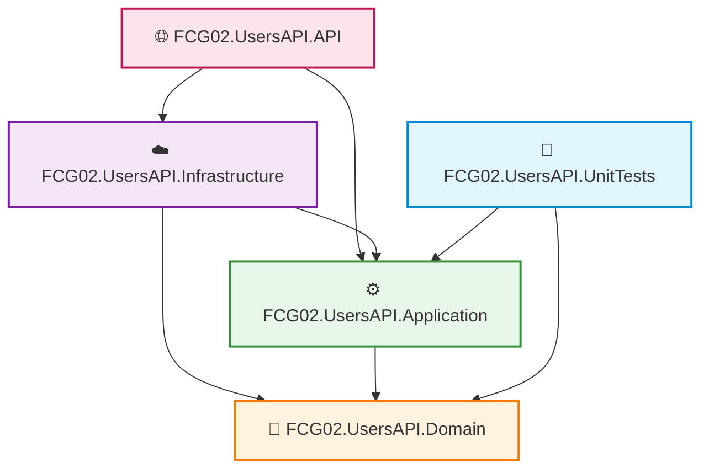

# Gerenciamento de Projetos, Referências e Pacotes NuGet

No segundo módulo do guia de **Desenvolvimento .NET no Visual Studio Code**, você aprenderá a estruturar soluções corporativas complexas. Vamos dominar os comandos da .NET CLI para vincular projetos à Solution, estabelecer referências arquiteturais entre camadas seguindo a **Clean Architecture**, pesquisar pacotes diretamente pelo terminal e gerenciar dependências do **NuGet** com práticas de segurança e auditoria de vulnerabilidades.

---

## 📑 Sumário

- [1. Vinculando Projetos à Solução (`dotnet sln`)](#1-vinculando-projetos-à-solução-dotnet-sln)
  - [1.1. Adicionar Projetos Individualmente e em Lote](#11-adicionar-projetos-individualmente-e-em-lote)
  - [1.2. Listar Projetos da Solução (`dotnet sln list`)](#12-listar-projetos-da-solução-dotnet-sln-list)
  - [1.3. Remover Projetos da Solução (`dotnet sln remove`)](#13-remover-projetos-da-solução-dotnet-sln-remove)
- [2. Referências entre Projetos (Clean Architecture)](#2-referências-entre-projetos-clean-architecture)
  - [2.1. A Regra de Dependência Arquitetural](#21-a-regra-de-dependência-arquitetural)
  - [2.2. Adicionar Referências de Projeto (`dotnet add reference`)](#22-adicionar-referências-de-projeto-dotnet-add-reference)
  - [2.3. Listar e Remover Referências](#23-listar-e-remover-referências)
- [3. Pesquisa de Pacotes NuGet](#3-pesquisa-de-pacotes-nuget)
  - [3.1. Pesquisa Direta no Terminal (`dotnet package search`)](#31-pesquisa-direta-no-terminal-dotnet-package-search)
  - [3.2. Pesquisa no Portal Oficial NuGet.org](#32-pesquisa-no-portal-oficial-nugetorg)
  - [3.3. Interface Gráfica no VS Code (Extensão NuGet Gallery)](#33-interface-gráfica-no-vs-code-extensão-nuget-gallery)
- [4. Instalação e Remoção de Pacotes NuGet](#4-instalação-e-remoção-de-pacotes-nuget)
  - [4.1. Instalar a Versão Mais Recente Compatível](#41-instalar-a-versão-mais-recente-compatível)
  - [4.2. Instalar Versões Específicas (`--version`)](#42-instalar-versões-específicas---version)
  - [4.3. Pacotes Oficiais Utilizados no FIAP Cloud Games](#43-pacotes-oficiais-utilizados-no-fiap-cloud-games)
  - [4.4. Remover um Pacote NuGet (`dotnet remove package`)](#44-remover-um-pacote-nuget-dotnet-remove-package)
- [5. Auditoria de Dependências e Segurança](#5-auditoria-de-dependências-e-segurança)
  - [5.1. Listar Pacotes Instalados](#51-listar-pacotes-instalados)
  - [5.2. Identificar Pacotes Desatualizados (`--outdated`)](#52-identificar-pacotes-desatualizados---outdated)
  - [5.3. Detectar Vulnerabilidades de Segurança CVE (`--vulnerable`)](#53-detectar-vulnerabilidades-de-segurança-cve---vulnerable)
- [6. Navegação](#6-navegação)

---

## 1. Vinculando Projetos à Solução (`dotnet sln`)

Após criar os projetos com `dotnet new` ([📖 Ver Aula 01](01-ambiente-extensoes-e-dotnet-cli.md)), eles existem como pastas soltas no disco. Para que o compilador, o VS Code e as ferramentas de teste compreendam a hierarquia completa, você deve registrá-los no arquivo de solução (`.sln` ou `.slnx`).

### 1.1. Adicionar Projetos Individualmente e em Lote

```powershell
# 1. Adicionar um projeto individual à solução:
dotnet sln add src/FCG02.UsersAPI.Domain/FCG02.UsersAPI.Domain.csproj

# 2. Adicionar múltiplos projetos em uma única linha de comando:
dotnet sln add src/FCG02.UsersAPI.Application/FCG02.UsersAPI.Application.csproj `
               src/FCG02.UsersAPI.Infrastructure/FCG02.UsersAPI.Infrastructure.csproj `
               src/FCG02.UsersAPI.API/FCG02.UsersAPI.API.csproj

# 3. Super dica no PowerShell: Adicionar TODOS os projetos da pasta de uma só vez usando wildcard!
dotnet sln add (Get-ChildItem -Recurse -Filter *.csproj).FullName
```

---

### 1.2. Listar Projetos da Solução (`dotnet sln list`)
Para inspecionar quais projetos estão vinculados à solução atual:

```powershell
dotnet sln list
```

#### Saída típica:
```text
Project(s)
----------
src/FCG02.UsersAPI.Domain/FCG02.UsersAPI.Domain.csproj
src/FCG02.UsersAPI.Application/FCG02.UsersAPI.Application.csproj
src/FCG02.UsersAPI.Infrastructure/FCG02.UsersAPI.Infrastructure.csproj
src/FCG02.UsersAPI.API/FCG02.UsersAPI.API.csproj
tests/FCG02.UsersAPI.UnitTests/FCG02.UsersAPI.UnitTests.csproj
```

---

### 1.3. Remover Projetos da Solução (`dotnet sln remove`)
Caso queira desvincular um projeto da solução:

```powershell
dotnet sln remove src/ProjetoObsoleto/ProjetoObsoleto.csproj
```
*(O comando desvincula o projeto da solution, mas **não apaga** os arquivos físicos do seu disco rígido)*.

---

## 2. Referências entre Projetos (Clean Architecture)

### 2.1. A Regra de Dependência Arquitetural

Em uma Clean Architecture profissional:
- O **Domain** é o coração da regra de negócio e **não referencia ninguém** (livre de frameworks e bibliotecas de terceiros).
- A **Application** referencia apenas o **Domain**.
- A **Infrastructure** implementa contratos e referencia **Application** e **Domain**.
- A **API** (apresentação) orquestra a injeção de dependências no `Program.cs` e referencia **Application** e **Infrastructure**.
- O projeto de **UnitTests** referencia **Domain** e **Application** para testar regras sem acoplamento de banco.



---

### 2.2. Adicionar Referências de Projeto (`dotnet add reference`)

A sintaxe padrão da CLI é:  
`dotnet add <PROJETO_DESTINO> reference <PROJETOS_DE_ORIGEM>`

Exemplo prático configurando as referências da `UsersAPI`:

```powershell
# 1. Application depende de Domain:
dotnet add src/FCG02.UsersAPI.Application/FCG02.UsersAPI.Application.csproj reference src/FCG02.UsersAPI.Domain/FCG02.UsersAPI.Domain.csproj

# 2. Infrastructure depende de Domain e Application:
dotnet add src/FCG02.UsersAPI.Infrastructure/FCG02.UsersAPI.Infrastructure.csproj reference `
           src/FCG02.UsersAPI.Domain/FCG02.UsersAPI.Domain.csproj `
           src/FCG02.UsersAPI.Application/FCG02.UsersAPI.Application.csproj

# 3. API depende de Application e Infrastructure:
dotnet add src/FCG02.UsersAPI.API/FCG02.UsersAPI.API.csproj reference `
           src/FCG02.UsersAPI.Application/FCG02.UsersAPI.Application.csproj `
           src/FCG02.UsersAPI.Infrastructure/FCG02.UsersAPI.Infrastructure.csproj

# 4. UnitTests depende de Domain e Application:
dotnet add tests/FCG02.UsersAPI.UnitTests/FCG02.UsersAPI.UnitTests.csproj reference `
           src/FCG02.UsersAPI.Domain/FCG02.UsersAPI.Domain.csproj `
           src/FCG02.UsersAPI.Application/FCG02.UsersAPI.Application.csproj
```

---

### 2.3. Listar e Remover Referências

```powershell
# Inspecionar as referências de projeto declaradas em um .csproj:
dotnet list src/FCG02.UsersAPI.API/FCG02.UsersAPI.API.csproj reference

# Remover uma referência incorreta:
dotnet remove src/FCG02.UsersAPI.Domain/FCG02.UsersAPI.Domain.csproj reference src/FCG02.UsersAPI.Infrastructure/FCG02.UsersAPI.Infrastructure.csproj
```

---

## 3. Pesquisa de Pacotes NuGet

O **NuGet** é o gerenciador de pacotes oficial do ecossistema .NET, hospedando centenas de milhares de bibliotecas públicas e corporativas.

### 3.1. Pesquisa Direta no Terminal (`dotnet package search`)
Desde as versões recentes do .NET SDK, você pode pesquisar pacotes diretamente pelo terminal sem abrir o navegador:

```powershell
# 1. Pesquisar pacotes para Entity Framework Core com SQL Server (Azure Database)
dotnet package search Microsoft.EntityFrameworkCore.SqlServer

# 2. Pesquisar clientes oficiais de RabbitMQ
dotnet package search RabbitMQ.Client

# 3. Pesquisar bibliotecas de documentação OpenAPI moderna
dotnet package search Scalar.AspNetCore

# 4. Pesquisar bibliotecas de testes e mocking
dotnet package search Moq
dotnet package search FluentAssertions
```

A saída exibe o ID exato do pacote, a versão estável mais recente e o número de downloads na comunidade.

---

### 3.2. Pesquisa no Portal Oficial NuGet.org
Acessando [nuget.org](https://www.nuget.org), você pode inspecionar:
- Licença do pacote (MIT, Apache, etc.);
- Gráfico de compatibilidade com o target framework (`net10.0`);
- Dependências transitivas que o pacote trará consigo;
- Instruções prontas para inclusão via CLI.

---

### 3.3. Interface Gráfica no VS Code (Extensão NuGet Gallery)
Se você instalou a extensão **NuGet Gallery** ([📖 Ver Aula 01](01-ambiente-extensoes-e-dotnet-cli.md)):
1. Pressione `Ctrl + Shift + P` no VS Code.
2. Digite: `> Open NuGet Gallery`.
3. Uma interface visual rica se abrirá com campo de busca, botão de instalação em 1 clique e seleção visual de qual projeto (`.csproj`) receberá a biblioteca.

---

## 4. Instalação e Remoção de Pacotes NuGet

### 4.1. Instalar a Versão Mais Recente Compatível
A sintaxe básica adiciona a biblioteca ao arquivo `.csproj` e executa um `dotnet restore` automático:

```powershell
dotnet add <caminho.csproj> package <NomeDoPacote>
```

### 4.2. Instalar Versões Específicas (`--version`)
Em ambientes de produção com requisitos estritos de governança, fixe a versão exata do pacote:

```powershell
dotnet add src/FCG02.UsersAPI.Infrastructure/FCG02.UsersAPI.Infrastructure.csproj package RabbitMQ.Client --version 7.1.1
```

---

### 4.3. Pacotes Oficiais Utilizados no FIAP Cloud Games

Consulte a matriz de pacotes instalados em nossa arquitetura:

#### Na Camada de Infraestrutura (`Infrastructure`):
```powershell
# 1. ORM Entity Framework Core e Provedor Oficial para Azure Database (SQL Server):
dotnet add src/FCG02.UsersAPI.Infrastructure package Microsoft.EntityFrameworkCore.SqlServer --version 10.0.14
dotnet add src/FCG02.UsersAPI.Infrastructure package Microsoft.EntityFrameworkCore.Design --version 10.0.14

# 2. Mensageria Assíncrona com RabbitMQ v7:
dotnet add src/FCG02.UsersAPI.Infrastructure package RabbitMQ.Client --version 7.1.1

# 3. Criptografia Segura de Senhas (BCrypt):
dotnet add src/FCG02.UsersAPI.Infrastructure package BCrypt.Net-Next --version 4.0.3

# 4. Emissão e Validação de Tokens JWT:
dotnet add src/FCG02.UsersAPI.Infrastructure package System.IdentityModel.Tokens.Jwt --version 8.6.0
```

#### Na Camada de Apresentação (`API`):
```powershell
# 1. Autenticação JWT Bearer no ASP.NET Core:
dotnet add src/FCG02.UsersAPI.API package Microsoft.AspNetCore.Authentication.JwtBearer --version 10.0.5

# 2. Documentação Interativa Moderna com Scalar:
dotnet add src/FCG02.UsersAPI.API package Scalar.AspNetCore --version 2.0.18
dotnet add src/FCG02.UsersAPI.API package Microsoft.AspNetCore.OpenApi --version 10.0.5
```

#### No Projeto de Testes Unitários (`UnitTests`):
```powershell
dotnet add tests/FCG02.UsersAPI.UnitTests package Moq --version 4.20.72
dotnet add tests/FCG02.UsersAPI.UnitTests package FluentAssertions --version 8.0.1
```

---

### 4.4. Remover um Pacote NuGet (`dotnet remove package`)
Para remover uma biblioteca obsoleta e limpar o `.csproj`:

```powershell
dotnet remove src/FCG02.UsersAPI.Infrastructure/FCG02.UsersAPI.Infrastructure.csproj package PacoteObsoleto
```

---

## 5. Auditoria de Dependências e Segurança

### 5.1. Listar Pacotes Instalados
Para inspecionar todas as dependências diretas de um projeto:

```powershell
dotnet list src/FCG02.UsersAPI.API/FCG02.UsersAPI.API.csproj package
```

---

### 5.2. Identificar Pacotes Desatualizados (`--outdated`)
Exibe uma tabela comparando a versão atualmente instalada com a versão estável mais recente publicada no NuGet:

```powershell
dotnet list package --outdated
```

#### Saída típica:
```text
Project `FCG02.UsersAPI.Infrastructure` has the following updates to its packages
   [net10.0]:
   Top-level Package                  Requested   Resolved   Latest
   > RabbitMQ.Client                  7.0.0       7.0.0      7.1.1
```

---

### 5.3. Detectar Vulnerabilidades de Segurança CVE (`--vulnerable`)
O compilador .NET consulta a base global de vulnerabilidades da Microsoft e da comunidade para avisar se alguma biblioteca do seu projeto possui brechas de segurança conhecidas (*Common Vulnerabilities and Exposures - CVE*):

```powershell
dotnet list package --vulnerable --include-transitive
```

> 🛡️ **Boas Práticas de DevSecOps:**  
> Execute `dotnet list package --vulnerable` antes de cada deploy em produção ou integre este comando à sua esteira de CI/CD no GitHub Actions. Se uma vulnerabilidade for encontrada, atualize o pacote imediatamente para a versão corrigida!

---

## 6. Navegação

- ⬅️ **[Voltar para a Aula 01: Ambiente, Extensões e Criação de Projetos (`01-ambiente-extensoes-e-dotnet-cli.md`)](01-ambiente-extensoes-e-dotnet-cli.md)**
- 📑 **[Ir para o Índice do Guia de VS Code (`index.md`)](index.md)**
- ➡️ **[Avançar para a Aula 03: Automação com tasks.json e launch.json (`03-automacao-com-tasks-e-launch.md`)](03-automacao-com-tasks-e-launch.md)**
