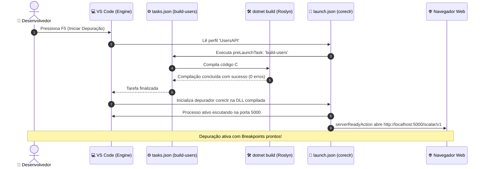

# Automação no VS Code: Os Arquivos tasks.json e launch.json

No terceiro módulo do guia de **Desenvolvimento .NET no Visual Studio Code**, você aprenderá a configurar a automação completa do seu fluxo de trabalho de compilação e execução. Vamos explorar a pasta especial `.vscode/`, dissecar os arquivos **`tasks.json`** e **`launch.json`**, entender a função de cada campo e compreender a sinergia que permite compilar o código em C# e inicializar a API com um único clique de tecla.

---

## 📑 Sumário

- [1. A Pasta Especial `.vscode/`](#1-a-pasta-especial-vscode)
  - [1.1. Onde deve ser criada?](#11-onde-deve-ser-criada)
  - [1.2. Qual a função dessa pasta e o que ela contém?](#12-qual-a-função-dessa-pasta-e-o-que-ela-contém)
  - [1.3. Deve ser commitada no Git?](#13-deve-ser-commitada-no-git)
- [2. O Arquivo `tasks.json` em Detalhes](#2-o-arquivo-tasksjson-em-detalhes)
  - [2.1. Qual a função do `tasks.json`?](#21-qual-a-função-do-tasksjson)
  - [2.2. Anatomia e Dissecação dos Campos](#22-anatomia-e-dissecação-dos-campos)
  - [2.3. Captura de Erros com `problemMatcher: "$msCompile"`](#23-captura-de-erros-com-problemmatcher-mscompile)
  - [2.4. Encadeando Tarefas com `dependsOn`](#24-encadeando-tarefas-com-dependson)
  - [2.5. O `tasks.json` Real da Nossa Solução](#25-o-tasksjson-real-da-nossa-solução)
- [3. O Arquivo `launch.json` em Detalhes](#3-o-arquivo-launchjson-em-detalhes)
  - [3.1. Qual a função do `launch.json`?](#31-qual-a-função-do-launchjson)
  - [3.2. Anatomia e Dissecação dos Campos](#32-anatomia-e-dissecação-dos-campos)
  - [3.3. O Depurador `coreclr` e o Caminho do Binário (`program`)](#33-o-depurador-coreclr-e-o-caminho-do-binário-program)
  - [3.4. Injeção de Variáveis de Ambiente (`env`) e Portas](#34-injeção-de-variáveis-de-ambiente-env-e-portas)
  - [3.5. Abertura Automática do Navegador (`serverReadyAction`)](#35-abertura-automática-do-navegador-serverreadyaction)
- [4. A Sinergia entre `tasks.json` e `launch.json` (`preLaunchTask`)](#4-a-sinergia-entre-tasksjson-e-launchjson-prelaunchtask)
  - [4.1. Diagrama de Fluxo de Inicialização](#41-diagrama-de-fluxo-de-inicialização)
- [5. Navegação](#5-navegação)

---

## 1. A Pasta Especial `.vscode/`

### 1.1. Onde deve ser criada?
A pasta **`.vscode/`** deve ser criada **exclusivamente na raiz do seu workspace** (diretório raiz aberto no Visual Studio Code).

No caso da nossa arquitetura distribuída, ela reside na raiz do repositório guarda-chuva:
```text
fiap-cloud-games--fase-02/
├── .vscode/                      # <- Pasta de automação do workspace
│   ├── launch.json               # Perfis de depuração e execução (F5)
│   └── tasks.json                # Tarefas de compilação (Build / Restore)
├── fcg-fase-02--orchestration/
├── fcg-fase-02--users/
├── fcg-fase-02--catalog/
├── fcg-fase-02--payments/
└── fcg-fase-02--notifications/
```

### 1.2. Qual a função dessa pasta e o que ela contém?
A pasta `.vscode/` guarda as configurações de automação compartilhadas do projeto:
- **`tasks.json`:** Define comandos de compilação (`dotnet build`), scripts de restore ou rotinas de terminal que rodam antes da execução.
- **`launch.json`:** Define como o VS Code inicializa as aplicações em modo de depuração (*debugging*), quais argumentos passar, quais variáveis de ambiente injetar e em quais portas escutar.
- **`settings.json` (Opcional):** Define preferências de formatação, regras de linter C# e encoding padronizado para quem abrir este workspace.
- **`extensions.json` (Opcional):** Lista as extensões recomendadas para os desenvolvedores do time.

### 1.3. Deve ser commitada no Git?
**SIM!**  
Os arquivos `launch.json` e `tasks.json` devem ser versionados no repositório Git corporativo. Isso garante que qualquer membro da equipe ou novo desenvolvedor que clonar o projeto consiga pressionar `F5` e iniciar as APIs imediatamente, sem perder horas configurando parâmetros de depuração manualmente.

---

## 2. O Arquivo `tasks.json` em Detalhes

### 2.1. Qual a função do `tasks.json`?
O `tasks.json` ensina o VS Code a **compilar o seu código-fonte**. Sem ele, o VS Code seria apenas um editor de texto e não saberia qual comando executar para transformar seus arquivos `.cs` em DLLs executáveis.

### 2.2. Anatomia e Dissecação dos Campos

```json
{
  "version": "2.0.0",
  "tasks": [
    {
      "label": "build-users",
      "command": "dotnet",
      "type": "process",
      "args": [
        "build",
        "${workspaceFolder}/fcg-fase-02--users/src/FCG02.UsersAPI.API/FCG02.UsersAPI.API.csproj",
        "/property:GenerateFullPaths=true",
        "/consoleloggerparameters:NoSummary"
      ],
      "problemMatcher": "$msCompile"
    }
  ]
}
```

#### Dissecando cada campo:
- **`version: "2.0.0"`:** Versão do schema de tarefas do VS Code.
- **`label`:** O nome exclusivo da tarefa (ex: `"build-users"`). É esse rótulo que será chamado pelo `launch.json`.
- **`command: "dotnet"`:** O executável do sistema operacional que será invocado no terminal.
- **`type: "process"`:** Executa o processo binário diretamente (mais rápido e consome menos memória do que `type: "shell"`).
- **`args`:** A lista de argumentos passados para o executável `dotnet`:
  - `"build"`: Executa o comando de compilação;
  - `"${workspaceFolder}/..."`: Utiliza a variável interna do VS Code `${workspaceFolder}` para montar o caminho absoluto até o arquivo `.csproj` de forma agnóstica de sistema operacional;
  - `"/property:GenerateFullPaths=true"`: Força o compilador C# a emitir caminhos de arquivo completos nas mensagens de erro.

---

### 2.3. Captura de Erros com `problemMatcher: "$msCompile"`
O campo **`problemMatcher: "$msCompile"`** é fundamental:
- Ele ensina o VS Code a interceptar a saída de texto do compilador Roslyn do .NET.
- Se houver um erro de sintaxe em uma linha de código, o VS Code destaca a linha em vermelho no editor e lista o erro na aba **Problems** (`Ctrl + Shift + M`).
- Clicar duas vezes no erro na aba *Problems* leva o cursor diretamente para a linha e coluna do arquivo C# com o problema!

---

### 2.4. Encadeando Tarefas com `dependsOn`
Você pode criar uma tarefa mestre que executa múltiplas tarefas filhas em paralelo:

```json
{
  "label": "build-all",
  "dependsOn": [
    "build-users",
    "build-catalog",
    "build-payments",
    "build-notifications"
  ],
  "problemMatcher": []
}
```
A tarefa `build-all` dispara a compilação das 4 APIs simultaneamente!

---

### 2.5. O `tasks.json` Real da Nossa Solução

Localização: `.vscode/tasks.json`

```json
{
    "version": "2.0.0",
    "tasks": [
        {
            "label": "build-users",
            "command": "dotnet",
            "type": "process",
            "args": [
                "build",
                "${workspaceFolder}/fcg-fase-02--users/src/FCG02.UsersAPI.API/FCG02.UsersAPI.API.csproj",
                "/property:GenerateFullPaths=true",
                "/consoleloggerparameters:NoSummary"
            ],
            "problemMatcher": "$msCompile"
        },
        {
            "label": "build-catalog",
            "command": "dotnet",
            "type": "process",
            "args": [
                "build",
                "${workspaceFolder}/fcg-fase-02--catalog/src/FCG02.CatalogAPI.API/FCG02.CatalogAPI.API.csproj",
                "/property:GenerateFullPaths=true",
                "/consoleloggerparameters:NoSummary"
            ],
            "problemMatcher": "$msCompile"
        },
        {
            "label": "build-payments",
            "command": "dotnet",
            "type": "process",
            "args": [
                "build",
                "${workspaceFolder}/fcg-fase-02--payments/src/FCG02.PaymentsAPI.API/FCG02.PaymentsAPI.API.csproj",
                "/property:GenerateFullPaths=true",
                "/consoleloggerparameters:NoSummary"
            ],
            "problemMatcher": "$msCompile"
        },
        {
            "label": "build-notifications",
            "command": "dotnet",
            "type": "process",
            "args": [
                "build",
                "${workspaceFolder}/fcg-fase-02--notifications/src/FCG02.NotificationsAPI.API/FCG02.NotificationsAPI.API.csproj",
                "/property:GenerateFullPaths=true",
                "/consoleloggerparameters:NoSummary"
            ],
            "problemMatcher": "$msCompile"
        },
        {
            "label": "build-all",
            "dependsOn": [
                "build-users",
                "build-catalog",
                "build-payments",
                "build-notifications"
            ],
            "problemMatcher": []
        }
    ]
}
```

---

## 3. O Arquivo `launch.json` em Detalhes

### 3.1. Qual a função do `launch.json`?
O `launch.json` configura os **perfis de depuração (*Launch Configurations*)**. Quando você abre a aba *Run and Debug* (`Ctrl + Shift + D`) e clica no botão de "Play" verde (ou aperta `F5`), é este arquivo que dita como o depurador inicializa o processo.

---

### 3.2. Anatomia e Dissecação dos Campos

Exemplo de configuração da `UsersAPI`:

```json
{
  "name": "UsersAPI",
  "type": "coreclr",
  "request": "launch",
  "preLaunchTask": "build-users",
  "program": "${workspaceFolder}/fcg-fase-02--users/src/FCG02.UsersAPI.API/bin/Debug/net10.0/FCG02.UsersAPI.API.dll",
  "args": [],
  "cwd": "${workspaceFolder}/fcg-fase-02--users/src/FCG02.UsersAPI.API",
  "stopAtEntry": false,
  "serverReadyAction": {
    "action": "openExternally",
    "pattern": "\\bNow listening on:\\s+(https?://\\S+)"
  },
  "env": {
    "ASPNETCORE_ENVIRONMENT": "Development",
    "ASPNETCORE_URLS": "http://localhost:5000"
  }
}
```

---

### 3.3. O Depurador `coreclr` e o Caminho do Binário (`program`)
- **`type: "coreclr"`:** O motor de depuração nativo do .NET Core / .NET 10 (gerenciado pela extensão C# da Microsoft).
- **`request: "launch"`:** Indica que o VS Code deve inicializar um novo processo a partir da DLL. (A alternativa seria `"attach"`, para conectar o depurador a um processo que já estava rodando).
- **`program`:** Aponta exatamente para a DLL compilada que contém o ponto de entrada da aplicação (`bin/Debug/net10.0/FCG02.UsersAPI.API.dll`).

---

### 3.4. Injeção de Variáveis de Ambiente (`env`) e Portas
A seção **`env`** permite sobrescrever configurações para a sessão de depuração local sem alterar nenhum arquivo físico:
- **`ASPNETCORE_ENVIRONMENT: "Development"`:** Ativa a exibição de erros detalhados e as interfaces OpenAPI/Scalar no navegador.
- **`ASPNETCORE_URLS: "http://localhost:5000"`:** Fixa a porta HTTP em que a API escutará no seu computador.  
  *(Definimos portas exclusivas para cada serviço: UsersAPI na 5000, CatalogAPI na 5001, PaymentsAPI na 5002 e NotificationsAPI na 5003)*.

---

### 3.5. Abertura Automática do Navegador (`serverReadyAction`)
O bloco `serverReadyAction` automatiza o fluxo de teste:
- Ele monitora os logs da aplicação no console de depuração procurando a mensagem padrão do ASP.NET Core:  
  `Now listening on: http://localhost:5000`
- Assim que essa linha é impressa, o VS Code **abre automaticamente o seu navegador padrão na URL da aplicação**, poupando você de abrir abas manualmente!

---

## 4. A Sinergia entre `tasks.json` e `launch.json` (`preLaunchTask`)

O campo **`preLaunchTask`** é a "cola" arquitetural que une a compilação e a depuração em uma experiência fluida:

### 4.1. Diagrama de Fluxo de Inicialização



Se o compilador encontrar algum erro no código C#, a `preLaunchTask` falha, o VS Code interrompe o processo e avisa você imediatamente, **impedindo que uma DLL desatualizada ou quebrada seja executada**.

---

## 5. Navegação

- ⬅️ **[Voltar para a Aula 02: Gerenciamento de Projetos e NuGet (`02-gerenciamento-de-projetos-referencias-e-nuget.md`)](02-gerenciamento-de-projetos-referencias-e-nuget.md)**
- 📑 **[Ir para o Índice do Guia de VS Code (`index.md`)](index.md)**
- ➡️ **[Avançar para a Aula 04: Execução de Múltiplos Projetos com Compounds (`04-execucao-multiplos-projetos-e-compounds.md`)](04-execucao-multiplos-projetos-e-compounds.md)**
