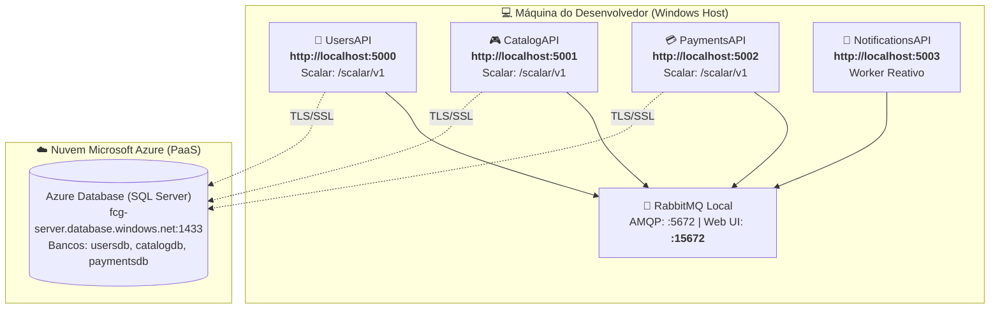

# Execução de Projetos no VS Code: Individual vs. Múltiplos com Compounds

No quarto módulo do guia de **Desenvolvimento .NET no Visual Studio Code**, você aprenderá como executar seus projetos em ambiente de desenvolvimento. Vamos analisar as diferenças entre executar projetos individualmente via terminal ou interface gráfica e dominar o recurso **`compounds`** do VS Code, que viabiliza a inicialização e depuração simultânea dos 4 microsserviços do **FIAP Cloud Games** com um único clique de tecla.

---

## 📑 Sumário

- [1. Execução Individual de Projetos](#1-execução-individual-de-projetos)
  - [1.1. Execução via .NET CLI no Terminal Integrado](#11-execução-via-net-cli-no-terminal-integrado)
  - [1.2. Execução com Hot-Reload (`dotnet watch`)](#12-execução-com-hot-reload-dotnet-watch)
  - [1.3. Execução Visual via Menu "Run and Debug" (F5)](#13-execução-visual-via-menu-run-and-debug-f5)
- [2. O Desafio de Sistemas Distribuídos e Microsserviços](#2-o-desafio-de-sistemas-distribuídos-e-microsserviços)
  - [2.1. Por que Rodar um Microsserviço Isolado não é Suficiente?](#21-por-que-rodar-um-microsserviço-isolado-não-é-suficiente)
  - [2.2. O Mapa de Portas Locais do FIAP Cloud Games](#22-o-mapa-de-portas-locais-do-fiap-cloud-games)
- [3. Orquestração de Múltiplos Projetos com `compounds`](#3-orquestração-de-múltiplos-projetos-com-compounds)
  - [3.1. O que é a Diretiva `compounds`?](#31-o-que-é-a-diretiva-compounds)
  - [3.2. A Importância Crítica da Opção `"stopAll": true`](#32-a-importância-crítica-da-opção-stopall-true)
  - [3.3. Configuração Real do `launch.json`](#33-configuração-real-do-launchjson)
- [4. Passo a Passo da Execução Integrada](#4-passo-a-passo-da-execução-integrada)
  - [4.1. Passo 1: Subir o Broker RabbitMQ](#41-passo-1-subir-o-broker-rabbitmq)
  - [4.2. Passo 2: Disparar o Compound no VS Code](#42-passo-2-disparar-o-compound-no-vs-code)
  - [4.3. Passo 3: Inspecionar os Processos Ativos na Barra de Ferramentas](#43-passo-3-inspecionar-os-processos-ativos-na-barra-de-ferramentas)
- [5. Navegação](#5-navegação)

---

## 1. Execução Individual de Projetos

Quando você está trabalhando no desenvolvimento focado de uma única camada ou ajustando a lógica de um único microsserviço, existem três maneiras de executá-lo:

### 1.1. Execução via .NET CLI no Terminal Integrado
Abra o terminal integrado do VS Code (`Ctrl + ~` ou `Ctrl + '`):

```powershell
# Executa a UsersAPI apontando diretamente para seu arquivo de projeto
dotnet run --project fcg-fase-02--users/src/FCG02.UsersAPI.API
```

- **Vantagem:** Leve e rápido, sem overhead de depuração.
- **Desvantagem:** Não interrompe a execução em Breakpoints.

---

### 1.2. Execução com Hot-Reload (`dotnet watch`)
O comando `dotnet watch` monitora alterações nos arquivos `.cs` e aplica as mudanças em memória imediatamente sem reiniciar o processo (*Hot Reload*):

```powershell
dotnet watch --project fcg-fase-02--users/src/FCG02.UsersAPI.API
```

---

### 1.3. Execução Visual via Menu "Run and Debug" (F5)

1. Pressione `Ctrl + Shift + D` para abrir a aba **Run and Debug** na barra lateral.
2. No menu suspenso (*dropdown*) no topo, selecione o perfil individual desejado (ex: **`UsersAPI`**).
3. Pressione **`F5`** (ou clique no ícone verde de "Play").
4. O VS Code executará a tarefa de build declarada no `tasks.json` ([📖 Ver Aula 03](03-automacao-com-tasks-e-launch.md)), compilará o projeto e iniciará o depurador oficial `coreclr`.

---

## 2. O Desafio de Sistemas Distribuídos e Microsserviços

### 2.1. Por que Rodar um Microsserviço Isolado não é Suficiente?

No ecossistema **FIAP Cloud Games**, as operações de negócio atravessam múltiplos serviços:
- **Jornada de Compra de Jogo:**
  1. O jogador faz login na `UsersAPI` e obtém um Bearer Token JWT;
  2. O jogador envia um pedido de compra para a `CatalogAPI` com o token JWT;
  3. A `CatalogAPI` publica o evento `OrderPlacedEvent` no broker RabbitMQ;
  4. A `PaymentsAPI` consome a mensagem da fila, processa a transação e salva a auditoria no **Azure Database**;
  5. A `PaymentsAPI` publica o resultado `PaymentProcessedEvent`;
  6. A `CatalogAPI` adiciona o jogo à biblioteca do jogador e a `NotificationsAPI` imprime o comprovante!

Se você iniciar apenas a `CatalogAPI`, o pedido ficará eternamente com status `PendingPayment`, pois o consumidor da `PaymentsAPI` não estará ativo para processar a transação financeira!

---

### 2.2. O Mapa de Portas Locais do FIAP Cloud Games

Para que todos os microsserviços rodem simultaneamente na mesma máquina Windows sem conflito de portas TCP, cada serviço possui uma porta exclusiva configurada no `launch.json`:



---

## 3. Orquestração de Múltiplos Projetos com `compounds`

### 3.1. O que é a Diretiva `compounds`?

O recurso **`compounds`** do arquivo `.vscode/launch.json` permite agrupar múltiplas configurações de depuração individuais sob um único nome composto.

Ao selecionar e disparar um compound, o VS Code:
1. Dispara todas as tarefas de compilação associadas (`build-users`, `build-catalog`, etc.);
2. Inicializa cada um dos processos .NET independentemente;
3. Anexa uma instância do depurador `coreclr` em cada processo simultaneamente;
4. Unifica os consoles de depuração na interface!

---

### 3.2. A Importância Crítica da Opção `"stopAll": true`

Observe este campo no `launch.json`:
```json
"stopAll": true
```

- **Sem `"stopAll": true`:** Se você clicar no botão vermelho de parar (`Shift + F5`) durante a depuração, o VS Code encerrará apenas o processo que estiver em foco naquele momento. As outras 3 APIs continuarão rodando "invisíveis" em segundo plano, prendendo as portas 5001, 5002 e 5003. Quando você tentasse pressionar `F5` novamente, receberia o erro clássico:  
  `System.IO.IOException: Failed to bind to address http://localhost:5001: address already in use`.
- **Com `"stopAll": true` (Recomendado):** Ao interromper a sessão, **todos os 4 microsserviços são desligados juntos**, liberando 100% das portas e da memória RAM instantaneamente!

---

### 3.3. Configuração Real do `launch.json`

Localização: `.vscode/launch.json`

```json
{
    "version": "0.2.0",
    "configurations": [
        {
            "name": "UsersAPI",
            "type": "coreclr",
            "request": "launch",
            "preLaunchTask": "build-users",
            "program": "${workspaceFolder}/fcg-fase-02--users/src/FCG02.UsersAPI.API/bin/Debug/net10.0/FCG02.UsersAPI.API.dll",
            "args": [],
            "cwd": "${workspaceFolder}/fcg-fase-02--users/src/FCG02.UsersAPI.API",
            "stopAtEntry": false,
            "serverReadyAction": {
                "action": "openExternally",
                "pattern": "\\bNow listening on:\\s+(https?://\\S+)"
            },
            "env": {
                "ASPNETCORE_ENVIRONMENT": "Development",
                "ASPNETCORE_URLS": "http://localhost:5000"
            }
        },
        {
            "name": "CatalogAPI",
            "type": "coreclr",
            "request": "launch",
            "preLaunchTask": "build-catalog",
            "program": "${workspaceFolder}/fcg-fase-02--catalog/src/FCG02.CatalogAPI.API/bin/Debug/net10.0/FCG02.CatalogAPI.API.dll",
            "args": [],
            "cwd": "${workspaceFolder}/fcg-fase-02--catalog/src/FCG02.CatalogAPI.API",
            "stopAtEntry": false,
            "env": {
                "ASPNETCORE_ENVIRONMENT": "Development",
                "ASPNETCORE_URLS": "http://localhost:5001"
            }
        },
        {
            "name": "PaymentsAPI",
            "type": "coreclr",
            "request": "launch",
            "preLaunchTask": "build-payments",
            "program": "${workspaceFolder}/fcg-fase-02--payments/src/FCG02.PaymentsAPI.API/bin/Debug/net10.0/FCG02.PaymentsAPI.API.dll",
            "args": [],
            "cwd": "${workspaceFolder}/fcg-fase-02--payments/src/FCG02.PaymentsAPI.API",
            "stopAtEntry": false,
            "env": {
                "ASPNETCORE_ENVIRONMENT": "Development",
                "ASPNETCORE_URLS": "http://localhost:5002"
            }
        },
        {
            "name": "NotificationsAPI",
            "type": "coreclr",
            "request": "launch",
            "preLaunchTask": "build-notifications",
            "program": "${workspaceFolder}/fcg-fase-02--notifications/src/FCG02.NotificationsAPI.API/bin/Debug/net10.0/FCG02.NotificationsAPI.API.dll",
            "args": [],
            "cwd": "${workspaceFolder}/fcg-fase-02--notifications/src/FCG02.NotificationsAPI.API",
            "stopAtEntry": false,
            "env": {
                "ASPNETCORE_ENVIRONMENT": "Development",
                "ASPNETCORE_URLS": "http://localhost:5003"
            }
        }
    ],
    "compounds": [
        {
            "name": "🚀 Todos os Microsserviços (Fase 02)",
            "configurations": [
                "UsersAPI",
                "CatalogAPI",
                "PaymentsAPI",
                "NotificationsAPI"
            ],
            "stopAll": true
        }
    ]
}
```

---

## 4. Passo a Passo da Execução Integrada

Para rodar todo o ecossistema distribuído em modo de depuração na sua máquina:

### 4.1. Passo 1: Subir o Broker RabbitMQ
Como os bancos de dados já estão hospedados na nuvem no **Azure Database**, a única infraestrutura que você precisa rodar localmente é o broker de mensageria RabbitMQ:

```powershell
# Subir o RabbitMQ via Docker com um comando simples:
docker run -d --name rabbitmq -p 5672:5672 -p 15672:15672 -e RABBITMQ_DEFAULT_USER=guest -e RABBITMQ_DEFAULT_PASS=guest rabbitmq:3-management
```

*(Ou suba apenas o serviço do broker via Compose: `docker compose -f fcg-fase-02--orchestration/docker-compose.yml up -d rabbitmq`)*.

---

### 4.2. Passo 2: Disparar o Compound no VS Code

1. Abra a raiz do projeto no Visual Studio Code.
2. Pressione `Ctrl + Shift + D` para ir até a aba **Run and Debug**.
3. No seletor suspenso no topo, escolha:  
   👉 **`🚀 Todos os Microsserviços (Fase 02)`**.
4. Pressione a tecla **`F5`**.

---

### 4.3. Passo 3: Inspecionar os Processos Ativos na Barra de Ferramentas

Observe o que acontece no VS Code:
1. A barra inferior de status do VS Code fica **laranja**, indicando que uma sessão de depuração está em andamento.
2. A barra flutuante de controle de depuração exibe um menu de seleção contendo os 4 processos ativos:
   - `UsersAPI`
   - `CatalogAPI`
   - `PaymentsAPI`
   - `NotificationsAPI`
3. Você pode alternar entre os processos para inspecionar os logs de cada um individualmente no **Debug Console** (`Ctrl + Shift + Y`).
4. Abra o navegador em `http://localhost:5000/scalar/v1` e `http://localhost:5001/scalar/v1` para disparar as requisições e ver os breakpoints sendo atingidos em tempo real!

---

## 5. Navegação

- ⬅️ **[Voltar para a Aula 03: Automação com tasks e launch (`03-automacao-com-tasks-e-launch.md`)](03-automacao-com-tasks-e-launch.md)**
- 📑 **[Ir para o Índice do Guia de VS Code (`index.md`)](index.md)**
- ➡️ **[Avançar para a Aula 05: Depuração Profissional com coreclr (`05-depuracao-profissional-debugging.md`)](05-depuracao-profissional-debugging.md)**
