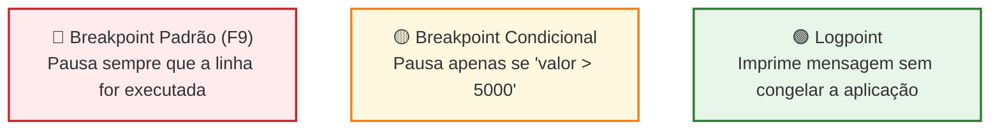
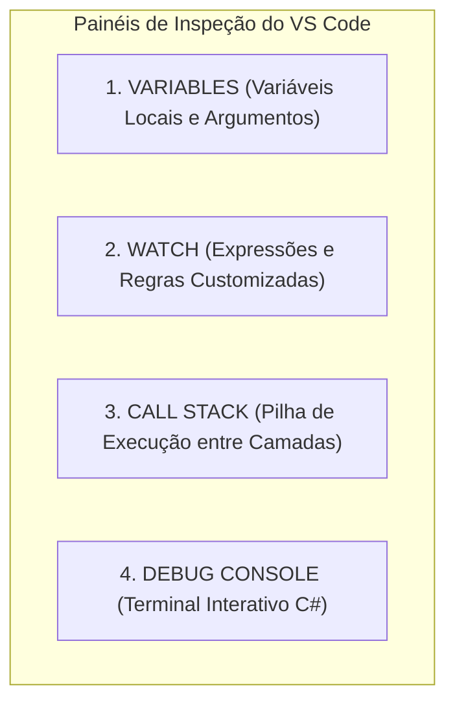

# Depuração Profissional de Aplicações .NET no VS Code

No quinto módulo do guia de **Desenvolvimento .NET no Visual Studio Code**, você aprenderá como utilizar o poderoso motor de depuração **`coreclr`** para inspecionar o comportamento em tempo de execução da sua aplicação. Vamos explorar todos os tipos de **Breakpoints**, dominar os atalhos de controle de fluxo de execução, inspecionar a memória nos painéis de variáveis e pilha de chamadas, e realizar um teste prático de depuração ponta a ponta na jornada de compra de jogos do **FIAP Cloud Games**.

---

## 📑 Sumário

- [1. O que é Depuração e Como Funciona o `coreclr`?](#1-o-que-é-depuração-e-como-funciona-o-coreclr)
  - [1.1. Além do `Console.WriteLine`](#11-além-do-consolewriteline)
  - [1.2. O Papel dos Arquivos PDB (Program Database)](#12-o-papel-dos-arquivos-pdb-program-database)
- [2. Tipos de Breakpoints no VS Code](#2-tipos-de-breakpoints-no-vs-code)
  - [2.1. Breakpoint de Linha Padrão (`F9`)](#21-breakpoint-de-linha-padrão-f9)
  - [2.2. Breakpoint Condicional (Expressão Booleana)](#22-breakpoint-condicional-expressão-booleana)
  - [2.3. Hit Count Breakpoints (Pausa por Contagem)](#23-hit-count-breakpoints-pausa-por-contagem)
  - [2.4. Logpoints (Logs Limpos sem Pausar a Execução)](#24-logpoints-logs-limpos-sem-pausar-a-execução)
- [3. Teclas de Atalho e Controle de Fluxo](#3-teclas-de-atalho-e-controle-de-fluxo)
  - [3.1. A Barra de Ferramentas de Depuração](#31-a-barra-de-ferramentas-de-depuração)
  - [3.2. Step Over (`F10`) vs. Step Into (`F11`) vs. Step Out (`Shift + F11`)](#32-step-over-f10-vs-step-into-f11-vs-step-out-shift--f11)
- [4. Os 4 Painéis de Inspeção do Depurador](#4-os-4-painéis-de-inspeção-do-depurador)
  - [4.1. Painel Variables (Locais e Argumentos)](#41-painel-variables-locais-e-argumentos)
  - [4.2. Painel Watch (Expressões Customizadas em Tempo Real)](#42-painel-watch-expressões-customizadas-em-tempo-real)
  - [4.3. Painel Call Stack (Pilha de Chamadas em Camadas DDD)](#43-painel-call-stack-pilha-de-chamadas-em-camadas-ddd)
  - [4.4. Debug Console (Avaliação Interativa de Expressões C#)](#44-debug-console-avaliação-interativa-de-expressões-c)
- [5. Cenário Prático: Depurando o Fluxo de Compra e Eventos](#5-cenário-prático-depurando-o-fluxo-de-compra-e-eventos)
- [6. Navegação](#6-navegação)

---

## 1. O que é Depuração e Como Funciona o `coreclr`?

### 1.1. Além do `Console.WriteLine`
Adicionar linhas temporárias de log (`Console.WriteLine("cheguei aqui")`) é lento, polui o código-fonte e exige recompilar a aplicação repetidamente.

A **depuração interativa (*Debugging*)** permite congelar o processo em qualquer linha de código no exato momento da execução, inspecionar cada objeto na memória RAM, avaliar expressões lógicas e até alterar valores de variáveis em tempo real antes que a próxima instrução seja executada.

### 1.2. O Papel dos Arquivos PDB (Program Database)
Quando você compila uma aplicação C# em modo `Debug` ([📖 Ver Aula 03](03-automacao-com-tasks-e-launch.md)), o compilador gera dois arquivos na pasta `bin/Debug/net10.0/`:
- **`MinhaApi.dll`:** Contém o código intermediário em Common Intermediate Language (CIL/MSIL).
- **`MinhaApi.pdb`:** É o "mapa" que correlaciona cada instrução binária de máquina com o **número da linha exata e nome do arquivo `.cs`** no seu editor.

O depurador **`coreclr`** lê os arquivos `.pdb` para conectar o VS Code à máquina virtual do .NET em execução.

---

## 2. Tipos de Breakpoints no VS Code

Um **Breakpoint** é um marcador visual inserido na margem esquerda do editor (*gutter*) que instrui o depurador a pausar a execução da thread naquele ponto.



---

### 2.1. Breakpoint de Linha Padrão (`F9`)
- **Como Inserir:** Clique com o mouse na margem esquerda ao lado do número da linha ou posicione o cursor na linha e pressione **`F9`**.
- Um ponto vermelho (**🔴**) aparecerá.
- Toda vez que uma requisição HTTP ou mensagem do RabbitMQ passar por essa linha, o VS Code pausará a aplicação e destacará a linha em amarelo.

---

### 2.2. Breakpoint Condicional (Expressão Booleana)
Imagine que um método é executado 10.000 vezes por segundo, mas você só quer investigar quando o valor do pedido for superior a R$ 5.000,00 ou quando o usuário for um `Admin`:

1. Clique com o **botão direito** na margem esquerda da linha de código.
2. Selecione **Add Conditional Breakpoint...**.
3. No seletor, escolha **Expression** e digite a expressão C#:
   ```csharp
   request.Price > 5000 || user.Role == UserRole.Admin
   ```
4. Pressione `Enter`. O ponto vermelho ganhará um símbolo interno (**🟡**).
5. O depurador **só pausará a aplicação quando a condição for verdadeira**. Em todas as outras execuções, o código roda na velocidade máxima sem interrupção!

---

### 2.3. Hit Count Breakpoints (Pausa por Contagem)
Configura o breakpoint para pausar apenas após ter sido executado um número determinado de vezes:
- Exemplo: `hit count: > 100` (ignora as primeiras 100 iterações de um loop ou requisições e pausa na 101ª).

---

### 2.4. Logpoints (Logs Limpos sem Pausar a Execução)
O **Logpoint** (representado por um diamante vermelho/verde) permite imprimir mensagens dinâmicas no **Debug Console** sem pausar o contêiner e sem alterar o código C#:

1. Clique com o botão direito na margem $\rightarrow$ **Add Logpoint...**.
2. Digite a mensagem interpolada entre chaves:
   ```text
   [AUDITORIA] Processando pedido {request.OrderId} para o usuário {request.UserId} com valor R$ {request.Price}
   ```
3. Toda vez que o código passar por ali, a mensagem formatada aparecerá no console de depuração com os valores reais das variáveis em tempo de execução!

---

## 3. Teclas de Atalho e Controle de Fluxo

### 3.1. A Barra de Ferramentas de Depuração
Quando a execução atinge um breakpoint e congela, surge a barra flutuante no topo do VS Code:

| Botão / Ícone | Tecla de Atalho | Ação Executada |
|---|---|---|
| **▶️ Continue** | **`F5`** | Retoma a execução normal até encontrar o próximo breakpoint. |
| **⤵️ Step Over** | **`F10`** | Executa a linha atual por inteiro e avança para a próxima linha do mesmo método sem entrar nos detalhes internos de funções chamadas. |
| **⬇️ Step Into** | **`F11`** | "Mergulha" para dentro do método chamado na linha atual (ex: entra no código do serviço ou repositório). |
| **⬆️ Step Out** | **`Shift + F11`** | Executa o restante do método atual de uma vez e pausa na linha imediatamente seguinte no método chamador. |
| **🔄 Restart** | **`Ctrl + Shift + F5`** | Reinicia o processo e a sessão de depuração do zero. |
| **⏹️ Stop** | **`Shift + F5`** | Encerra a sessão de depuração e desliga os processos associados. |

---

### 3.2. Step Over (`F10`) vs. Step Into (`F11`) vs. Step Out (`Shift + F11`)

```csharp
// Exemplo no UserService.cs:
public async Task<UserResponse> RegisterAsync(RegisterUserRequest request)
{
    var existingUser = await _userRepository.GetByEmailAsync(request.Email); // Linha 1
    var passwordHash = _passwordHasher.Hash(request.Password);              // Linha 2
    var user = User.Create(request.Name, request.Email, passwordHash);      // Linha 3
    await _userRepository.AddAsync(user);                                  // Linha 4
    return user.ToResponse();                                              // Linha 5
}
```

- Se você estiver na **Linha 2** e pressionar **`F10` (Step Over)**: O hash da senha é calculado e o depurador avança diretamente para a **Linha 3**.
- Se você estiver na **Linha 2** e pressionar **`F11` (Step Into)**: O depurador abrirá o arquivo `PasswordHasher.cs` e pausará na primeira linha do algoritmo BCrypt!
- Se você entrou sem querer no algoritmo BCrypt e quer sair de volta para o `UserService.cs`, pressione **`Shift + F11` (Step Out)**!

---

## 4. Os 4 Painéis de Inspeção do Depurador

Abra a aba de depuração (`Ctrl + Shift + D`) enquanto a aplicação estiver pausada em um breakpoint:



---

### 4.1. Painel Variables (Locais e Argumentos)
Exibe a árvore completa de objetos em memória no escopo atual:
- **`Locals`:** Variáveis declaradas dentro do bloco do método;
- **`Arguments`:** Parâmetros recebidos;
- **`this`:** Propriedades e campos privados da classe atual.

> 💡 **Alteração de Valor em Tempo Real:**  
> Dê um clique duplo em qualquer valor no painel de variáveis (ex: mudar uma variável `isValid` de `false` para `true`). O depurador atualizará o registrador de memória e continuará a execução com o novo valor!

---

### 4.2. Painel Watch (Expressões Customizadas em Tempo Real)
Permite monitorar regras e cálculos continuamente. Clique no botão **`+`** e adicione expressões como:
- `user.Email.Value.ToUpper()`
- `request.Price * 0.9`
- `_context.ChangeTracker.HasChanges()`

O VS Code reavalia as expressões a cada linha avançada (`F10`)!

---

### 4.3. Painel Call Stack (Pilha de Chamadas em Camadas DDD)
Em uma Clean Architecture, uma requisição percorre múltiplas camadas. O painel **Call Stack** exibe a árvore cronológica exata de quem chamou quem:

```text
CALL STACK:
  > FCG02.UsersAPI.Infrastructure.Repositories.UserRepository.AddAsync() [Linha 28]
    FCG02.UsersAPI.Application.Services.UserService.RegisterAsync() [Linha 35]
    FCG02.UsersAPI.API.Endpoints.AuthEndpoints.<MapAuthEndpoints>b__0_0() [Linha 24]
    Microsoft.AspNetCore.Routing.EndpointMiddleware.Invoke()
```

Clicar em qualquer nível da pilha altera o editor e o painel de variáveis para o estado exato daquele momento da chamada!

---

### 4.4. Debug Console (Avaliação Interativa de Expressões C#)
Pressione `Ctrl + Shift + Y` para abrir o **Debug Console**. Durante a pausa, ele atua como um console REPL interativo:
- Digite `request.Name` e pressione `Enter` para ver o valor;
- Chame métodos como `user.Validate()` para inspecionar o retorno antes de continuar a execução!

---

## 5. Cenário Prático: Depurando o Fluxo de Compra e Eventos

Para vivenciar o poder da depuração composta ([📖 Ver Aula 04](04-execucao-multiplos-projetos-e-compounds.md)) em nosso ecossistema distribuído:

1. Inicie a depuração de todos os serviços com o compound:  
   👉 **`🚀 Todos os Microsserviços (Fase 02)`** (`F5`).
2. Abra o arquivo `fcg-fase-02--catalog/src/.../OrderEndpoints.cs` e coloque um breakpoint na linha de criação do pedido (`POST /api/v1/orders`).
3. Abra o arquivo `fcg-fase-02--payments/src/.../OrderPlacedConsumerService.cs` e coloque um breakpoint na linha em que o worker recebe a mensagem do RabbitMQ.
4. Abra o arquivo `fcg-fase-02--notifications/src/.../RabbitMqConsumerService.cs` e coloque um breakpoint na linha de envio de e-mail.
5. Abra o navegador em `http://localhost:5001/scalar/v1` (CatalogAPI) e dispare a compra de um jogo.

#### O que você observará:
1. O breakpoint da **CatalogAPI** será atingido primeiro. Você inspeciona o `GameId` e autoriza a continuidade com `F5`.
2. A CatalogAPI despacha o evento assíncrono para o RabbitMQ e retorna `202 Accepted`.
3. Menos de 50 milissegundos depois, o VS Code **salta automaticamente para o processo da PaymentsAPI**, parando no seu breakpoint consumidor!
4. Você inspeciona a simulação financeira e pressiona `F5`.
5. O VS Code **salta para o processo da NotificationsAPI**, pausando no exato momento da geração do comprovante por e-mail!

Esse fluxo demonstra a capacidade de depurar cenários distribuídos complexos diretamente na sua máquina local com total visibilidade e rastreabilidade.

---

## 6. Navegação

- ⬅️ **[Voltar para a Aula 04: Execução Múltipla com Compounds (`04-execucao-multiplos-projetos-e-compounds.md`)](04-execucao-multiplos-projetos-e-compounds.md)**
- 📑 **[Ir para o Índice do Guia de VS Code (`index.md`)](index.md)**
- 🐳 **[Acessar o Guia Oficial de Docker & Containerização](../docker/index.md)**
- ☸️ **[Acessar o Guia Oficial de Kubernetes (K8s)](../kubernetes/index.md)**
- 🚀 **[Voltar para o README Principal da Orquestração](../../README.md)**
