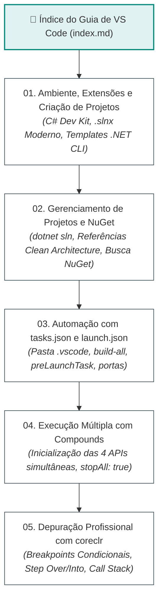

# Guia de Desenvolvimento .NET no Visual Studio Code - FIAP Cloud Games

Bem-vindo ao **Guia Oficial de Desenvolvimento .NET no Visual Studio Code** do ecossistema distribuído **FIAP Cloud Games (Fase 02)**.

Este manual técnico consolidado foi elaborado para transformar o Visual Studio Code em um ambiente profissional, performático e completo para desenvolvimento corporativo em **C# / .NET 10**, cobrindo desde a criação de projetos na linha de comando até a orquestração de múltiplos processos e depuração interativa avançada com breakpoints.

---

## 🗺️ Mapa de Navegação da Trilha

---

## 📚 Módulos do Guia

### 1. [01. Ambiente, Extensões e Criação de Projetos (`01-ambiente-extensoes-e-dotnet-cli.md`)](01-ambiente-extensoes-e-dotnet-cli.md)
- **Vantagens do VS Code para .NET:** Leveza, suporte multiplataforma nativo e aceleração do compilador Roslyn.
- **Configuração do Ambiente:** Verificação do .NET 10 SDK (`dotnet --version`, `dotnet --info`).
- **Extensões Oficiais da Microsoft:** C# Dev Kit (Solution Explorer e Test Explorer), extensão base C# com depurador `coreclr` e .NET Install Tool.
- **Extensões de Alta Produtividade:** REST Client (para arquivos `.http`), Docker, Kubernetes e NuGet Gallery.
- **Gestão de Soluções:** Comparativo entre o formato clássico `.sln` e o novo formato XML limpo **`.slnx`** do .NET 10.
- **Criação de Projetos por Template:** Criação prática de `console`, `webapi` (Minimal APIs), `classlib` (camadas DDD), `worker` (consumidores de mensageria) e `xunit` (testes).
- **Pesquisa de Templates:** Listagem local com `dotnet new list` e busca online no NuGet com `dotnet new search`.

---

### 2. [02. Gerenciamento de Projetos, Referências e Pacotes NuGet (`02-gerenciamento-de-projetos-referencias-e-nuget.md`)](02-gerenciamento-de-projetos-referencias-e-nuget.md)
- **Vinculação à Solution:** Como adicionar e remover projetos com `dotnet sln add/remove/list`.
- **Referências entre Projetos (Clean Architecture):** Aplicação estrita da regra de dependência (Domain no centro) com comandos `dotnet add reference`.
- **Pesquisa de Pacotes NuGet:** Consulta direta pelo terminal com `dotnet package search`, portal nuget.org e interface gráfica NuGet Gallery.
- **Instalação e Fixação de Versões:** Matriz oficial de pacotes do projeto (EF Core SQL Server, RabbitMQ Client v7, Scalar OpenAPI, BCrypt, Moq, FluentAssertions).
- **Auditoria de Dependências e Segurança:** Identificação de pacotes desatualizados (`--outdated`) e detecção preventiva de vulnerabilidades conhecidas (`--vulnerable`).

---

### 3. [03. Automação no VS Code: Os Arquivos tasks.json e launch.json (`03-automacao-com-tasks-e-launch.md`)](03-automacao-com-tasks-e-launch.md)
- **A Pasta Especial `.vscode/`:** Onde deve ser criada na raiz do workspace, o que contém e por que deve ser versionada no Git.
- **O Arquivo `tasks.json`:** Função, anatomia, captura de erros de compilação C# com `problemMatcher: "$msCompile"` e encadeamento com `dependsOn`.
- **O Arquivo `launch.json`:** Perfis de depuração com `coreclr`, caminho da DLL (`program`), injeção de variáveis de ambiente (`env`), portas HTTP e abertura automática do navegador com `serverReadyAction`.
- **A Sinergia Arquitetural:** Como o campo `preLaunchTask` conecta o build à inicialização do depurador sem intervenção manual.

---

### 4. [04. Execução de Projetos: Individual vs. Múltiplos com Compounds (`04-execucao-multiplos-projetos-e-compounds.md`)](04-execucao-multiplos-projetos-e-compounds.md)
- **Execução Individual:** Via terminal com `dotnet run`, com hot-reload (`dotnet watch`) ou via menu Run and Debug (`F5`).
- **O Desafio dos Microsserviços Distribuídos:** Por que o fluxo de compra exige que múltiplos serviços estejam ativos.
- **O Mapa de Portas Locais:** Distribuição sem conflitos (UsersAPI na 5000, CatalogAPI na 5001, PaymentsAPI na 5002, NotificationsAPI na 5003).
- **A Mágica dos `compounds`:** Como agrupar múltiplos perfis de depuração em um único disparador.
- **A Opção Essencial `"stopAll": true`:** Como evitar processos zumbis travando portas TCP ao encerrar a depuração.
- **Passo a Passo da Execução:** Subir o broker RabbitMQ e disparar o compound no VS Code.

---

### 5. [05. Depuração Profissional de Aplicações .NET no VS Code (`05-depuracao-profissional-debugging.md`)](05-depuracao-profissional-debugging.md)
- **O Motor de Depuração `coreclr`:** Função dos arquivos PDB (*Program Database*) na correlação de memória com código C#.
- **Tipos de Breakpoints:** Breakpoint Padrão (`F9`), Breakpoint Condicional (expressões booleanas em C#), Hit Count e Logpoints (logs formatados sem congelar a aplicação).
- **Atalhos de Controle de Fluxo:** Continue (`F5`), Step Over (`F10`), Step Into (`F11`), Step Out (`Shift + F11`), Restart (`Ctrl + Shift + F5`) e Stop (`Shift + F5`).
- **Os 4 Painéis de Inspeção:** Variables (com edição em tempo real de valores na memória), Watch, Call Stack (rastreabilidade entre camadas DDD) e Debug Console (console REPL interativo).
- **Cenário Prático de Depuração:** Rastreabilidade em tempo real da compra de jogo saltando entre `CatalogAPI`, `PaymentsAPI` e `NotificationsAPI` via mensagens do RabbitMQ!

---

## ⚡ Tabela Rápida de Atalhos Essenciais no VS Code

| Atalho de Teclado | Função no VS Code / .NET |
|---|---|
| **`F5`** | Iniciar Depuração / Continuar Execução |
| **`Ctrl + F5`** | Executar Sem Depuração (*Run Without Debugging*) |
| **`F9`** | Alternar Breakpoint na Linha Atual (*Toggle Breakpoint*) |
| **`F10`** | Passo por Cima (*Step Over* - próxima linha) |
| **`F11`** | Passo para Dentro (*Step Into* - mergulha no método) |
| **`Shift + F11`** | Passo para Fora (*Step Out* - volta ao chamador) |
| **`Shift + F5`** | Interromper Depuração (*Stop*) |
| **`Ctrl + Shift + F5`** | Reiniciar Sessão de Depuração (*Restart*) |
| **`F12`** | Ir para Definição (*Go to Definition*) |
| **`Shift + F12`** | Encontrar Todas as Referências (*Find All References*) |
| **`Ctrl + .`** | Ações Rápidas e Refatoração (*Quick Fix / Import*) |
| **`Ctrl + Shift + D`** | Abrir Painel de Execução e Depuração (*Run and Debug*) |
| **`Ctrl + Shift + Y`** | Abrir o Console de Depuração (*Debug Console*) |
| **`Ctrl + Shift + B`** | Executar Tarefa de Build Padrão (*Run Build Task*) |
| **`Ctrl + ~`** | Abrir / Fechar Terminal Integrado |

---

## 🔗 Navegação e Links Relacionados

- 🐳 **[Guia Oficial de Docker & Containerização](../docker/index.md)**
- ☸️ **[Guia Oficial de Kubernetes (K8s)](../kubernetes/index.md)**
- 🌐 **[Documentação do Fluxo Global da Solução](../fluxo-geral-solucao.md)**
- 🐇 **[Guia Completo de RabbitMQ & Mensageria](../rabbitmq/index.md)**
- 📑 **[Índice Central da Documentação de Orquestração](../index.md)**
- 🚀 **[README Principal da Orquestração](../../README.md)**
